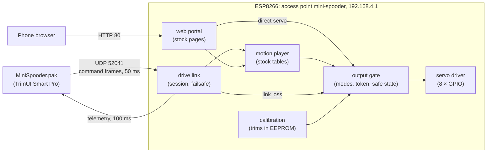

# Architecture

The firmware is one Arduino `loop()` on the ESP8266, built so that no pass blocks: every subsystem does a bounded amount of work per pass, and then returns. The logic lives in `core/`, which has no Arduino headers and is host-tested. `firmware/src/` holds thin adapters for the Wi-Fi, the web server, flash storage and the servo pins.

The OpenSpec changes in `openspec/changes/` are the specification. This page is an overview; where it and a spec differ, the spec wins.

## System

## The loop

Each pass runs these steps in this order (`firmware/src/main.cpp`):

1. **Drive link receive:** drains the UDP queue, applies the newest valid command, and runs the session rules, including the link-loss failsafe. It runs first, so a stop or a failsafe takes effect before anything moves in the same pass.
2. **Portal:** parses at most what has arrived, and writes at most what the client's send buffer accepts without waiting. A page goes out over many passes.
3. **Check console:** check builds only.
4. **Motion player:** at most one interpolation tick, on 10 ms deadlines that advance by the interval, so the timing doesn't drift.
5. **Drive link telemetry:** sent after the player's tick, so it reports this pass's state.
6. **Servo driver:** last, so every command from this pass reaches the pins in the same pass.

The firmware counts every pass longer than 20 ms. The `robot-trace` build prints that count, the longest pass and the station joins and leaves every 5 s. In use, the longest pass is about 7–9 ms.

## Output gate

Every servo command goes through the output gate (`core/servo/output_gate.*`). It has four modes:

| Mode | Meaning |
|---|---|
| `idle` | After boot: nothing driven, every servo limp |
| `active` | Output on, enabled by an explicit request |
| `safe` | Every servo limp after a link loss (or a check command) until a new explicit request |
| `fault` | Calibration unreadable: nothing moves until it is repaired |

The robot never moves by itself: not at boot, and not after a fault or a failsafe. Output switches on only for an explicit request, from the pak, the portal or a check build. It always starts in the stock zero pose. The caller that switched output on gets a writer token, so a stale caller can't keep driving the servos. While a pak session is live, the gate refuses the portal's requests. That is the portal lock.

Every commanded angle has the servo's calibration trim added, then is limited to a safe range for that servo, before it becomes a pulse width. The conversion is the stock one: 1–180° maps to 400–2400 µs.

## Motions

`tools/extract_motions.py` reads the motion tables out of `baseline/original-flash-4MB.bin`, after checking the image's hash. It writes them to `core/motion/stock_motions.h`. `mise run check-motions` fails if the header and the image ever differ.

The player plays one motion or one keyframe at a time and keeps at most one request pending, where the latest request wins. It ends a motion as soon as the output gate leaves `active`. Unlike stock, it keeps serving the link and the portal while a motion plays, which is what makes stopping a motion possible.

## Drive link

The link uses UDP on port 52041, protocol version 1. Its framing comes from Spooder: start byte `0xA5`, version, type, sequence number, length, payload, CRC-16.

- **Command frame:** 9 bytes, sent by the pak every 50 ms, carrying the requested motion (0 means stop) and a request counter.
- **Telemetry frame:** 33 bytes, sent by the robot every 100 ms, carrying the playing and pending motion, the request result and the eight joint angles.
- **Sessions:** a session starts with the first valid frame from one sender. If no valid frame arrives for 300 ms, the session ends, the motion stops and the gate enters `safe`.

`core/test/golden/drive_link_v1.txt` pins the encoding: the firmware's tests and the pak's Go tests both check against it. The decoder and the session rules are fuzzed (`mise run fuzz-link`).

## Web portal

The portal serves the stock routes `/`, `/controller`, `/save`, `/editor`, `/zero`, `/setting` and `/online`, with the stock controls. The pages are generated at build time from `firmware/portal/pages/` and the vendored Blackfyre design tokens, and are checked mechanically (`mise run portal-check`). ESP8266WebServer only parses requests. A portal-owned sender (`core/portal/transfer.*`) writes each reply across loop passes, and drops a client that makes no progress for 2 s.

## MiniSpooder.pak

The pak is a Go program on gabagool and SDL2, built for arm64 under Podman (`handheld/`). On start, it:

1. finds the saved `mini-spooder` network;
2. selects it, which keeps NextUI from moving the TrimUI to another network during the session;
3. gets an address with its own `udhcpc` run;
4. starts sending frames.

The controls map to the stock motions. While a walking direction is held, the pak requests the motion again each time it ends. Leaving requests Standby, waits for it to finish, then stops sending. On every exit path, including crashes through `launch.sh`, the pak switches all the TrimUI's networks back on. `mise run handheld-e2e` drives the real pak logic against a fake robot over loopback.
