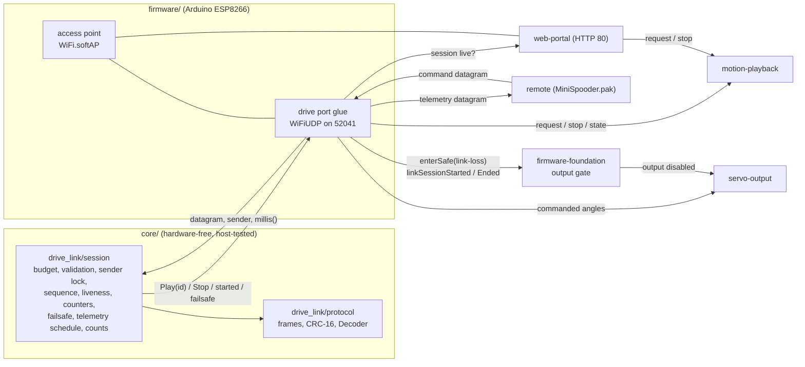
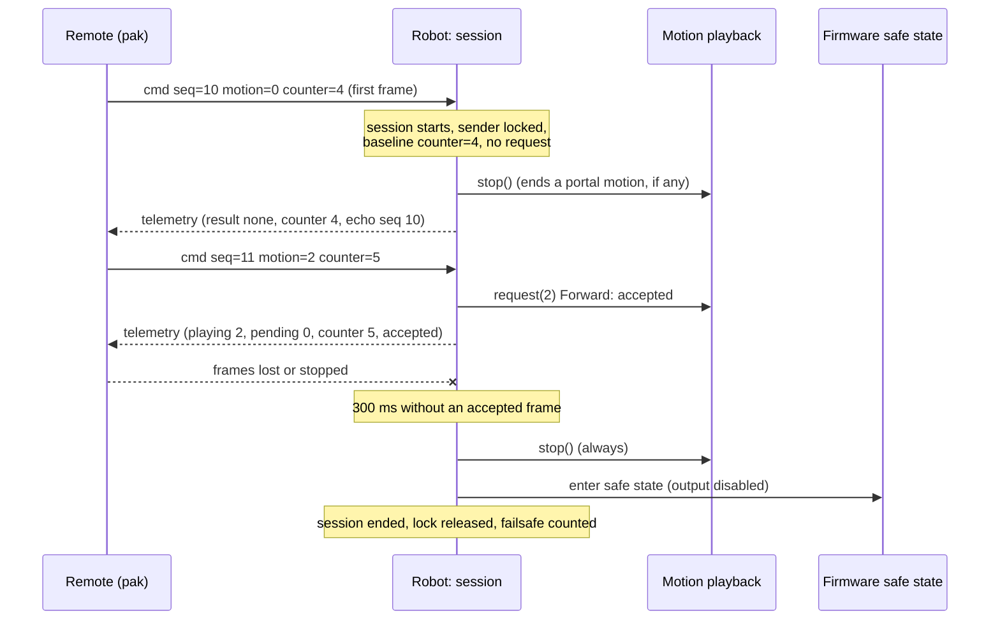
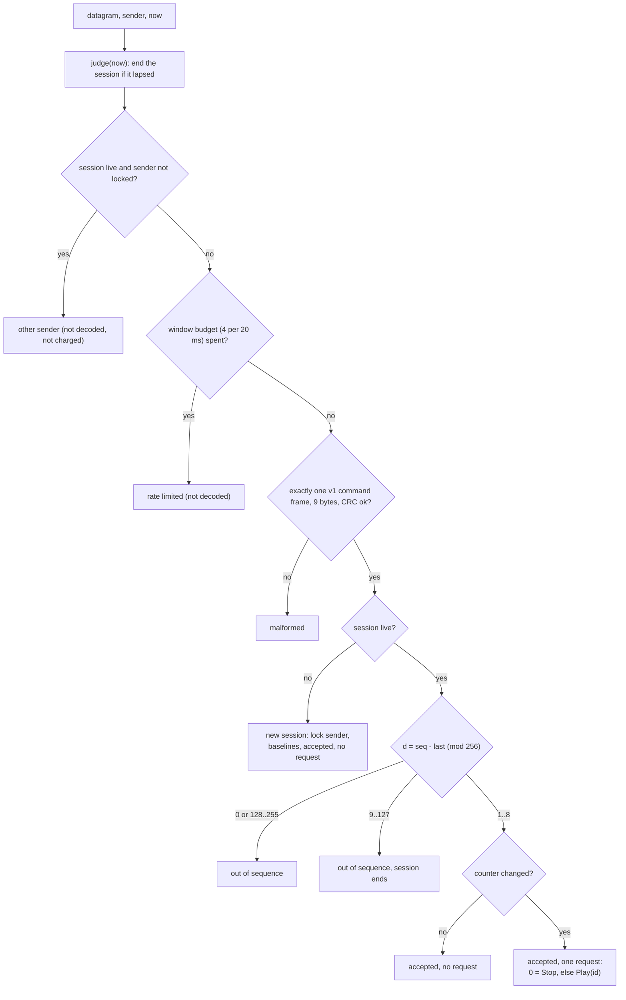
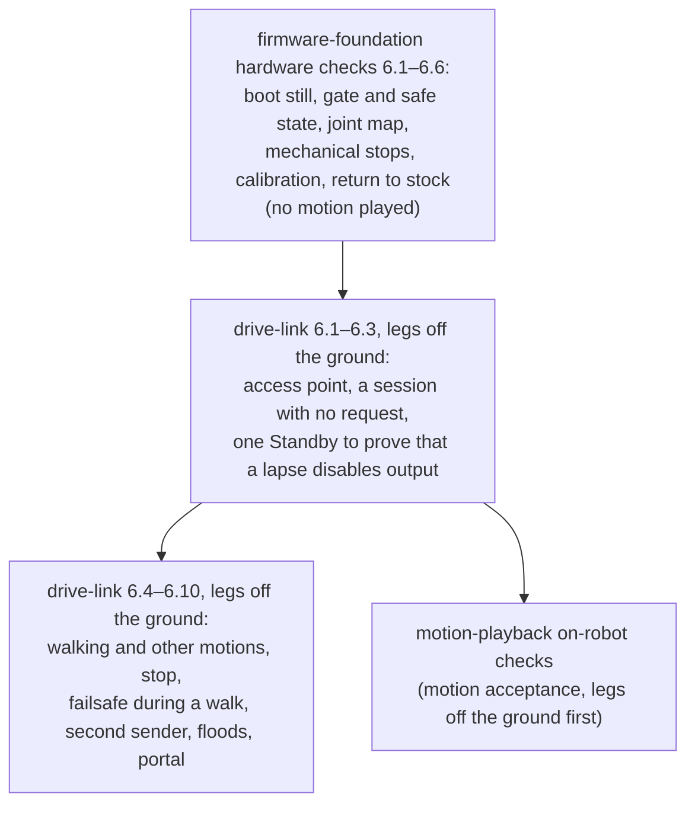

# Design

## Context

See proposal.md (Why) for the motivation, and `specs/drive-link/spec.md` for the requirements. No firmware source exists yet. The behaviour to match is in `baseline/README.md`:

- **Access point (verified):** the stock image starts a plain soft access point `Spider Robot` with password `12345678`, and its SDK Wi-Fi configuration sector holds the same values. It starts no DNS server and no mDNS responder, so it is not a captive portal.
- **Motion requests (verified from the disassembly):** the stock portal requests a motion with `GET /controller?pm=<n>`: 1–15, 99 (Centre, on stock the same pose as zero) and 100. Unknown values are accepted and ignored. Stock does not serve HTTP while a motion plays, so a stock motion cannot be stopped.
- **Inferred, not measured:** the address 192.168.4.1 is the SDK's soft-AP default; stock sets no address. The channel and security mode of the stock access point are not confirmed.

The reference is spooder's link: `../spooder/core/protocol/protocol.{h,cpp}` (framing, CRC, incremental decoder, golden file `test/golden/protocol_v3.txt`) and `../spooder/core/wifi_drive/handheld_controller.{h,cpp}` (UDP datagram rules: window budget, exactly one frame per datagram, sender lock, sequence window, liveness, counter baselines). Spooder runs that logic on an ESP32 bridge that relays to a robot. Here the ESP8266 is the endpoint: it decodes the remote's frames itself and turns them straight into motion playback requests. Code is copied into this repository and adapted. Nothing links to or edits `../spooder`.

The ESP8266 runs one Arduino `loop()`. The web portal (HTTP, `web-portal`), motion playback (`motion-playback`), servo output and this link all share it, so every part must be non-blocking. Unlike stock, the new firmware keeps serving the link and HTTP while a motion plays; that is what makes a stop and the link-loss failsafe possible.

## Goals / Non-Goals

**Goals:**
- The smallest robot-side link that lets `MiniSpooder.pak` play the stock motions, with its safety rules in hardware-free, host-tested `core/` code and its encoding pinned for the pak's Go copy.
- No interference with the web portal on the shared access point.

**Non-Goals:**
- Direct servo control, calibration, zero check or the motion editor over the link. These stay in the web portal, as in stock.
- An emergency stop, a limp or detach command, or any other request beyond the stock motions. The stop request and the link-loss failsafe are the only safety actions over the link.
- The mode state machine and the servo-output enable and safe-state gate. `firmware-foundation` owns them; this change only requests the safe state.
- Authentication or encryption beyond the access point's WPA2. More than one remote at a time. Station mode, OTA, DNS or mDNS.
- Any hardware that the stock firmware does not use, such as battery sensing: low-battery behaviour is out of scope.
- The pak itself, its Go codec and its screens (`handheld-pak`).

## Decisions

### D1. Module layout

- `core/drive_link/protocol.{h,cpp}`: a copy of spooder's `protocol` reduced to two frame types. It keeps `crc16`, the encoders and the incremental `Decoder` with `push`, `next`, `idle`, `validFrames`, `discardedFrames` and `pending`. It drops `frameBytes`, which only spooder's relay needs.
- `core/drive_link/session.{h,cpp}`: the counterpart of spooder's `handheld_controller`. It takes `accept(datagram, length, sender, nowMs)` and returns an outcome, whether a session ended before or because of this datagram (the lapse found by its own `judge` step, or a sequence jump), whether a session started, and at most one request (`Play(id)` or `Stop`). It also provides `judge(nowMs)`, which reports a session end (a failsafe), `live()`, the telemetry schedule (`telemetryDue`, `telemetrySent`), `recordResult` for the player's accept or reject answer, and `makeTelemetry` from the player's state, the angles and its own counts.
- `firmware/src/drive_link.cpp` (glue, name to fit `firmware-foundation`'s layout): starts the access point and the socket, drains datagrams each loop pass, calls motion playback, requests the safe state, reports each session's start and end to `firmware-foundation`'s output gate (`linkSessionStarted()`, `linkSessionEnded()`), and reads the commanded angles from servo output. It applies each datagram's results as soon as `accept` returns them, so events keep the order of the datagrams; within one result it applies a reported end before a reported start (D5).
- `core/fuzz/drive_link/` (D8): the fuzz targets and drivers. They are executables with their own entry points, so they live under `core/fuzz/`, which `firmware-foundation` excludes from both envs.

Alternative considered: putting the rules in the firmware glue. Rejected, because the rules would then be testable only on the robot. Spooder's split keeps every timing and sequence rule host-testable.

### D2. Protocol version 1: copied framing, new payloads

The header, CRC and decoder are spooder's byte for byte (start 0xA5, version, type, sequence, length, CRC-16/CCITT-FALSE over bytes 1..4+N). Only the version number and the payloads are new. The version starts at 1 because this is a separate protocol, not spooder version 4.

- **Command, 2 bytes:** requested motion (0 = stop) and the motion-request counter. A stop is motion 0, not a flag, so a frame cannot ask for two things at once. Standby is still reachable as motion 1, as in the stock portal.
- **Telemetry, 26 bytes:** the motion playing and the motion pending behind it, the last request's counter and result, the echoed sequence number of the newest accepted command frame with its age, eight joint angles, and six 16-bit counts. Motion playback keeps a request pending while a motion plays, so "accepted" (the result) and "started" (the motion playing) are separate fields. The echo and age let the pak compute the round-trip time as (receive time − send time of that sequence − age), without waiting for the 100 ms telemetry period to blur it; they cost two bytes. The pak needs nothing more to show what the robot does, whether its press was taken, and how the link is doing.
- **No reserved bytes and no flags.** Every valid frame is then canonical: re-encoding gives the same bytes, and the fuzz test can require exact re-encoding without spooder's non-canonical case.
- **Frame sizes:** command 9 bytes, telemetry 33 bytes. `MAX_FRAME_SIZE` is 33.

Alternative considered: reusing spooder's version 3 command frame. Rejected, because its fields (translate, rotate, gait, height) have no meaning for keyframe motions, and keeping them would invite a dependency on spooder's protocol.

### D3. Port, address and periods

- **Port and address:** UDP 52041 at 192.168.4.1. No discovery: the access point's address is also the gateway in the DHCP lease. The port differs from spooder's 52040, so a Spooder.pak frame can never be taken for one of this robot's frames, and the version byte and payload lengths differ too.
- **Command period, 50 ms (20 Hz):** spooder uses 20 ms for continuous stick control. Here a request starts a keyframe motion whose steps last hundreds of milliseconds, so 50 ms of added latency is not noticeable. 20 Hz also halves the packet load on an ESP8266 that serves HTTP in the same loop.
- **Liveness, 300 ms (six periods):** five consecutive losses are tolerated and a sixth ends the session, with ages measured between reads. Because a frame is read up to one loop pass after it arrives, read jitter can turn a run of exactly five losses into a lapse; the margin is accepted, since a lapse only puts the robot into the safe state, from which the next session's first motion request recovers. A lapse is detected on the first loop pass after 300 ms. With loop passes of at most 20 ms (a `firmware-foundation` assumption), the failsafe is applied within 340 ms of the last frame's arrival: at most one pass before it is read (D4) and one pass after the 300 ms. The one pass `firmware-foundation` allows to run longer, a calibration commit, lengthens that bound by its excess (measured by its task 6.5). The web portal's lock refuses calibration saving while a session is live, so a portal save cannot delay a failsafe; only another source of a commit during a session, such as the check build's console, could, by tens of milliseconds.
- **Telemetry period, 100 ms (10 Hz):** this is spooder's rate. The first frame goes out in the loop pass in which the session starts. Every frame is built after motion playback's step in its pass (D6), so a request passed on in that pass already shows as playing or pending. Each deadline advances by 100 ms from the previous deadline, so loop jitter does not accumulate; a frame more than one period late re-bases the schedule instead of sending a burst.
- **Sequence window, 8:** spooder's value. A live sender advances at most 6 between accepted frames (300 ms at 50 ms), so d from 9 to 127 can only mean a restart.

### D4. Acceptance order: sender before budget

Each datagram goes through these checks, in this order:

Spooder charges every datagram to the budget before it looks at the sender. With a budget of 4 per window, a second station's flood would then use up the budget before the locked remote's one frame per 50 ms arrived, and the session would lapse. Comparing the sender is as cheap as counting, so the robot checks it first, and only the locked sender, or any sender while no session is live, uses the budget.

Validation uses a fresh `Decoder` per datagram. The robot pushes the datagram's bytes, calls `idle()` at the end, and requires exactly one command frame, no discarded bytes and no pending bytes. The glue reads at most 10 bytes into its buffer and uses the length that `parsePacket()` reports, so a longer datagram is still seen as too long.

The ESP8266 core gives no receive timestamp, so a datagram is stamped with `millis()` when the glue reads it. Each loop pass drains up to 128 queued datagrams (`DRAIN_MAX`), so while no more than 128 wait (2000 per second at 20 ms passes is 40 per pass), every datagram is read, and stamped, at most one loop pass (20 ms, a `firmware-foundation` assumption) after it arrived: a queued frame can extend a session by at most that, and the failsafe comes at most 300 + 20 + 20 ms after the last frame's arrival. Every drained datagram goes through `accept`, which is cheap for one beyond the budget. Draining keeps lwIP's queue short under a flood, and the cap bounds the time one pass can spend on it.

### D5. Requests and link loss

- **Counter changes:** each change of the motion-request counter between consecutive accepted frames is one request, whatever its size. A jump of several means lost frames, and spooder counts one request per change too. The first frame of a session only sets the baseline. A remote's restart can therefore never replay a request.
- **Passing requests on:** `Play(id)` goes to motion playback's request call and `Stop` to its stop. What they do (catalogue, pending rule, what a stop holds) is motion playback's, listed under Cross-change assumptions. The link keeps no copy of the catalogue: the player's accept or reject answer becomes the telemetry result. Standby is motion 1, a request like any other. Motion playback's separate return-to-standby command is not used over the link, which keeps the command frame to the stock motions plus stop.
- **One play per request:** the robot keeps stock's behaviour of playing a motion once per request. Holding a walking control is the pak's: it sends a new request, with the counter advanced, each time telemetry shows the previous run ended. The link needs nothing for this beyond telemetry that is built after the player's step, so that a frame echoing the new counter never shows a run that has not yet started as ended.
- **Start of a session:** the robot calls `firmware-foundation`'s `linkSessionStarted()` and motion playback's stop, so a motion or `/online` keyframe that the web portal started ends as motion playback's stop defines. The remote starts from a robot that plays nothing, which its telemetry then shows. `linkSessionStarted()` is what lets the output gate accept this session's first motion request as one from a session that started after output was last disabled; the call itself enables nothing.
- **End of a session (the link-loss failsafe):** when a session lapses or ends on a sequence jump, the robot, in the same loop pass and before motion playback's next step, releases the lock, resets the request state, calls motion playback's stop unconditionally (so a request passed on but not yet started never starts), and requests `firmware-foundation`'s safe state with the reason `link-loss`, and then calls `linkSessionEnded()`. The failsafe is counted. The drive link makes no enable call. Output comes back by `firmware-foundation`'s rule (Cross-change assumptions): the next explicit request, which over the link can only be a motion request from a new session, since the old one has ended, and otherwise a web portal request once no session is live.
- **End and start in one pass:** the glue applies each `accept` result, and the pass's final `judge`, as soon as it is returned, so the gate sees session events in the order of the datagrams that caused them; a session that starts and then ends on a jump within one pass is therefore reported live and then ended. One result can hold both an end and a start: the `judge` step at the start of `accept` finds a lapse, and the same datagram starts the next session. Then the glue applies the end first (stop, `enterSafe(link-loss)`, `linkSessionEnded()`) and the start second (`linkSessionStarted()`, stop). Because every entry into `safe` clears the gate's "started after the disable" fact, the reverse order would make the new session look older than the safe state, and its first motion request would be refused.
- **Frames that do not count:** only an accepted frame refreshes liveness. A malformed, rate-limited, out-of-sequence or other-sender datagram leaves the last accepted state and the liveness clock as they were, so a stream of undecodable frames cannot keep a session alive.

Alternative considered: returning to Standby on link loss (the earlier draft). Rejected: it moves the robot after control is lost, keeps the servos powered with no one in control, and a pending request or a portal command could still move it afterwards. Disabling output is the only state in which nothing moves without a valid command. The cost is that the robot sinks onto its body when its servos go limp; on this light 8-DOF robot that is harmless.

Alternative considered: applying the failsafe only when a motion is playing. Rejected: servos holding a pose would keep receiving pulses indefinitely, and a pending request could start after the link was lost.

### D6. Coexistence with the web portal: one controller at a time

- **Network:** the web portal (`web-portal`) uses TCP 80 on the access point defined here. Neither runs a DNS server. The drive link uses UDP 52041 only, so their sockets never conflict.
- **Arbitration:** the drive link does not arbitrate the portal's requests. `web-portal` locks the portal while a session is live, from the drive link's `live()` (its portal lock, under Cross-change assumptions). This change only provides that report: `live()` changes only in the link's receive and failsafe step, in the same place in the pass as the `linkSessionStarted()` and `linkSessionEnded()` calls, so every HTTP request handled later in a pass sees the same session state as `firmware-foundation`'s output gate. A command frame makes a request only when its counter changes, so a motion that another caller of motion playback started is neither undone nor replayed by the remote's next frames. The session start's stop (D5) covers a portal motion that was playing, or a portal request that was still pending, when the remote joined, and the link-loss failsafe covers whatever plays when the session ends.
- **Loop budget and order:** HTTP handling and the link's drain share the same loop pass. The 128-datagram cap and the 4-per-window decode budget keep the link's share small. The link has two steps per pass: its receive and failsafe step runs before motion playback's step, so a request, a stop or a failsafe found in a pass takes effect before the player moves again; its telemetry step runs after motion playback's step, so a frame reports the player's state after that pass's tick.

Alternative considered: the drive link refusing the portal's requests itself during a session. Rejected: the portal's handling of its own requests is `web-portal`'s, which applies the lock (the user's decision: lock the portal while the pak has control) from the `live()` report this change already exposes. This change adds no second session signal for it.

### D7. Access point settings at every boot

The firmware calls `WiFi.persistent(false)`, `WiFi.mode(WIFI_AP)`, `WiFi.softAPConfig(192.168.4.1, 192.168.4.1, 255.255.255.0)` and `WiFi.softAP("Spider Robot", "87654321", 1, false, 4)` in `setup()`, and starts no DNS server or mDNS responder, as stock starts none. Setting the address explicitly pins the value that stock presumably gets from the SDK default, which was not measured. This keeps the settings in the firmware: they are never stored in the SDK's configuration sectors (0x3FC000–0x3FFFFF), which avoids flash wear and means that a value stored by an earlier firmware cannot change the network. The SDK may still write those sectors for its own data, such as RF calibration. The SDK default of four stations is kept, which is enough for the remote and a phone. The stock credentials are kept because the settled scope is the stock functionality, and stock users already know the network.

### D8. Golden file and fuzz tests

- **Golden file:** `core/test/golden/drive_link_v1.txt` uses spooder's line format: `<name> <hex bytes> field=value ...`, with lines marked `rejected` for frames a decoder must discard. The golden test writes it when `MINI_SPOODER_WRITE_GOLDEN=1` is set, and otherwise compares the encoder and decoder against it. `handheld-pak` tests its Go codec against the same file.
- **Fuzz harness:** everything lives in `core/fuzz/drive_link/`, which `firmware-foundation`'s `srcFilter` excludes, so neither the firmware build nor the native env's library build compiles it:
  - `targets.{h,cpp}`: one ordinary function per target, `fuzzDecoderOne(data, size)` and `fuzzSessionOne(data, size)`, that run one input and `abort()` on a property violation. They have distinct names, so both link into one executable.
  - `libfuzzer_decoder.cpp` and `libfuzzer_session.cpp`: one `LLVMFuzzerTestOneInput` each, calling its target, for a later `clang++ -fsanitize=fuzzer` build, one executable per target. Nothing else defines that symbol.
  - `driver.cpp`: the stand-alone random driver, built by `mise run fuzz-link` with the host compiler together with `targets.cpp` and the `core/drive_link` sources. It generates and mutates inputs from the corpus for `--time` per target (default 60 s). It prints its seed, and on a failure it writes the input to the target's corpus directory and exits non-zero.
  - The Unity test `core/test/test_drive_link_fuzz_corpus` replays every file in `core/fuzz/drive_link/corpus/<target>/` (golden seeds and saved failures) through the named target functions in `mise run test`. Only that test's build includes `targets.cpp`, by the test's own build source filter or an include, never the library's.
- **Targets:** `decoder` treats the input as a byte stream. `session` reads the input as records of (sender index 0–3, time step 0–255 ms, length 0–40, bytes), so a seed holds any golden frame intact and oversized datagrams can be represented, fed to `accept` and `judge`, and checks the invariants in the spec, including one failsafe per session end.
- **Sanitisers:** AddressSanitizer and UndefinedBehaviorSanitizer are added when the compiler can link their runtimes. Otherwise the run prints a warning and continues without them. This host's GCC currently cannot link `libasan`.

Alternative considered: libFuzzer through Clang. Not chosen as the only driver, because Clang is not in the toolchain (`mise.toml`) and not on this host. The harness keeps libFuzzer's signature, so `clang++ -fsanitize=fuzzer` can drive it later without changes.

### D9. Desktop probe

`tools/drive-probe.py` uses only the standard library (`socket`, `struct`, `binascii.crc_hqx`, which computes CRC-16/CCITT-FALSE with initial value 0xFFFF). It is run with `mise exec -- python tools/drive-probe.py`. It waits 350 ms after start, then sends command frames every 50 ms to 192.168.4.1:52041 from one socket. Options set a motion request at a given time, a stop, a pause long enough to make the session lapse, a flood rate, and a corrupt-frame rate. It prints every telemetry frame's fields and the round-trip time from the echoed sequence number and age. With it, every on-robot check in tasks.md can run before the pak exists. The probe is a test tool, not a second remote product.

### D10. On-robot check order

One order serves `firmware-foundation`, this change and `motion-playback`. It separates the single Standby that proves the link-loss failsafe from the later motion checks:

- **Before this change's checks:** `firmware-foundation`'s hardware checks 6.1 to 6.6 have passed. They connect all servos, prove that the robot boots still and that the gate's safe state releases every servo (with its check build's `enable`, not with a motion), record the joint map and the safe ranges, and end with the return to stock (6.6); task 6.1 here uploads the firmware again.
- **The link-loss Standby (6.2, 6.3):** 6.2 requests nothing. 6.3 requests Standby (motion 1) once, only so that a lapse has a driven pose to release, and proves that the lapse disables output. It is the only motion played before the failsafe is proven. It is not a motion-acceptance check: whether Standby's poses and timing match stock is `motion-playback`'s.
- **After 6.3:** this change's motion-requesting checks (6.4–6.10) and `motion-playback`'s on-robot checks may run, in either order, each with the legs off the ground first. Neither needs the other. Motion checks on the ground are `motion-playback`'s.

## Cross-change assumptions

These are facts that other changes own. This change relies on them and does not specify them. If an owner settles one differently, this change follows the owner and its tasks adapt.

- **firmware-foundation:**
  - `firmware/` is a PlatformIO project on the Arduino ESP8266 core, with a non-blocking `loop()` whose passes take at most 20 ms, including every service (link, player, HTTP, servo output), except a pass that commits calibration.
  - Each service is a poll call in `main.cpp`, and the order of the calls is the services' concern. This change places its receive and failsafe step before motion playback's step and its telemetry step after it (D6), as motion playback also requires.
  - The robot boots still, in mode `idle`, with every servo released and no commanded angle, so telemetry reports 255 for every angle until output is enabled.
  - It owns the output modes, the enable request, the writer token and the safe state. Its safe-state request `enterSafe(link-loss)` moves `idle` or `active` to `safe` in the same pass, releases every servo and makes the writer token stale, so that no motion and no web portal command moves a servo until output is enabled again.
  - Output is enabled again after a safe state (link loss or fault) only by the next explicit request: a motion request from a new pak session, or, when no session is live, a motion, keyframe or direct single-servo request from the web portal (a direct servo command enables with the stock zero pose 135, 45, 135, 45, 45, 135, 45, 135 and then applies its angle). How that request enables output is its rule; the drive link only passes its own requests on and makes no enable call itself. The robot still boots still until such a request.
  - Its output gate takes the session state from two calls that the drive link makes: `linkSessionStarted()` when a session starts and `linkSessionEnded()` when it ends, each in the pass in which it happens and before motion playback's step. With them, an enable request with origin `link` is accepted in `idle` or `safe` only while a session is live that started after output was last disabled; every entry into `safe` or `fault` clears that fact. The drive link makes these calls in the order of the datagrams that cause them; when one datagram ends a lapsed session and starts the next, it calls `enterSafe(link-loss)` and `linkSessionEnded()` before `linkSessionStarted()` (D5).
  - When servo output refuses an enable request, for example in `fault`, or in `safe` while the live session started before the last disable (for example the check console's `safe`; the web portal's lock refuses calibration saving during a session, so a calibration fault cannot be repaired from the portal while one is live), motion playback ends that request as its refused-enable rule says and reports itself idle; the telemetry then shows that, and the drive link does nothing further. Such a session gets output back only after it ends and a new one starts.
  - Servo indices 0–7 are attached to GPIO 15, 13, 12, 14, 2, 4, 5 and 16. The drive link reports angles by index and names no GPIO.
  - Its hardware checks 6.1 to 6.6 (D8 of its design: boot still, gate and safe state, joint map, mechanical stops, calibration, return to stock) connect all servos, play no motion, and come before this change's on-robot checks (D10).
  - `core/` is linked into a PlatformIO native env with Unity, run by `mise run test`, with tests under `core/test/`. Both envs compile every source under `core/` except `core/test/` and `core/fuzz/`; executables with their own entry point, such as this change's fuzz targets and driver, live under `core/fuzz/<name>/` and are built by their owner.
  - It provides `mise run build` and `mise run upload` for the firmware.
  - If its paths differ, this change follows them. The paths are not part of the spec.
- **servo-output:** its state report gives, for each servo index 0–7, whether it is driven or released and its last commanded angle without the trim (0–180°); in `idle` every servo is released with no commanded angle.
- **servo-calibration:** trims are applied below the angle that servo output reports, so the telemetry angles are logical angles.
- **motion-playback:**
  - A non-blocking request call that accepts or rejects an id by its catalogue and answers at once; the answer becomes the telemetry result. An accepted request while idle has its first tick at the player's next chance to run, which is the same pass's player step; while a motion or keyframe plays it becomes the single pending request, the latest replacing an earlier one.
  - Its catalogue is the stock `pm` set: 1–15, 99 (Centre) and 100. The drive link keeps no copy.
  - Its `stop()` is authoritative: it ends the current motion or keyframe before the next tick, discards the pending request (including one not yet started) and keeps the last angles written.
  - A state report with the current motion (0 when idle or playing a keyframe) and the pending motion (0 when none). A motion whose first tick has run, including a tick that enables output with the zero pose, is reported as current.
  - Every motion plays once per request; the stock motions do not repeat on their own.
  - When servo output enters its safe state the firmware calls its stop before its next chance to run; the drive link's own stop call in the failsafe satisfies this for a link loss.
  - The web portal's `pm` and `/online` requests use the same player, so the session start's stop ends them.
  - Its on-robot checks run after this change's tasks 6.1 to 6.3 have passed; the Standby of task 6.3 is part of this change's link-loss check, not one of its motion-acceptance checks (D10).
- **web-portal:**
  - It serves HTTP on TCP 80 on the access point defined here, keeps answering on 192.168.4.1 while a session is live, runs no DNS server, never changes the access point settings and never uses UDP 52041.
  - It sends its motion requests to motion playback directly, not through this link. How it treats them while servo output is in its safe state is its own rule.
  - **Portal lock:** while the drive link's `live()` reports a session, it refuses every request that moves the robot (motions, keyframes, direct servo commands, the zero check) and calibration saving, and it does not enable output; its pages and read-only data still load. It takes the session state only from `live()`, so the lock ends in the pass in which the session ends (lapse, sequence jump, or the lapse after the pak's leave). A portal request accepted in the pass before a session starts is ended by the session start's stop (D5). Its own scenarios and checks define the refusal's status and body; this change's on-robot check 6.9 observes the lock from the link's side.
- **handheld-pak:**
  - It implements protocol version 1 in Go against `core/test/golden/drive_link_v1.txt`, including the 26-byte telemetry payload.
  - It joins `Spider Robot` and sends one command frame every 50 ms to 192.168.4.1:52041 from one source port per run, and waits at least 350 ms (strictly more than the 300 ms liveness, plus one period) after start before its first frame. This closes the restart case in which a new run reuses the port within the liveness time with a sequence number just ahead of the last one.
  - It uses the single motion-request counter, advanced once per explicit request, with stop as requested motion 0.
  - Hold-to-repeat is the pak's alone: while a walking control (motions 2–7) is held, it requests the same motion again, advancing the counter, each time telemetry shows that the previous run has ended; on release it stops requesting it.
  - On leaving, it requests Standby (motion 1), waits until telemetry shows that Standby has finished or 3 s have passed, and then stops sending; the robot's link-loss failsafe then applies. B (stop) stays live during that wait: it sends a stop (requested motion 0, counter advanced), and once the stop is echoed or marked not confirmed it requests Standby again (counter advanced) and waits for it, within the same 3 s from the press. To the robot these are ordinary counter changes followed by a lapse, so the drive link needs nothing more for them.

## Risks / Trade-offs

- **Anyone who knows the stock password can drive the robot.** The stock password `12345678` is public and the user's replacement `87654321` is as easy to guess, and frames are not authenticated, so a station on the network could replay frames after a lapse. → This matches the stock portal, which anyone on the network can use. The robot only plays stock motions and applies the failsafe on a lapse. The open question below records whether to change the password.
- **A flood could exhaust lwIP's buffers.** The Arduino core's `UdpContext` queues received datagrams on the heap. → The loop drains up to 128 datagrams per pass and decodes at most 4 per window. Sustained-flood checks on the robot (tasks 6.7 and 6.8) confirm that the robot does not restart and the portal still answers.
- **A loop pass longer than 20 ms delays lapse detection and telemetry.** Blocking HTTP handling, a blocking servo detach or a long motion step could cause this. → It is a `firmware-foundation`, `motion-playback` and `web-portal` assumption. The probe measures the telemetry interval on the robot (task 6.3).
- **The failsafe makes the robot go limp and sink onto its body.** → On this light robot that is harmless, and it is the only state in which nothing moves without a command (D5). The suspended on-robot checks (D10) see it first with the legs off the ground.
- **50 ms command period and 300 ms liveness.** A Wi-Fi stall longer than 300 ms ends a walk with the failsafe. → Both values are named constants, and the out-of-sequence and failsafe counts show stalls. The next session's first motion request recovers, by the firmware's safe-state rules.
- **A stop holds a mid-step pose.** Motion playback's stop keeps the last angles written. → The remote can follow it with Standby (motion 1). This is motion playback's rule, not the link's.
- **Without coverage guidance, the random fuzz driver finds fewer bugs.** → The harness keeps libFuzzer's signature for a later Clang run, and the inputs are small (frames of at most 33 bytes and 4-field records).
- **`millis()` wraps after about 49.7 days.** → All time comparisons use unsigned differences, and the session tests include a wrap.

## Migration Plan

- **Additive:** the new firmware has its own access point and link, and the stock image has no UDP link to keep compatible with.
- **Rollback:** `mise run restore` writes `baseline/original-flash-4MB.bin` back, after the user's go-ahead.
- **Protocol changes:** a later protocol change bumps the version byte and regenerates the golden file. The pak and the firmware are then updated together.

## Open Questions

- **Stock channel and security mode:** these are not confirmed. They could be read from the SDK configuration sector in the dump. This design uses channel 1 and WPA2-PSK, the Arduino core's behaviour with a password. The answer does not change the specs' behaviour for the remote.
- **Stock address:** 192.168.4.1 is inferred from the SDK default; stock sets none and it was not measured. Task 6.1 confirms the new firmware's address; the stock value does not affect this change.
- **Password:** should a later change replace the public stock password with one unique to each robot? That is a product decision outside this change's stock-only scope.
