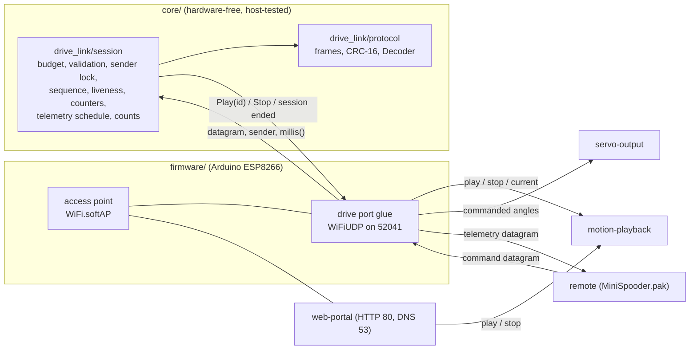
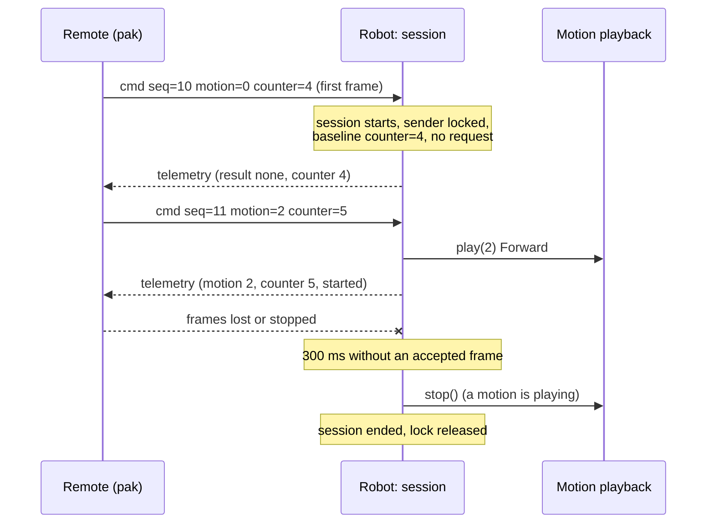
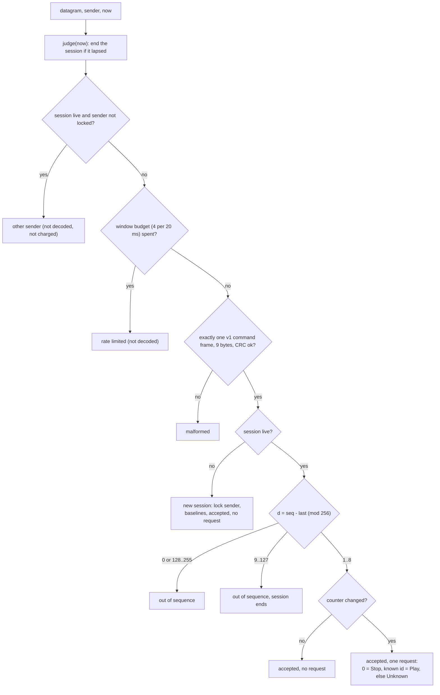

# Design

## Context

See proposal.md (Why) for the motivation, and `specs/drive-link/spec.md` for the requirements. No firmware source exists yet. The behaviour to match is in `baseline/README.md`:

- **Access point (verified):** the stock image runs `Spider Robot` with password `12345678`, and its SDK Wi-Fi configuration sector holds the same values.
- **Motion requests (verified strings, inferred behaviour):** the stock portal requests a motion with `GET /controller?pm=<n>`, n in 1–15 and 100.
- **Inferred, not seen in the dump:** the address 192.168.4.1 is the Arduino ESP8266 core's soft-AP default. The channel and security mode of the stock access point are not confirmed.

The reference is spooder's link: `../spooder/core/protocol/protocol.{h,cpp}` (framing, CRC, incremental decoder, golden file `test/golden/protocol_v3.txt`) and `../spooder/core/wifi_drive/handheld_controller.{h,cpp}` (UDP datagram rules: window budget, exactly one frame per datagram, sender lock, sequence window, liveness, counter baselines). Spooder runs that logic on an ESP32 bridge that relays to a robot. Here the ESP8266 is the endpoint: it decodes the remote's frames itself and turns them straight into motion playback requests. Code is copied into this repository and adapted. Nothing links to or edits `../spooder`.

The ESP8266 runs one Arduino `loop()`. The web portal (HTTP and captive-portal DNS, `web-portal`), motion playback (`motion-playback`) and this link all share it, so every part must be non-blocking.

## Goals / Non-Goals

**Goals:**
- The smallest robot-side link that lets `MiniSpooder.pak` play the stock motions, with its safety rules in hardware-free, host-tested `core/` code and its encoding pinned for the pak's Go copy.
- No interference with the web portal on the shared access point.

**Non-Goals:**
- Direct servo control, calibration, zero check or the motion editor over the link. These stay in the web portal, as in stock.
- An emergency stop, a limp or detach command, or any other request that the stock firmware does not have. The stop request and the link-loss stop are the only safety actions.
- Authentication or encryption beyond the access point's WPA2. More than one remote at a time. Station mode, OTA or mDNS.
- The pak itself, its Go codec and its screens (`handheld-pak`).

## Decisions

### D1. Module layout

- `core/drive_link/protocol.{h,cpp}`: a copy of spooder's `protocol` reduced to two frame types. It keeps `crc16`, the encoders and the incremental `Decoder` with `push`, `next`, `idle`, `validFrames`, `discardedFrames` and `pending`. It drops `frameBytes`, which only spooder's relay needs.
- `core/drive_link/session.{h,cpp}`: the counterpart of spooder's `handheld_controller`. It takes `accept(datagram, length, sender, nowMs)` and returns an outcome and at most one request (`Play(id)`, `Stop` or `Unknown`). It also provides `judge(nowMs)`, which reports a session end, the telemetry schedule (`telemetryDue`, `telemetrySent`), and `makeTelemetry` from the motion playing, the angles and its own counts.
- `firmware/src/drive_link.cpp` (glue, name to fit `firmware-foundation`'s layout): starts the access point and the socket, drains datagrams each loop pass, and calls motion playback and servo output.

Alternative considered: putting the rules in the firmware glue. Rejected, because the rules would then be testable only on the robot. Spooder's split keeps every timing and sequence rule host-testable.

### D2. Protocol version 1: copied framing, new payloads

The header, CRC and decoder are spooder's byte for byte (start 0xA5, version, type, sequence, length, CRC-16/CCITT-FALSE over bytes 1..4+N). Only the version number and the payloads are new. The version starts at 1 because this is a separate protocol, not spooder version 4.

- **Command, 2 bytes:** requested motion (0 = stop) and the motion-request counter. A stop is motion 0, not a flag, so a frame cannot ask for two things at once. Standby is still reachable as motion 1, as in the stock portal.
- **Telemetry, 23 bytes:** the motion playing, the last request's counter and result, eight joint angles, and six 16-bit counts. The pak needs nothing more to show what the robot does, whether its press was taken, and how the link is doing.
- **No reserved bytes and no flags.** Every valid frame is then canonical: re-encoding gives the same bytes, and the fuzz test can require exact re-encoding without spooder's non-canonical case.
- **Frame sizes:** command 9 bytes, telemetry 30 bytes. `MAX_FRAME_SIZE` is 30.

Alternative considered: reusing spooder's version 3 command frame. Rejected, because its fields (translate, rotate, gait, height) have no meaning for keyframe motions, and keeping them would invite a dependency on spooder's protocol.

### D3. Port, address and periods

- **Port and address:** UDP 52041 at 192.168.4.1. No discovery: the access point's address is also the gateway in the DHCP lease. The port differs from spooder's 52040, so a Spooder.pak frame can never be taken for one of this robot's frames, and the version byte and payload lengths differ too.
- **Command period, 50 ms (20 Hz):** spooder uses 20 ms for continuous stick control. Here a request starts a keyframe motion whose steps last hundreds of milliseconds, so 50 ms of added latency is not noticeable. 20 Hz also halves the packet load on an ESP8266 that serves HTTP in the same loop.
- **Liveness, 300 ms (six periods):** five consecutive losses are tolerated and a sixth ends the session, with ages measured between reads. Because a frame is read up to one loop pass after it arrives, read jitter can turn a run of exactly five losses into a lapse; the margin is accepted, since a lapse only returns the robot to standby. A lapse is detected on the first loop pass after 300 ms. With loop passes of at most 20 ms (a `firmware-foundation` assumption), the stop is requested within 340 ms of the last frame's arrival: at most one pass before it is read (D4) and one pass after the 300 ms.
- **Telemetry period, 100 ms (10 Hz):** this is spooder's rate. The first frame goes out on the first loop pass after a session starts.
- **Sequence window, 8:** spooder's value. A live sender advances at most 6 between accepted frames (300 ms at 50 ms), so d from 9 to 127 can only mean a restart.

### D4. Acceptance order: sender before budget

Each datagram goes through these checks, in this order:

Spooder charges every datagram to the budget before it looks at the sender. With a budget of 4 per window, a second station's flood would then use up the budget before the locked remote's one frame per 50 ms arrived, and the session would lapse. Comparing the sender is as cheap as counting, so the robot checks it first, and only the locked sender, or any sender while no session is live, uses the budget.

Validation uses a fresh `Decoder` per datagram. The robot pushes the datagram's bytes, calls `idle()` at the end, and requires exactly one command frame, no discarded bytes and no pending bytes. The glue reads at most 10 bytes into its buffer and uses the length that `parsePacket()` reports, so a longer datagram is still seen as too long.

The ESP8266 core gives no receive timestamp, so a datagram is stamped with `millis()` when the glue reads it. Each loop pass drains up to 128 queued datagrams (`DRAIN_MAX`), so while no more than 128 wait (2000 per second at 20 ms passes is 40 per pass), every datagram is read, and stamped, at most one loop pass (20 ms, a `firmware-foundation` assumption) after it arrived: a queued frame can extend a session by at most that, and the lapse stop comes at most 300 + 20 + 20 ms after the last frame's arrival. Every drained datagram goes through `accept`, which is cheap for one beyond the budget. Draining keeps lwIP's queue short under a flood, and the cap bounds the time one pass can spend on it.

### D5. Requests and link loss

- **Counter changes:** each change of the motion-request counter between consecutive accepted frames is one request, whatever its size. A jump of several means lost frames, and spooder counts one request per change too. The first frame of a session only sets the baseline. A remote's restart can therefore never replay a request.
- **Passing requests on:** `Play(id)` and `Stop` go to `motion-playback`. Whether a motion plays once or repeats until it is stopped, and whether a stop finishes the current keyframe first, are motion playback's rules. The link does not change them. `Unknown` is reported in telemetry and goes nowhere else. Motion ids are checked against motion playback's table, not against a copy in this module.
- **End of a session:** when a session lapses or ends on a sequence jump, the robot releases the lock and resets the request state. If `motion-playback` reports a motion playing, the robot requests its stop. If none is playing, the robot does nothing, so a lapse while the web portal's calibration or zero check page holds servos does not move them.

Alternative considered: going limp on link loss. Rejected, because the robot would collapse on its legs, and limping is a servo-output action that the stock firmware never takes during a motion. Standby is the stock rest pose.

Alternative considered: stopping only motions that the link itself started. Rejected for now, because it needs `web-portal` to report its requests to this module. Stopping whatever plays is the safer and simpler rule, and it only applies when a remote's session ends.

### D6. Coexistence with the web portal

- **Network:** the web portal (`web-portal`) uses TCP 80 and its captive-portal DNS uses UDP 53, both on the access point defined here. The drive link uses UDP 52041 only, so their sockets never conflict.
- **Requests:** both sources call the same motion playback entry points, in the order they arrive within the loop, and the most recent request wins. The link's frames are state: a frame with an unchanged counter makes no request, so a portal request made during a session is not undone by the remote's next frame.
- **Loop budget:** HTTP handling and the link's drain share the same loop pass. The 128-datagram cap and the 4-per-window decode budget keep the link's share small.

### D7. Access point settings at every boot

The firmware calls `WiFi.persistent(false)`, `WiFi.mode(WIFI_AP)`, `WiFi.softAPConfig(192.168.4.1, 192.168.4.1, 255.255.255.0)` and `WiFi.softAP("Spider Robot", "12345678", 1, false, 4)` in `setup()`. This keeps the settings in the firmware: they are never stored in the SDK's configuration sectors (0x3FC000–0x3FFFFF), which avoids flash wear and means that a value stored by an earlier firmware cannot change the network. The SDK may still write those sectors for its own data, such as RF calibration. The SDK default of four stations is kept, which is enough for the remote and a phone. The stock credentials are kept because the settled scope is the stock functionality, and stock users already know the network.

### D8. Golden file and fuzz tests

- **Golden file:** `core/test/golden/drive_link_v1.txt` uses spooder's line format: `<name> <hex bytes> field=value ...`, with lines marked `rejected` for frames a decoder must discard. The golden test writes it when `MINI_SPOODER_WRITE_GOLDEN=1` is set, and otherwise compares the encoder and decoder against it. `handheld-pak` tests its Go codec against the same file.
- **Fuzz harness:** there is one function per target with libFuzzer's signature (`LLVMFuzzerTestOneInput`) and two drivers:
  1. a Unity test in the native env that replays every file in `core/test/fuzz/<target>/` (golden seeds and saved failures) in `mise run test`;
  2. a stand-alone random driver, `core/fuzz/drive_link_fuzz.cpp`, built by `mise run fuzz-link` with the host compiler. It generates and mutates inputs from the corpus for `--time` per target (default 60 s). It prints its seed, and on a failure it writes the input to the target's corpus directory and exits non-zero.
- **Targets:** `decoder` treats the input as a byte stream. `session` reads the input as records of (sender index 0–3, time step 0–255 ms, length 0–40, bytes), so a seed holds any golden frame intact and oversized datagrams can be represented, fed to `accept` and `judge`, and checks the invariants in the spec.
- **Sanitisers:** AddressSanitizer and UndefinedBehaviorSanitizer are added when the compiler can link their runtimes. Otherwise the run prints a warning and continues without them. This host's GCC currently cannot link `libasan`.

Alternative considered: libFuzzer through Clang. Not chosen as the only driver, because Clang is not in the toolchain (`mise.toml`) and not on this host. The harness keeps libFuzzer's signature, so `clang++ -fsanitize=fuzzer` can drive it later without changes.

### D9. Desktop probe

`tools/drive-probe.py` uses only the standard library (`socket`, `struct`, `binascii.crc_hqx`, which computes CRC-16/CCITT-FALSE with initial value 0xFFFF). It is run with `mise exec -- python tools/drive-probe.py`. It waits 350 ms after start, then sends command frames every 50 ms to 192.168.4.1:52041 from one socket. Options set a motion request at a given time, a stop, a pause long enough to make the session lapse, a flood rate, and a corrupt-frame rate. It prints every telemetry frame's fields. With it, every on-robot check in tasks.md can run before the pak exists. The probe is a test tool, not a second remote product.

## Cross-change assumptions

These are facts that other changes own. This change relies on them and does not specify them.

- **firmware-foundation:**
  - `firmware/` is a PlatformIO project on the Arduino ESP8266 core, with a non-blocking `loop()` whose passes take at most 20 ms.
  - `core/` has a PlatformIO native env with Unity, run by `mise run test`, with tests under `core/test/`. New sources are listed in its source filter, as spooder's are.
  - It provides `mise run build` and `mise run upload` for the firmware.
  - If its paths differ, this change follows them. The paths are not part of the spec.
- **servo-output:** for each servo index 0–7, it exposes the angle last commanded before calibration offsets, in whole degrees, and whether the servo is detached or not yet commanded.
- **servo-calibration:** offsets are applied below the angle that servo-output reports, so the telemetry angles are logical angles.
- **motion-playback:**
  - It provides a non-blocking `play(id)` that replaces whatever plays, a `stop()` that returns the robot to standby, a query for the motion playing (0 when none, including once standby is reached), and a check of whether an id is defined (1–15 and 100).
  - It decides whether a motion plays once or repeats.
  - The web portal's `pm` requests use the same entry points.
- **web-portal:**
  - It serves HTTP on TCP 80 and captive-portal DNS on UDP 53 on the access point defined here. It never changes the access point settings and never uses UDP 52041.
  - Its motion requests go to motion playback directly, not through this link.
- **handheld-pak:**
  - It implements protocol version 1 in Go against `core/test/golden/drive_link_v1.txt`.
  - It joins `Spider Robot` and sends one command frame every 50 ms to 192.168.4.1:52041 from one source port per run, and waits at least 350 ms (strictly more than the 300 ms liveness, plus one period) after start before its first frame. This closes the restart case in which a new run reuses the port within the liveness time with a sequence number just ahead of the last one.
  - It increments the counter once per explicit request.
  - Before it exits, it requests a stop and relies on the lapse otherwise.

## Risks / Trade-offs

- **Anyone who knows the stock password can drive the robot.** The password `12345678` is public, and frames are not authenticated, so a station on the network could replay frames after a lapse. → This matches the stock portal, which anyone on the network can use. The robot only plays stock motions and stops on a lapse. The open question below records whether to change the password.
- **A flood could exhaust lwIP's buffers.** The Arduino core's `UdpContext` queues received datagrams on the heap. → The loop drains up to 128 datagrams per pass and decodes at most 4 per window. A sustained-flood check on the robot (tasks 6.5 and 6.6) confirms that the robot does not restart and the portal still answers.
- **A loop pass longer than 20 ms delays lapse detection and telemetry.** Blocking HTTP handling or a long motion step could cause this. → It is a `firmware-foundation` and `motion-playback` assumption. The probe measures the telemetry interval on the robot (task 6.2).
- **A lapse stops a motion that the web portal started.** → It happens only when a remote's session ends, and it is the safe direction (D5).
- **50 ms command period and 300 ms liveness.** A Wi-Fi stall longer than 300 ms stops a walk. → The robot only returns to standby. Both values are named constants, and the out-of-sequence and session-end counts show stalls.
- **Without coverage guidance, the random fuzz driver finds fewer bugs.** → The harness keeps libFuzzer's signature for a later Clang run, and the inputs are small (a 30-byte frame format and 4-field records).
- **`millis()` wraps after about 49.7 days.** → All time comparisons use unsigned differences, and the session tests include a wrap.

## Migration Plan

- **Additive:** the new firmware has its own access point and link, and the stock image has no UDP link to keep compatible with.
- **Rollback:** `mise run restore` writes `baseline/original-flash-4MB.bin` back, after the user's go-ahead.
- **Protocol changes:** a later protocol change bumps the version byte and regenerates the golden file. The pak and the firmware are then updated together.

## Open Questions

- **Stock channel and security mode:** these are not confirmed. They could be read from the SDK configuration sector in the dump. This design uses channel 1 and WPA2-PSK, the Arduino core's behaviour with a password. The answer does not change the specs' behaviour for the remote.
- **Password:** should a later change replace the public stock password with one unique to each robot? That is a product decision outside this change's stock-only scope.
- **Stock calibration:** the stock image has a calibration page (`/setting`, `/save?key=<servo>&value=<v>`, RESET ALL as `saveServo(100,0)`), and its EEPROM emulation sector 0x3FB000 is erased. The user recalls that the original firmware had no calibration. Whether stock persisted calibration, and where, is unverified. `firmware-foundation` (`servo-calibration`) owns the answer. This change only reports angles before offsets.
- **`/controller?pms=<n>`:** its purpose in the stock firmware is unknown. The drive link does not need it. Motion playback and the web portal own the answer.
