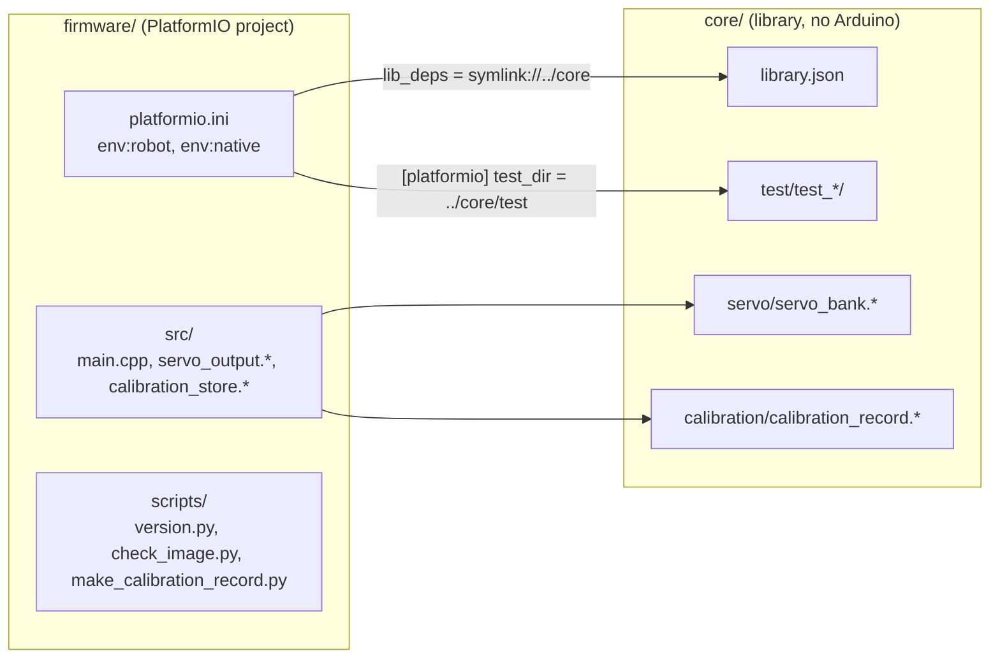
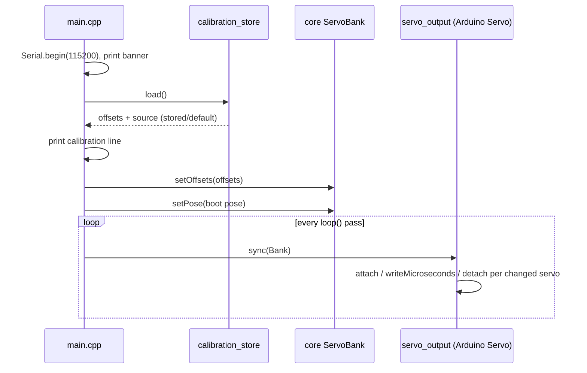

# Design

## Context

- No firmware source exists. The repository holds the verified stock image (`baseline/original-flash-4MB.bin`), its analysis (`baseline/README.md`, `baseline/portal-strings.txt`), and a `mise.toml` with Python, uv, PlatformIO 6.2.0, esptool 5.2.0 and the tasks `backup`, `restore` and `monitor`. `ROBOT_PORT` is the CP2102's `/dev/serial/by-id/` path.
- The stock image is an Arduino ESP8266 core build: `eboot` at 0x000000, the application from 0x001000 (about 308 KB), no filesystem, the EEPROM emulation sector at 0x3FB000 (erased) and SDK data at 0x3FC000–0x3FFFFF. The chip runs its flash in DIO mode at 40 MHz.
- Calibration evidence in the stock image:
  - The "Servo calibration" page (`/setting`) fills each servo's text field from the firmware, and each SET calls `/save?key=<servo>&value=<v>`.
  - The page's RESET ALL button, `saveServo(100,0)`, sits inside an HTML comment (`<!--<tr> … RESET ALL … </tr>-->`). The stock page therefore shows no reset button, although its JavaScript handles `id==100`.
  - The application contains the 32-bit literal 0x405FB000 at image offset 0x548C. That is the memory-mapped address of flash offset 0x3FB000 on a 4 MB layout, the value of the Arduino core's `_EEPROM_start`. This suggests that the core's EEPROM library is linked (inferred, not disassembled).
  - The EEPROM sector is erased at the time of the dump. That shows no calibration is stored there now; it does not show whether one was ever stored there or elsewhere.
- Servo pulses: the stock firmware's pulse mapping is not known. The Arduino core's `Servo` library maps 0–180° to 544–2400 µs by default, and the stock code most probably used it (inferred).
- The host lacks the GCC sanitiser runtimes (`libasan`, `libubsan` are not installed), and the `espressif8266` PlatformIO platform is not yet installed; PlatformIO downloads it on first build.

## Goals / Non-Goals

**Goals:**
- One PlatformIO project that later changes extend by adding sources to `firmware/src/` and `core/`, and tests to `core/test/`, without touching the build configuration.
- Every rule in servo-output and servo-calibration that does not need hardware is tested on the host.
- Flash writes are deliberate: one task writes the application, one writes stock back, and nothing writes the calibration or SDK sectors by accident.

**Non-Goals:**
- Motions, the standby pose, the access point, the web portal and the drive link. They belong to motion-playback, drive-link and web-portal.
- Any user-facing way to set calibration. The web portal provides `/setting` and `/save`.
- Over-the-air updates, a filesystem, static analysis (clang-format, clang-tidy) and sanitised host tests. Sanitisers need runtimes that this host lacks; they can be added later without changing these specs.

## Decisions

### D1. Repository layout: one PlatformIO project, `core/` as a local library

- `firmware/platformio.ini` has two environments:
  - `robot`: platform `espressif8266` pinned to an exact version (expected 4.2.1, Arduino core 3.1.2; task 1.1 confirms the newest release at implementation time and pins it), board `esp12e`, `board_build.flash_mode = dio`, `board_build.f_flash = 40000000L`, `board_build.ldscript = eagle.flash.4m.ld` (4 MB, no filesystem), `upload_speed = 460800`.
  - `[platformio]` sets `test_dir = ../core/test` (PlatformIO accepts `test_dir` only in that section); only the native env runs tests.
  - `native`: platform `native` pinned, `test_framework = unity`, no framework, `test_build_src = no` so that `firmware/src/` (Arduino code) is never compiled on the host.
- Both use `lib_deps = symlink://../core` with `lib_ldf_mode = off`. In manual mode PlatformIO builds every source of a listed library, so every `.cpp` under `core/` compiles in both envs without a source list. This replaces spooder's `build_src_filter` list and the check that keeps it complete.
- `core/library.json` sets `-Wall -Wextra -Werror` for the library's own sources. `build_src_flags` sets the same for `firmware/src/`. Neither applies to the Arduino core or Unity.
- The native env has no framework, so a `core/` source that includes `Arduino.h` does not compile. That enforces the hardware-free rule.
- Alternative considered: spooder's root `platformio.ini` with `src_dir = core`. Rejected because it needs the explicit source list and a separate checker, and it would put a second PlatformIO project at the root next to `firmware/`.

### D2. Build checks and version

- `firmware/scripts/version.py` (a `pre:` extra script) adds `-DMINI_SPOODER_VERSION="<git describe --always --dirty>"`, or `"unknown"` outside a git checkout.
- `firmware/scripts/check_image.py` runs after the build in `mise run build`. It reads the header with `esptool image-info` (flash size, mode, frequency) and the linker symbols `_EEPROM_start`, `_FS_start` and `_FS_end` with the toolchain's `nm`. It fails when the size is not 4 MB, the mode not DIO, the frequency not 40 MHz, `_EEPROM_start` is not 0x405FB000, the filesystem range is non-empty, or the image's length from 0x000000 reaches 0x3FB000. The parsing and comparison are pure functions with a Python `unittest`, which `mise run test` runs.

### D3. mise tasks

| Task | Runs |
|---|---|
| `build` | `pio run -d firmware -e robot`, then `check_image.py` |
| `upload` | checks that `$ROBOT_PORT` is non-empty and exists, `mise run build`, then `pio run -d firmware -e robot -t nobuild -t upload --upload-port "$ROBOT_PORT"` |
| `test` | `pio test -d firmware -e native`, then the Python `unittest` of `firmware/scripts/` |

- PlatformIO's ESP8266 upload calls `esptool write-flash 0x0 firmware.bin`, which writes only the image's length. `upload_flags` must not add `--erase-all`. The upload therefore leaves 0x3FB000–0x3FFFFF alone, which keeps calibration across uploads.
- `upload` never omits `--upload-port`: PlatformIO would otherwise auto-detect a port, and other ESP32 and RP2040 boards are often connected.
- `backup`, `restore` and `monitor` stay as they are.

### D4. Servo output: a hardware-free model, a thin driver

- `core/servo/servo_bank` holds, per servo: driven or released, the commanded angle, and the offset. It applies the rules of servo-output and servo-calibration: clamping, reject a single-servo command before the first complete pose, reject an index outside 0–7, release, and the output pulse width `round(544 + 1856 × out / 180)` µs with `out = clamp(commanded + offset, 0, 180)`. It also produces the state report. Every scenario of those specs that needs no pin is a Unity test of this model.
- `firmware/src/servo_output` owns eight Arduino `Servo` objects. Each loop pass it compares the model with what it last applied: it attaches newly driven servos with the initial width already given (`attach(pin, 544, 2400, width)`, so the first pulse already has the commanded width rather than the library default or the previous width), calls `writeMicroseconds` for changed widths, and detaches released servos and drives their pins low with `digitalWrite`. All eight are attached in the same pass when the first pose arrives.
- Release timing: in Arduino core 3.1.2, `Servo::detach()` sends one zero-width period and waits 20 ms (`delay(REFRESH_INTERVAL)`) so that the last pulse is not cut short. Releasing all eight one after another therefore takes about 160 ms, and the later servos keep pulsing meanwhile. To keep other servos responsive, each sync pass first applies attaches and width changes for every servo and then detaches at most one released servo, so a pass blocks for at most about 20 ms; a new angle therefore reaches its servo within about 40 ms, inside the spec's 60 ms, and a release of all eight completes in about eight passes. The spec allows 200 ms for a release to complete for this reason; cutting pulses with `stopWaveform()` directly was rejected because a truncated pulse is a brief command to a different angle.
- `writeMicroseconds` rather than `write(angle)`: the model owns the mapping and its rounding, so the host tests cover it. `Servo::write` truncates in `map()`, which differs by at most 1 µs.
- Alternatives considered: the core's `analogWrite` at 50 Hz (resolution too coarse for servo pulses) and a custom timer ISR (duplicates the core's waveform generator, which the stock image used on the same pins).
- Strapping pins: no source calls `Serial1` or `pinMode` with a pull on GPIO15 or GPIO2, and the build sets no `DEBUG_ESP_PORT`. Until the first pose, `servo_output` does not touch the pins.

### D5. Calibration record

- Stored at the start of the EEPROM emulation sector through the core's `EEPROM` library (`EEPROM.begin(16)`, `EEPROM.commit()`), as the stock image's linked `_EEPROM_start` suggests stock did.
- Record, 15 bytes, little-endian:

  | Offset | Size | Content |
  |---|---|---|
  | 0 | 4 | identifier `MSCL` |
  | 4 | 1 | format version, 1 |
  | 5 | 8 | offsets of servos 0–7, signed 8-bit |
  | 13 | 2 | CRC-16/CCITT-FALSE over bytes 0–12 |

- `core/calibration/calibration_record` encodes and decodes it. Decoding rejects a wrong identifier, version or CRC, and any offset outside −30…+30; a rejected or erased (all `0xFF`) record gives all zeros and source `default`.
- `firmware/src/calibration_store` reads the record at start-up and writes it only when the table differs from what was loaded or last written. A power failure during `commit()` leaves an erased or half-written sector, which fails the CRC and loads as zeros. That is why the spec allows "all zeros" after an interrupted write.
- Range ±30°: stock's limit is unknown. On the MG90-class servos one spline tooth is about 17°, so a larger correction means re-seating the horn; ±30° leaves margin and keeps a mistyped value from driving a joint into its stop.
- `firmware/scripts/make_calibration_record.py` writes a record file for a given table. Its output and the C++ encoder's output are both checked against one committed golden record (`core/test/fixtures/calibration_record_v1.bin`), so the hardware load check (task 6.3) uses a record the firmware will accept.

### D6. Temporary boot pose

Until motion-playback exists, `main.cpp` gives the complete pose 70, 90, 90, 110, 110, 90, 90, 70 (the stock pages' default angles) once after loading calibration. motion-playback replaces this with its standby motion. This is scaffolding for the hardware checks, not a feature.

### D7. Hardware check of the calibration write path

This change has no user-facing way to set an offset, so the write path (set, reset, `EEPROM.commit()`) needs a check build to be verified on the robot.

- A third environment, `robot-calcheck`, extends `robot` with `-DMINI_SPOODER_CALCHECK=1` (values `1`, `2` or `3`). Each value acts 2 s after the boot pose is driven, so the effect on driven servos is visible. With `1`, `main.cpp` sets the offsets −3, 0, 0, 0, −7, 0, 0, +12 through the normal set operation, one servo at a time; with `2`, it calls the normal reset-all operation; with `3`, it releases all servos and, 3 s later, commands servo 5 to 100°. With `1` and `2` it then prints the calibration line again. Otherwise it behaves as the normal firmware.
- It is flashed only by the hardware check (task 6.4), with `pio run -d firmware -e robot-calcheck -t upload --upload-port "$ROBOT_PORT"`, and is never the image that `mise run upload` writes.
- The check reads the sector back with esptool and compares it with the golden record, then boots the normal build to confirm the stored table loads; this covers the write format, the commit and the load in one pass.

## Cross-change assumptions

- **motion-playback** gives the first complete pose at start-up (its standby pose) and replaces D6's temporary pose. It drives servos only through servo-output and reads offsets only through it, so offsets apply to every motion.
- **web-portal** parses `/save?key=<i>&value=<v>` into a servo index and a whole number of degrees, maps `key=100` to the reset-all operation, fills `/setting` from the offset table, and sends direct servo control and the zero check through servo-output. Its handling of non-integer or out-of-range text is its own decision; servo-calibration only accepts −30…+30.
- **drive-link** takes the telemetry's joint angles from the servo state report (commanded angles, without offsets), and chooses its link-loss safe state from what servo-output offers (a pose or release). Its access point setup may write the SDK data sector; `mise run restore` returns it to stock.
- Every later change adds its hardware-free code to `core/` with tests in `core/test/`, and its hardware code to `firmware/src/`, without editing the `lib_deps`, `lib_ldf_mode` or warning settings of `firmware/platformio.ini`.

## Risks / Trade-offs

- [GPIO16 servo support in the pinned core's waveform generator is not verified] → task 6.2 checks every pin on the robot; if GPIO16 has no pulses, pin the core release that the hardware check passes with and record it.
- [A sector erase and write in `EEPROM.commit()` takes tens of milliseconds and may stretch servo pulses] → writes happen only when an offset changes, during calibration, never during motions.
- [The servos on GPIO15 and GPIO2 can twitch at power-up, before any firmware runs] → no firmware fix exists; the spec only guarantees that the firmware adds no output before the first pose and that the robot boots reliably.
- [The stock pulse mapping may differ from 544–2400 µs, which would shift every motion against the stock robot] → recorded as an open question; motion-playback's hardware checks compare poses with the stock firmware.
- [The flash layout check depends on the core's linker symbol names] → the check fails loudly when a symbol is missing, rather than passing.

## Migration Plan

1. With the user's go-ahead: `mise run backup` (read-only, resets the board) to keep the robot's current state.
2. With the user's go-ahead: `mise run upload` to flash the first build. The calibration and SDK sectors stay as they were.
3. Rollback at any time, with the user's go-ahead: `mise run restore` writes the hash-checked stock image, including the erased EEPROM sector and the stock SDK data.

## Open Questions

- Did the stock firmware persist calibration, and where? The page and the `/save` route exist, the EEPROM library appears to be linked (the 0x405FB000 literal), and the sector is erased; the user recalls the original firmware had no calibration. Unverified until the application is disassembled or the LAFVIN source (`docs/lafvin-*.md`) is compared. The answer does not change these specs: this firmware uses its own record format and treats any other sector content as no calibration.
- What unit and range did stock use for the calibration value (degrees as an offset, or an absolute angle), and what did it do with out-of-range text? Inferred as a degree offset defaulting to 0, from RESET ALL writing `0` into every field.
- What pulse mapping did stock use? Inferred as the `Servo` library default, 544–2400 µs.
