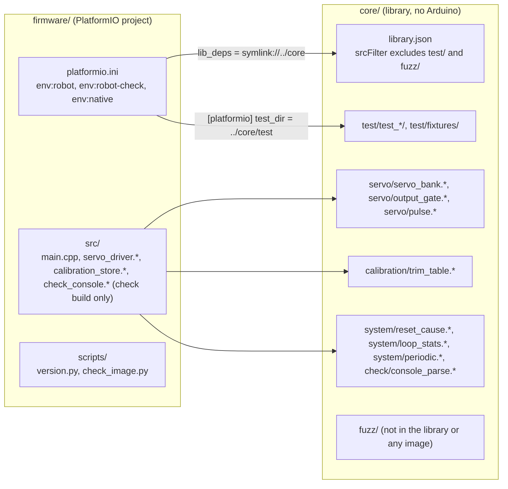
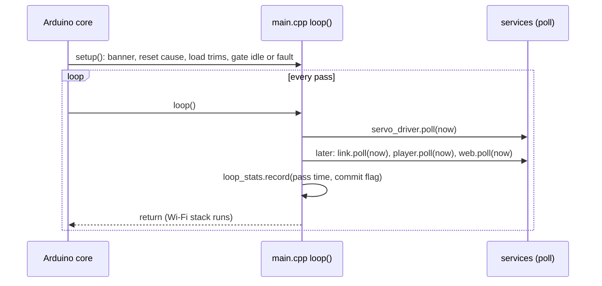
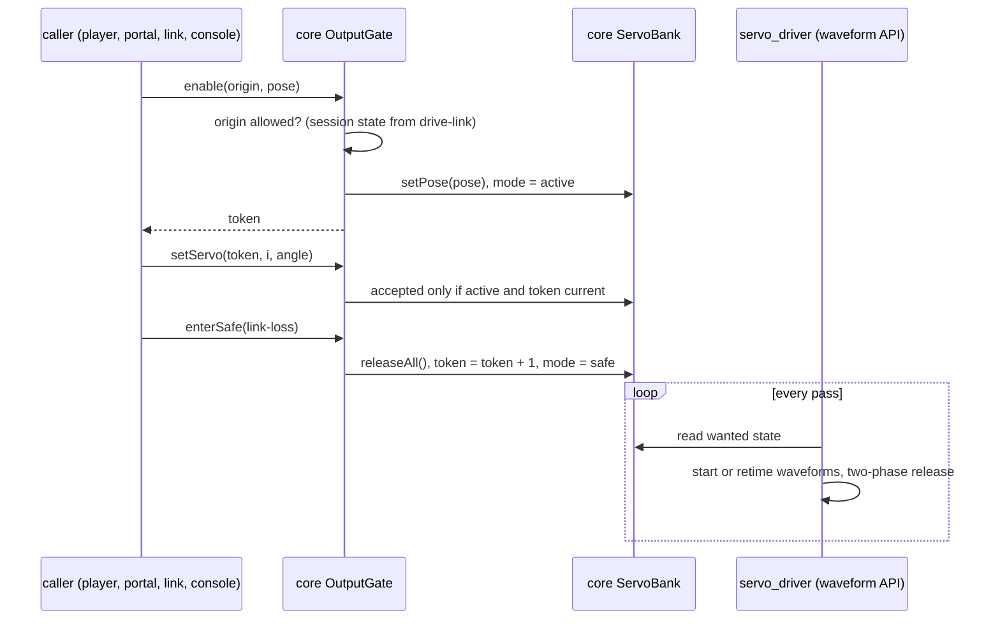
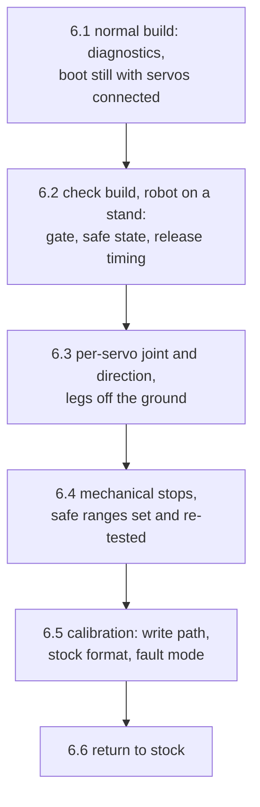

# Design

## Context

- **Repository:** no firmware source exists yet. The repository holds:
  - the verified stock image (`baseline/original-flash-4MB.bin`);
  - its analysis: `baseline/README.md` and `baseline/portal-strings.txt`, corrected from the disassembly in `docs/lafvin-comparison.md`, with every stock keyframe in `docs/lafvin-motions.md`;
  - a `mise.toml` with Python, uv, PlatformIO 6.2.0, esptool 5.2.0 and the tasks `backup`, `restore` and `monitor`. `ROBOT_PORT` is the CP2102's `/dev/serial/by-id/` path.
- **Hardware reference:** the stock firmware is the hardware reference. Hardware that stock does not use (battery sensing, sensors, extra pins) does not exist for this project. Stock defects are not hardware and are not reproduced.
- **Stock image layout:** the stock image is an Arduino ESP8266 core build, probably close to core 2.7.4 (inferred from its Servo code). It has `eboot` at 0x000000 and the application from 0x001000 (about 308 KB). It has no filesystem. The EEPROM emulation sector is at 0x3FB000 (erased) and the SDK data at 0x3FC000–0x3FFFFF. The chip runs its flash in DIO mode at 40 MHz.
- **Stock servo facts** (verified in `docs/lafvin-comparison.md` unless marked):
  - **Start-up attach order:** GPIO 15, 13, 12, 14, 2, 4, 5, 16 for indices 0–7. The motion tables assume this order. The page labels (14, 12, 13, 15, 16, 5, 4, 2) and the re-attach order after `/save` (16, 5, 4, 2, 14, 12, 13, 15) are not the hardware.
  - **Conversion:** `map(angle + trim, 1, 180, 400, 2400)` µs, then `Servo::write`. A sum of 0 or less maps below 400, and `Servo::write` then treats it as an angle and drives about 2400 µs. That is a stock defect; the safe range keeps every output at 1° or above.
  - **Calibration:** one signed byte per index in EEPROM bytes 0–7 (`EEPROM.begin(512)`, sector 0x3FB000). An erased byte gives −1.
  - **`/save`:** writes `value` only when `value + 124` (unsigned) is at most 248, which means −124…+124 (verified at 0x40203725–0x4020372E). `key=100` writes 0 to bytes 0–7.
  - **Envelope of the stock motion tables:** per servo, servo 0 30–170, servos 1, 2, 5, 6 45–135, servos 3, 4 45–150, servo 7 30–135. These figures come from all 123 stock rows in `docs/lafvin-motions.md`. The zero pose (135/45) lies inside them.
  - **Unknown:** the physical joint behind each index, its direction, and its mechanical stops.
- **Stock timing:** stock blocks HTTP while a motion plays, and it prints `Q1 mini Start!` at 9600 baud. This firmware does not reproduce either behaviour. It keeps every service running during a motion, which is what makes stopping a motion and the link failsafe possible.
- **Host:** the host lacks the GCC sanitiser runtimes (`libasan` and `libubsan` are not installed). The `espressif8266` PlatformIO platform is not yet installed; PlatformIO downloads it on the first build.

## Goals / Non-Goals

**Goals:**
- One PlatformIO project that later changes extend by adding sources to `firmware/src/` and `core/`, tests to `core/test/`, loop services to `main.cpp`, and, where they need them, their own envs and `pre:` extra scripts, without changing the library link, the source filter or the warning settings.
- Every rule in servo-output and servo-calibration that does not need hardware is tested on the host.
- The firmware has a single output gate: one owner for "may the servos move", an overriding safe state, and no movement at boot.
- Flash writes are deliberate. One task writes the application and one writes stock back. Nothing writes the calibration or SDK sectors by accident.

**Non-Goals:**
- Motions, the standby pose, the access point, the web portal and the drive link. They belong to motion-playback, drive-link and web-portal. This change also does not decide when the link is lost; it does decide when output may be enabled again (D5).
- Any user-facing way to set calibration. The web portal provides `/setting` and `/save`.
- Battery or supply monitoring: stock has no battery sensing, so none exists.
- Over-the-air updates, a filesystem, static analysis (clang-format, clang-tidy) and sanitised host tests. Sanitisers need runtimes that this host lacks, and they can be added later without changing these specs.

## Decisions

### D1. Repository layout: one PlatformIO project, `core/` as a local library

- **`firmware/platformio.ini`:**
  - `robot`: platform `espressif8266` pinned to an exact version. The expected pin is 4.2.1 with Arduino core 3.1.2; task 1.1 confirms the newest release at implementation time and pins it. Board `esp12e`, `board_build.flash_mode = dio`, `board_build.f_flash = 40000000L`, `board_build.ldscript = eagle.flash.4m.ld` (4 MB, no filesystem), `upload_speed = 460800`.
  - `robot-check`: `extends = env:robot`, adds `-DMINI_SPOODER_CHECK_BUILD=1 -DMINI_SPOODER_CHECK_CONSOLE=1` and `build_src_filter = +<*>`. `robot` has `build_src_filter = +<*> -<check_console.*>`, so the console is never in the normal image.
  - `native`: platform `native` pinned, `test_framework = unity`, no framework, and `test_build_src = no`, so that `firmware/src/` (Arduino code) is never compiled on the host.
  - `[platformio]` sets `test_dir = ../core/test`. PlatformIO accepts `test_dir` only in that section, and only the native env runs tests.
- **Linking `core/`:** all three envs use `lib_deps = symlink://../core` with `lib_ldf_mode = off`. In manual mode PlatformIO builds every source of a listed library that passes the library's own `srcFilter`. `core/library.json` sets `"build": {"srcFilter": ["+<*>", "-<test/>", "-<fuzz/>"]}`, so every `.cpp` under `core/` except `test/` and `fuzz/` compiles in every env without a source list. This replaces spooder's `build_src_filter` list and the check that keeps it complete.
- **Implementation note (task 1.2):** with `lib_ldf_mode = off`, PlatformIO links only the libraries that `lib_deps` lists, including framework and test-framework libraries. The `robot` env (and so `robot-check`) therefore lists `EEPROM` after `symlink://../core`, and `native` lists `throwtheswitch/Unity@2.6.1`. The `core/` link, the mode and the `srcFilter` are as above.
- **Fuzz targets:** `core/fuzz/<name>/` is where executables with their own entry point live, such as drive-link's fuzz targets with `LLVMFuzzerTestOneInput` or a standalone driver with `main`, and their helpers. Their builds are their owner's concern. The `srcFilter` keeps them out of the library, so neither the firmware image nor the library build in the native env compiles them. That is different from a host test compiling one of them on purpose: a test under `core/test/` may include a named source from `core/fuzz/` (drive-link's corpus replay test includes `core/fuzz/drive_link/targets.cpp`), and it is then compiled into that test programme only. Task 1.2 verifies the exclusion with two dummy targets and the explicit inclusion with a third test.
- **Warnings:** `core/library.json` sets `-Wall -Wextra -Werror` for the library's own sources, and `build_src_flags` sets the same for `firmware/src/`. Neither applies to the Arduino core or Unity.
- **Hardware-free rule:** the native env has no framework, so a `core/` source that includes `Arduino.h` does not compile. That enforces the rule.
- **Alternative considered:** spooder's root `platformio.ini` with `src_dir = core`. Rejected: it needs the explicit source list and a separate checker, and it would put a second PlatformIO project at the root next to `firmware/`.

### D2. Build checks and version

- **Version:** `firmware/scripts/version.py`, a `pre:` extra script, adds `-DMINI_SPOODER_VERSION="<git describe --always --dirty>"`, or `"unknown"` outside a git checkout.
- **Image check:** `firmware/scripts/check_image.py` runs after the build in `mise run build`.
  - It reads the header with `esptool image-info` (flash size, mode, frequency), and the linker symbols `_EEPROM_start`, `_FS_start` and `_FS_end` with the toolchain's `nm`.
  - It fails when the size is not 4 MB, the mode is not DIO, the frequency is not 40 MHz, `_EEPROM_start` is not 0x405FB000, the filesystem range is non-empty, the image's length from 0x000000 reaches 0x3FB000, or any symbol of the check console is present.
  - The parsing and comparison are pure functions with a Python `unittest`, which `mise run test` runs.

### D3. mise tasks

| Task | Runs |
|---|---|
| `build` | `pio run -d firmware -e robot`, then `check_image.py` |
| `upload` | checks that `$ROBOT_PORT` is non-empty and exists, `mise run build`, then `pio run -d firmware -e robot -t nobuild -t upload --upload-port "$ROBOT_PORT"` |
| `test` | `pio test -d firmware -e native`, then the Python `unittest` of `firmware/scripts/` |

- **What an upload writes:** PlatformIO's ESP8266 upload calls `esptool write-flash 0x0 firmware.bin`, which writes only the image's length. `upload_flags` must not add `--erase-all`. The upload therefore leaves 0x3FB000–0x3FFFFF alone, which keeps calibration across uploads.
- **Port:** `upload` never omits `--upload-port`. PlatformIO would otherwise auto-detect a port, and other ESP32 and RP2040 boards are often connected.
- **No task for the check build:** it is flashed only by hand in the hardware checks (`pio run -d firmware -e robot-check -t upload --upload-port "$ROBOT_PORT"`).
- **Existing tasks:** `backup`, `restore` and `monitor` stay as they are. `monitor` runs at 115200 baud, so the diagnostics use 115200, not stock's 9600.

### D4. Main loop and budget

- **Service shape:** each service is `void poll(uint32_t nowMs)` and does only due work. Periodic work runs at most once per pass. Its default deadline rule is in `core/system/periodic` (`nextDeadline(due, ran, interval)`, with a host test): `due + interval` when `ran − due` (unsigned, so wrap-safe) is less than `interval`, so jitter does not accumulate, and otherwise `ran + interval`, so missed intervals are not made up and a stall causes no burst. A service whose own specification sets its own rule follows it; motion-playback's player has the same rule in its own spec. Later changes add their poll calls in `main.cpp`. The order of the calls is their concern; this change fixes only the rules and the budget.
- **Budget:** 20 ms per pass for all services together. That allows a 50 Hz servo period to be met, and it leaves the drive link's receive and failsafe check at least one look per 20 ms.
- **Commit exception:** `EEPROM.commit()` erases and programs a flash sector and blocks for tens of milliseconds (inferred: typical sector erase time of the robot's flash chip; task 6.5 measures it). It is the one allowed exception. It happens only when a trim actually changes, so never during a motion unless someone calibrates while one plays. The 40 ms output deadlines are extended by a commit pass that falls within them (firmware-build); task 6.5 measures how long that is.
- **Statistics:** `core/system/loop_stats` is pure arithmetic (longest pass, the over-budget count that excludes commit passes, the longest commit pass) with a host test. `main.cpp` measures each pass with `micros()`.
- **Serial:** diagnostic lines are short (under 64 bytes) and printed only on events (start-up, a mode change, a calibration change), so they fit the UART FIFO and do not block a pass. Implementation: every line goes through `firmware/src/diag`, a byte queue that writes only what `Serial.availableForWrite()` allows and is drained by `diag::poll()` each pass, so a longer reply (the check console's `status`) also never blocks a pass.

### D5. Servo output: a hardware-free model, a non-blocking driver

- **`core/servo/pulse`:** holds the stock conversion `400 + ((out − 1) × 2000) / 179` and the clamp to the safe range. The range table `kSafeRange[8]` is a `constexpr` array, with the defaults from the spec. A host test checks every stock keyframe in `core/test/fixtures/stock_keyframes.h` against it. That fixture is generated once from `docs/lafvin-motions.md` by task 3.1 and committed.
- **`core/servo/servo_bank`:** holds, per servo, driven or released, the commanded angle and the trim. It computes the wanted pulse width per servo and produces the state report.
- **`core/servo/output_gate`:**
  - The mode state machine of servo-output: `idle`, `active`, `safe` and `fault`.
  - The writer token: a 32-bit counter, incremented on every entry into `safe` or `fault`. A pose or servo command is accepted only when the mode is `active` and the caller's token equals the counter.
  - **Why a token:** a motion that was running when the safe state was entered cannot continue after another caller re-enables output, because its token is stale. The gate enforces this; it does not rely on every caller's discipline.
  - `enterSafe` is synchronous: it releases every servo in the model in the same call, and the model's release hook starts the driver's release phase 1 within that call (D5, driver actions), so no new pulse starts after the request. The gate then calls its mode listeners before returning. Which services register a listener is their concern (Cross-change assumptions).
  - **Direct command:** `directServo(i, angle)` is the token-free single-servo command for a new, explicit request of the web portal (`/controller?servo=`, the Zero check buttons and the editor and calibration servo controls); its origin is always `portal`. It validates the index and angle first. It is rejected in every mode while a drive-link session is live. Otherwise, in `active` it behaves as `setServo` with the current token; in `idle` or `safe` it calls `enable(portal, kEnablePose)` and, when that is accepted, applies the angle to its servo in the same call, before the driver's next pass, so every servo's first pulse already has its final width; in `fault` it is rejected. The portal's glue therefore never holds or reads a token. It never changes the token. A writer continuing its own sequence (motion-playback's glue) keeps using the token that its enable returned, so a stale motion still stops at the safe state.
  - **Enable pose:** `kEnablePose` in `core/servo/pulse` is the stock zero pose 135, 45, 135, 45, 45, 135, 45, 135, the pose that stock attaches at boot. It is what `directServo` enables with, and what motion-playback's handshake uses (Cross-change assumptions). It is never applied at boot.
  - **Why the direct command may enable:** it is the user's decision, matching stock, where every servo is attached at boot so a single-servo button always moves its servo. Enabling the whole pose first keeps the "complete pose" rule: no servo starts from an unknown angle while the others stay limp.
  - **Enable rule:** `enable(origin, pose)` with `origin` one of `link`, `portal`, `check`. The gate is constructed with a flag that permits `check`; the firmware passes it from `MINI_SPOODER_CHECK_BUILD`, which `robot-check` defines (and any on-robot check env of a later change, such as motion-playback's `motion-demo`), and which `robot` does not. Without the flag, `check` is always rejected. The gate keeps two facts from drive-link: whether a session is live, and whether the live session started after the last disable. drive-link calls `linkSessionStarted()` and `linkSessionEnded()`; every entry into `safe` or `fault` clears the "started after" fact. In `idle` or `safe`, `link` is allowed only with a live session that started after the disable, and `portal` and `check` only with no live session. In `active`, `portal` is also rejected while a session is live, so the gate itself enforces the web portal's lock while the pak has control. `enablePermitted(origin)` answers the same question without enabling, so that the web portal can refuse a request before it reaches the player.
  - **Why this rule:** it is the settled product decision. After a link loss the pak's old session is over, so a new session's first motion request, or the portal once nobody drives, brings output back. Only an explicit motion or keyframe request (through motion-playback's enable handshake) or a direct servo command reaches `enable`, so a stop, a session start or a calibration change never re-enables output. While the pak has control (a session is live), no portal request can enable or move the robot.
  - **Origin of a request:** `enable` takes the origin as an argument and does not infer it. Which origin each caller passes is that caller's concern (Cross-change assumptions).
- **`firmware/src/servo_driver`:** drives the pins with the core's waveform generator (`startWaveform` and `stopWaveform` from `core_esp8266_waveform.h`), which is what the core's `Servo` class uses underneath. It does not use `Servo` objects, for two reasons:
  - `Servo::detach()` blocks for 20 ms (`delay(REFRESH_INTERVAL)` in core 2.7.4 and 3.1.2). Eight detaches would block for 160 ms, which breaks the loop budget and delays the failsafe.
  - The model owns the mapping and its rounding, so the host tests cover them. `Servo::write` would remap.
- **Driver actions, per servo** (each pass, except release phase 1, which runs inside the release call through the bank's release hook):
  - **Newly driven:** `pinMode(OUTPUT)`, `digitalWrite(LOW)`, then `startWaveform(pin, width, 20000 − width, 0)`, so the first pulse already has the commanded width.
  - **Width changed:** `startWaveform` with the new timing. The generator applies it at the next period.
  - **Newly released, phase 1:** in the release call itself (one servo, all servos, `enterSafe` or a fault), `startWaveform(pin, 0, 20000, 0)` stops further high pulses after the one in progress, and the driver records the time. It does not wait for the next pass, so no pulse starts after the release is requested.
  - **Released, phase 2:** in the first pass at least 20 ms after phase 1, `stopWaveform(pin)` and `digitalWrite(pin, LOW)`.
  - A release therefore completes within 20 ms plus one pass, at most 40 ms from the request, and no call waits. A new or changed width is applied at the next pass and takes effect at the next period, also at most 40 ms. Task 1.1 confirms in the pinned core's waveform source that a timing change and a zero high time take effect at the period boundary, without truncating the pulse in progress. If they do not, the driver waits for the end of the current pulse before changing it, using the phase it recorded.
  - **Task 1.1 result (espressif8266 4.2.1, framework-arduinoespressif8266 3.30102.0, Arduino core 3.1.2):** the core ships two generators. The default, `core_esp8266_waveform_pwm.cpp`, does not qualify: `startWaveform` rejects a zero high time (`timeHighCycles == 0` returns false), and a change to a running waveform goes through a single mailbox, so a second change in the same pass waits (`esp_yield`) until the first pin reaches its next rising edge, up to 20 ms per servo. The phase-locked generator, `core_esp8266_waveform_phase.cpp`, which an application selects by calling `enablePhaseLockedWaveform()`, does qualify: a change to a running waveform writes its duty and period directly, and the interrupt reads them only at the next rising edge, after the end of the pulse in progress has already been scheduled, so neither a new width nor a zero high time truncates that pulse; a zero duty keeps the pin low from the next period on; and a change does not wait. Starting a waveform on a pin waits only for the next timer interrupt, which the call forces within about 2 µs. `stopWaveform` disables at once and leaves the pin as it is, which is why it is used only in phase 2, when the pin is already low. `servo_driver` therefore calls `enablePhaseLockedWaveform()` before its first `startWaveform`, and the fallback above is not needed.
- **Strapping pins:** no source calls `Serial1`, or `pinMode` with a pull, on GPIO15 or GPIO2, and the build sets no `DEBUG_ESP_PORT`. Until the first enable, `servo_driver` does not touch the pins.
- **Alternatives considered:**
  - `analogWrite` at 50 Hz: its resolution is too coarse for servo pulses.
  - A custom timer ISR: it would duplicate the core's waveform generator, which the stock image used on the same pins.
  - Cutting pulses at once with `stopWaveform`: a truncated pulse is a brief command to another angle.

### D6. Calibration in the stock format

- **Storage:** `firmware/src/calibration_store` uses the core's `EEPROM` library exactly as stock does: `EEPROM.begin(512)` at start-up, and `EEPROM.write(i, (uint8_t)trim)` followed by `EEPROM.commit()` on a change. `begin` reads 512 bytes and `commit` erases the sector and writes the 512 bytes back, so bytes 8–511 are kept as loaded. Bytes 512–4095 end erased, as with stock's commit.
- **`core/calibration/trim_table`:** decodes eight bytes into trims (0xFF → −1 as two's complement; any byte is a number). It marks a trim outside −124…+124 as invalid. Set (with the result accepted, rejected or unchanged), reset all, and a "write needed" result follow the spec. It reports whether every trim is valid, which the gate uses for `fault`.
- **Why the stock format, not a record with an identifier and checksum** (that was the previous draft's choice): with a checksum record, stock trims would be lost on the first upload, and the record would overwrite bytes 0–7 with header data that stock would then read as trims. Keeping the format means that trims move with the robot in both directions.
- **What the format cannot do:** it cannot detect an interrupted write, which can leave any byte value. The design accepts this:
  - writes are rare (a change only);
  - out-of-range bytes cause a fault;
  - in-range nonsense is still limited by the safe range.
  The robot then moves to a wrong but bounded pose, which the user sees and recalibrates.
- **Range:** −124…+124 is stock's accepted range, so the web portal can forward stock requests unchanged. Mechanical protection comes from the per-servo safe range after the trim, not from a narrow trim range.
- **Fixtures:** `core/test/fixtures/trims_example.bin` (FD 00 00 00 F9 00 00 0C, the trims −3, 0, 0, 0, −7, 0, 0, +12) and `trims_fault.bin` (00 00 80 00 00 00 00 00), each 8 bytes. The hardware checks write them with esptool. When esptool writes at 0x3FB000, it erases the whole sector first, so the remaining bytes read 0xFF (−1 for bytes 0–7, which these fixtures cover).

### D7. Check build and console

- **Commands** (`check_console`, `robot-check` only), one per line, ASCII:
  - `enable a0 … a7`, `pose a0 … a7`, `servo i a`;
  - `release i`, `release all`;
  - `safe`;
  - `trim i v`, `trimreset`;
  - `status`;
  - `restart`, `hang`.
- **Parser:** `core/check/console_parse` is pure parsing into a command value, with a host test for every command and for malformed input. The console's `enable` uses origin `check`, keeps the token it gets and passes it on, as any caller would. The check build plays no motions, so its `enable` stands in for the motion request. `robot-check` defines `MINI_SPOODER_CHECK_BUILD` as well as `MINI_SPOODER_CHECK_CONSOLE`: the first permits the origin `check`, the second compiles the console. An on-robot check env of a later change can set the first without the second.
- **`hang`:** busy-waits without yielding, so the software watchdog resets the chip. This tests the reset-cause line.
- **Why a console, not compile-time scenarios** (the previous draft's `robot-calcheck`): the joint and direction check needs servos driven one at a time on demand, and the gate checks need commands in a chosen order. A console does both without moving anything at boot.

### D8. Hardware check order

- **First powered checks:** 6.1–6.5 are the first powered checks of the new firmware with servos connected, and they play no motion. How the other changes' on-robot checks follow them is under Cross-change assumptions.
- **No movement before the gate is checked:** the boot-still and gate checks (6.1, 6.2) come before any check that moves a joint over its range. Every check that drives a servo runs with the robot on a stand, legs off the ground.
- **Joint map and stops before any motion:** 6.3 records each index's joint and the direction of increasing angle in `docs/servo-joints.md`, and 6.4 sets the measured safe ranges, before any later change plays a motion. 6.6 (return to stock) is not a prerequisite of the other changes' checks.

## Cross-change assumptions

These are what the other changes own. This change relies on them and does not specify them.

- **motion-playback:**
  - It never moves the robot at boot. When the first tick of a motion or keyframe is due and output is not enabled, it gives one complete pose (its enable handshake, which uses the zero pose, equal to servo-output's `kEnablePose`), and it uses the returned token for every later pose or servo command. That handshake and servo-output's own `directServo` are the only paths to `enable` in the normal build.
  - Its firmware binding passes the origin (`link` or `portal`, or `check` in an on-robot check build) of the request whose first tick makes that handshake.
  - It ends the running motion when a command is rejected, and it reads the mode before every tick, so a safe state or fault from any cause ends its motion at its next chance to run without a call from this change. It may also register a mode listener.
  - Its ticks are a poll service within the loop budget.
  - It passes table angles as commanded angles (0–180°); the trims and the safe ranges are applied here.
  - Its firmware binding passes origin `check` for the requests of its `motion-demo` demonstration, an on-robot check env that defines `MINI_SPOODER_CHECK_BUILD`. Only with that marker can the demonstration's `go` enable output.
  - Its motion-acceptance checks run after this change's hardware checks 6.1–6.5 and after drive-link's link-loss checks, with the legs off the ground first.
- **drive-link:**
  - It calls `enterSafe(link-loss)` when a session ends (a lapse or a sequence jump), in the same pass and before the player's next tick, and never calls `enable` or leaves `safe` itself.
  - It calls `linkSessionStarted()` when a session starts and `linkSessionEnded()` when it ends, which is the session state that the enable rule uses. It reports whether a session is live, as its spec says.
  - It reads the mode, the safe reason and the commanded angles (without trims), or that a servo is released or not yet commanded, from the state report for its telemetry.
  - Its receive and failsafe check is a poll service, called before the player in each pass.
  - Its timing can count on the 20 ms pass budget, except for a pass that commits calibration. Task 6.5 records how long that pass takes.
  - It keeps its fuzz harness in `core/fuzz/drive_link/`, outside the library, and builds its executables itself. Its corpus replay test under `core/test/` includes `core/fuzz/drive_link/targets.cpp` explicitly, which firmware-build allows.
  - Its on-robot checks start after this change's hardware checks 6.1–6.5. Its first checks are its link-loss checks: one with no request, then one with a single Standby that only proves that a lapse releases a driven pose and is not a motion-acceptance check. Its walking checks and motion-playback's motion-acceptance checks come after them.
  - It starts the access point with Wi-Fi persistence off, so it stores nothing in the SDK data sector; `mise run restore` returns that sector to stock in any case.
- **web-portal:**
  - It maps `/save?key=<i>&value=<v>` with `i` in 0–7 to "set trim" with the range −124…+124, and `key=100` to "reset all trims".
  - It fills `/setting` from the trim table, including −1 for an erased byte.
  - It sends motion requests and `/online` keyframes to motion-playback, whose handshake enables output with origin `portal`. Before forwarding a robot-moving request while output is not `active`, it asks `enablePermitted(portal)` and refuses the request when that is false.
  - It sends direct servo commands (`/controller?servo=`, the Zero check page's per-servo buttons, and the editor and calibration servo controls) to servo-output's token-free direct servo command (`directServo`), which may enable output from `idle` or `safe` with the enable pose when no drive-link session is live. It no longer refuses a direct servo command in `idle` or `safe` when portal enable is permitted. It never holds or reads a writer token and never calls `enable` itself.
  - While a drive-link session is live, it refuses every request that moves the robot (motions, keyframes, direct servo commands, the zero check) and enables nothing; pages and read-only data still load. The gate rejects portal enables and direct servo commands in that state in any case. It also refuses calibration saving (`/save`) during a live session, because a trim change moves a driven servo; servo-calibration itself still accepts a trim change in every mode. The lock ends when the session ends (a lapse or a leave).
  - It validates angles against the accepted range 0–180° and relies on the safe-range clamp, adding none of its own.
  - It keeps serving `/setting` and `/save` in `safe` and `fault` while no session is live, so that a damaged trim can be repaired.
  - It labels channels with the GPIO map 15, 13, 12, 14, 2, 4, 5, 16.
- **handheld-pak:** any GPIO label it shows uses the same map. It relies on the enable rule only through drive-link: after a link loss, its new session's first motion request brings output back, and while its session is live the portal cannot enable or move the robot.
- **Hardware check order across changes** (each owner's tasks define its own checks; this is the order they rely on): this change's 6.1–6.5, then drive-link's link-loss checks (no request, then the single Standby), then drive-link's walking checks and motion-playback's motion-acceptance checks, all with the legs off the ground before any check on the ground.
- **Every later change** adds its hardware-free code to `core/`, its tests to `core/test/`, and its hardware code and poll call to `firmware/src/`. It may add its own env or `pre:` extra script, but does not edit the `lib_deps`, `lib_ldf_mode`, `srcFilter` or warning settings. Executables with their own entry point live under `core/fuzz/<name>/` or outside `core/`.

## Risks / Trade-offs

- **GPIO16 support:** support for GPIO16 in the pinned core's waveform generator is not verified. Task 6.2 checks every pin on the robot. If GPIO16 has no pulses, pin the core release that the hardware check passes with, and record it.
- **Waveform semantics:** the waveform generator's timing-change semantics differ between core releases (inferred). Task 1.1 reads the pinned source, and D5 names the fallback.
- **Commit timing:** a sector erase and write in `EEPROM.commit()` blocks the loop. It may also stretch servo pulses if the waveform interrupt is held off while the flash cache is disabled (unverified; stock detached its servos around a save). Task 6.5 measures the pass time and, if a logic analyser is available, the pulses during a commit. If pulses are disturbed, the commit is deferred to a pass in which no servo is driven, and the spec's "stored before the result is returned" is revisited.
- **Strapping-pin twitch:** the servos on GPIO15 and GPIO2 can twitch at power-up, before any firmware runs. No firmware fix exists. The spec only guarantees that the firmware adds no output before the first enable and that the robot boots reliably.
- **Interrupted calibration write:** a power failure during a commit can leave in-range wrong trims, which load without a fault (D6). Bounded by the safe ranges.
- **Default safe ranges:** the defaults are not mechanical measurements. Until task 6.4, a joint whose stop lies inside its default range can still be driven into the stop. Task 6.4 comes before any motion check for this reason.
- **Flash layout check:** it depends on the core's linker symbol names. The check fails loudly when a symbol is missing, rather than passing.

## Migration Plan

1. With the user's go-ahead: `mise run backup` (read-only, resets the board) to keep the robot's current state.
2. With the user's go-ahead: `mise run upload` to flash the first build. The calibration and SDK sectors stay as they were, and stock trims (if any) are used.
3. Rollback at any time, with the user's go-ahead: `mise run restore` writes the hash-checked stock image, including the erased EEPROM sector and the stock SDK data.

## Open Questions

- **Resolved:** did the stock firmware persist calibration, and where? Yes. The disassembly shows one signed byte per servo in EEPROM bytes 0–7 of the 512-byte buffer at 0x3FB000, written by `/save` and read on every servo write. The dumped sector is erased, so this robot has no saved calibration. That fits the user's recollection that the original had no calibration in practice.
- Which joint each servo index drives, in which direction, and where its mechanical stops are. Unknown until task 6.3 and task 6.4.
- How long `EEPROM.commit()` blocks on this chip, and whether servo pulses stay intact during it. Measured in task 6.5.
- Whether the pinned core's waveform generator applies a timing change at the period boundary. Checked in task 1.1.
- **Resolved:** may a direct servo command enable output? Yes, as on stock, when no drive-link session is live. It enables with the enable pose, the stock zero pose that stock attaches at boot, and then applies its angle. The robot still stays still at boot. While a session is live, the portal can neither enable output nor move a servo.
