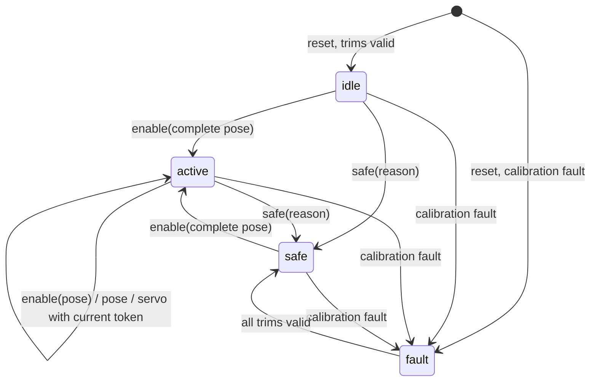

# Spec Delta

## Purpose

Drives the robot's eight servos from commanded angles with the stock pin map and pulse mapping. Output is limited to a per-servo safe range. The robot stays still until output is explicitly enabled with a complete pose. A safe state, reachable from every mode and overriding every caller, lets all servos go limp. Motions, direct servo control, the zero check and the drive link all share this one output path.

## ADDED Requirements

### Requirement: Servo map

The firmware SHALL drive servo indices 0 to 7 on GPIO 15, 13, 12, 14, 2, 4, 5 and 16 respectively. This is the stock firmware's start-up attach order, which its motion tables assume. The map SHALL be fixed at build time. It SHALL NOT change at runtime, including after a calibration write; stock re-attaches the servos in another order after `/save`, which is a stock defect and is not reproduced. A command for an index outside 0–7 SHALL be rejected and SHALL change no output.

#### Scenario: Index to pin

- **WHEN** output is enabled and servo 3 is commanded to 80° while every other servo holds its angle
- **THEN** only the pulse on GPIO14 changes

#### Scenario: Map unchanged by a calibration write

- **WHEN** servo 2's trim is set while output is enabled, and servo 0 is then commanded to 80°
- **THEN** the pulse on GPIO15 changes and no other pin's pulse changes

#### Scenario: Index out of range

- **WHEN** a command names servo index 8
- **THEN** the command is rejected and no servo's output changes

### Requirement: Pulse mapping

A commanded angle SHALL be a whole number of degrees. A commanded angle below 0 SHALL be taken as 0, and one above 180 as 180. A servo's output angle SHALL be its commanded angle plus its trim (servo-calibration), limited to that servo's safe range. Each driven servo SHALL receive one pulse every 20 ms. The pulse width in microseconds SHALL be `400 + ((out − 1) × 2000) / 179`, with integer division truncating, where `out` is the output angle. This is the stock conversion: Arduino `map(out, 1, 180, 400, 2400)`. A new commanded angle SHALL take effect within 40 ms of the command, including while other servos are being released.

#### Scenario: Centre

- **WHEN** servo 1 has trim 0 and its safe range includes 90°, and it is commanded to 90°
- **THEN** GPIO13 carries 1394 µs pulses every 20 ms

#### Scenario: Ends of the mapping

- **WHEN** the output angle is 1° and then 180°
- **THEN** the pulses are 400 µs and then 2400 µs wide

#### Scenario: Commanded angle above the range

- **WHEN** a servo is commanded to 200°
- **THEN** its reported commanded angle is 180°, and it is driven at 180° plus its trim, limited to its safe range

### Requirement: Per-servo safe range

Each servo index SHALL have a safe range `[low, high]` of output angles, with `1 ≤ low < high ≤ 180`, fixed at build time in `core/`. Every output angle SHALL be limited to its servo's safe range after the trim is added, whatever the source of the command (motions, direct servo control, the zero check, a keyframe from the motion editor, or the drive link). Until the hardware check records the joints' mechanical stops, each default range SHALL be the per-servo envelope of the stock motion tables and the stock zero pose, widened by 10° on each side and kept within 1–180. The defaults are: servo 0: 20–180; servos 1, 2, 5, 6: 35–145; servos 3, 4: 35–160; servo 7: 20–145. Each range that the hardware check measures SHALL replace its default.

#### Scenario: Limit after the trim

- **WHEN** servo 3's safe range is 35–160 and its trim is +5, and it is commanded to 158°
- **THEN** it is driven at 160° (the width for 160°), and its reported commanded angle is 158°

#### Scenario: Lower limit

- **WHEN** servo 1's safe range is 35–145 and its trim is −1, and it is commanded to 0°
- **THEN** it is driven at 35°

#### Scenario: Stock envelope inside the defaults

- **WHEN** every keyframe angle of the stock motion tables in `docs/lafvin-motions.md` and of the stock zero pose is checked with trims of −1 and of 0 against the default ranges
- **THEN** no angle is limited

### Requirement: Output modes and safe state

The firmware SHALL be in exactly one of four output modes:

- `idle`: after a reset;
- `active`: output enabled;
- `safe`: output disabled after a safe-state request;
- `fault`: output disabled after a start-up failure (servo-calibration).

The firmware SHALL drive servos only in `active`.

- **Entering `active`:** an enable request that carries a complete pose (one commanded angle for each of the eight servos) SHALL move `idle` or `safe` to `active`, with every servo driven at that pose. In `active`, the same request SHALL apply the pose. An enable request SHALL be rejected in `fault`.
- **Writer token:** each accepted enable request SHALL return the current writer token. A pose or single-servo command SHALL be accepted only in `active` and only with the current token. Otherwise it SHALL be rejected and SHALL change no output.
- **Safe-state request:** from any mode, a safe-state request carrying a reason (`link-loss`, `request` or `check`) SHALL move `idle` or `active` to `safe` at once, in the same loop pass. It SHALL record the reason, release every servo (Release), and make the current token stale. A safe-state request in `safe` or `fault` SHALL change nothing except to update the recorded reason in `safe`.
- **Calibration fault:** a calibration fault (servo-calibration) SHALL move any mode to `fault`, release every servo, and make the token stale. `fault` SHALL change to `safe` only when servo-calibration reports that every trim is valid.
- **No other transitions:** the firmware SHALL NOT enter `active` on its own: not at boot, not after a fault clears, and not after a safe state.

Every mode change SHALL print one line on UART0 in the form `mode <mode> <reason>`. The reason SHALL be `enable` for `active`, the request's reason for `safe`, `calibration` for `fault`, and `calibration-ok` for the change from `fault` to `safe`.

#### Scenario: Boot still

- **WHEN** the robot resets with valid trims and receives no enable request for 10 s
- **THEN** it stays in `idle`, and no servo pin carries pulses during those 10 s

#### Scenario: Enable with a complete pose

- **WHEN** an enable request with the pose 70, 90, 90, 110, 110, 90, 90, 70 is given in `idle`
- **THEN** the mode is `active`, all eight servos carry pulses for that pose within 40 ms, and each servo's first pulse already has the width for its angle in that pose

#### Scenario: Single servo before enable

- **WHEN** servo 0 is commanded on its own in `idle`
- **THEN** the command is rejected and no servo pin carries pulses

#### Scenario: Safe state overrides a running writer

- **WHEN** a writer holding the current token is in the middle of a sequence of poses, and a safe-state request with reason `link-loss` is given
- **THEN** the mode is `safe`, the next pose from that writer is rejected, and within 40 ms no servo pin carries pulses

#### Scenario: Stale token after re-enable

- **WHEN** output enters `safe`, a second caller then enables output with a complete pose, and the first writer then sends a pose with its old token
- **THEN** the first writer's pose is rejected and the servos hold the second caller's pose

#### Scenario: Enable refused in fault

- **WHEN** the mode is `fault` and an enable request with a complete pose is given
- **THEN** the request is rejected and no servo pin carries pulses

### Requirement: Boot-strapping pins

GPIO15 carries servo 0 and must be low at boot. GPIO2 carries servo 4 and must be high at boot. The firmware SHALL use these two pins only for servo pulses. It SHALL NOT route serial output (including the Arduino core's debug output on UART1, which uses GPIO2), an LED, SPI or any other function to them. It SHALL NOT enable an internal pull resistor on them. Until the first enable request, it SHALL leave all eight servo pins in their reset configuration. When it stops pulses on either strapping pin after they have started, it SHALL drive the pin low.

#### Scenario: Repeated power-up

- **WHEN** the robot, with all eight servos connected, is switched off and on 10 times
- **THEN** each time it boots into this firmware, which `mise run monitor` shows by the boot banner

#### Scenario: No debug output on GPIO2

- **WHEN** the firmware is built by `mise run build`
- **THEN** the build configuration sets no Arduino debug port, and no project source writes to UART1

### Requirement: Release

The firmware SHALL be able to release one servo or all eight without blocking the loop pass (firmware-build). A released servo SHALL receive at most the pulse already in progress, which SHALL complete at its full width. Within 40 ms of the release, it SHALL receive no pulses and its pin SHALL be driven low, so that it goes limp. A servo released in `active` SHALL stay released until it is commanded again; that command SHALL restart its pulses at the newly commanded angle. Releasing a servo that is already released, including any servo in `idle`, SHALL have no effect and SHALL leave its pin as it is.

#### Scenario: Release all

- **WHEN** all eight servos are driven and all are released
- **THEN** within 40 ms no servo pin carries pulses and every servo pin reads low, and no loop pass during the release takes longer than the loop budget

#### Scenario: Resume after release

- **WHEN** servo 5 is released in `active` and then commanded to 100° with the current token
- **THEN** GPIO4 carries pulses again, its first pulse already at the width for 100° plus its trim within its safe range, and the other servos are unaffected

#### Scenario: Release in idle

- **WHEN** all servos are released straight after a reset, in `idle`
- **THEN** nothing changes: no pin carries pulses and every pin keeps its reset configuration

### Requirement: Servo state report

The firmware SHALL make the following available to the rest of the firmware:

- the output mode;
- the reason recorded for the last safe state;
- for each servo index, whether it is driven or released, and its last commanded angle without the trim (0–180°).

In `idle`, every servo SHALL be reported released with no commanded angle.

#### Scenario: Report after a pose

- **WHEN** output is enabled with the pose 70, 90, 90, 110, 110, 90, 90, 70 and then servo 2 is released
- **THEN** the report shows mode `active`, servos 0, 1 and 3–7 driven at those angles, and servo 2 released with its last commanded angle 90°

#### Scenario: Report after a safe state

- **WHEN** output is enabled and a safe-state request with reason `link-loss` is given
- **THEN** the report shows mode `safe`, reason `link-loss`, and all eight servos released with their last commanded angles

#### Scenario: Report in idle

- **WHEN** the report is read after a reset, before any enable request
- **THEN** it shows mode `idle`, and all eight servos released with no commanded angle
