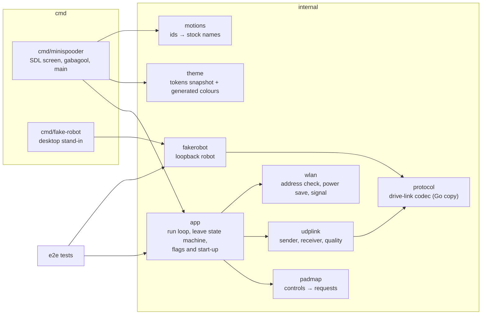
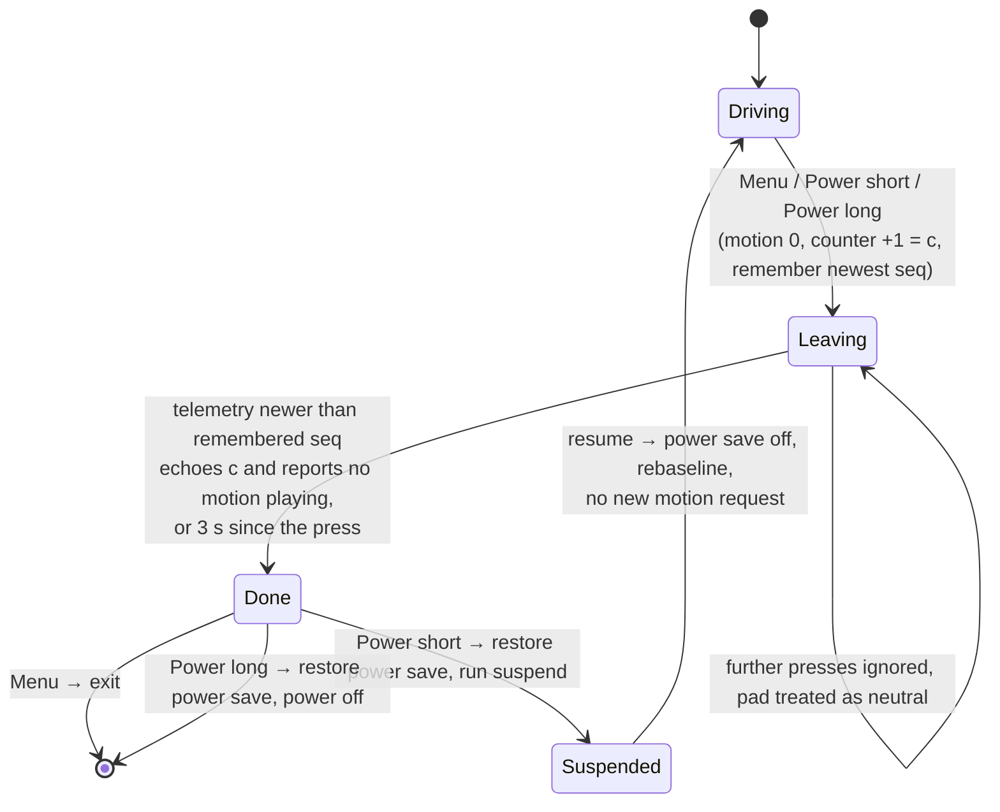
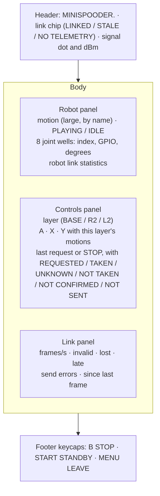

# Design

## Context

See proposal.md for the motivation. No pak source exists yet. Three facts shape the approach:

- **The robot side is someone else's change.** `drive-link` owns the access point, the UDP port, the framing, the command and telemetry frames, the one-remote rule and link loss; `motion-playback` owns the motion ids, names and what stop does. The pak only consumes them. What this design needs from them is listed under Cross-change assumptions, and each is a named constant or a generated table in the pak so that a change on the robot side is a one-place edit.
- **Spooder.pak is a working reference** (`../spooder/desktop/handheld`, its change `add-handheld-controller`): gabagool on SDL2, a nested Go module, a patched power-button hook, a launch script that restores WiFi power saving, an arm64 build under rootless Podman with a glibc check, an address check with one lease renewal, a two-frame leave confirmation and per-sequence link quality. This repository copies the parts it needs; it does not import from, build against or edit `../spooder`.
- **The stock remote has no hold semantics.** The stock controller page (`baseline/portal-strings.txt`) sends one `controller?pm=<n>` request per button click and nothing on release. The pak keeps that: one request per press.

## Goals / Non-Goals

**Goals:** the smallest pak that plays every stock motion from the TrimUI, stops the robot on demand and before it leaves, shows what the robot reports and how healthy the link is, and is tested without the robot (host tests plus an end-to-end run against a fake robot), with a reproducible device build.

**Non-Goals:**
- Direct servo control, calibration, the zero check page and the motion editor from the pak: they stay on the robot's web portal (`web-portal`).
- The stock `pms` variant of `/controller` (purpose unknown, `baseline/README.md`).
- Continuous driving while a control is held, stick driving, or any motion not in the stock set.
- Joining WiFi from inside the pak (NextUI's WiFi settings do it).
- Authenticated command frames (see D9).

## Decisions

### D1. A Go module at `handheld/`

The pak is the module `github.com/blackfyre/mini-spooder/handheld` at the repository root's `handheld/`, as the agreed layout has it. It is standalone (no `replace` to any other module of this repository: there is no other Go module here). Layout:

Everything below `cmd/minispooder` is hardware-free and SDL-free, so `go test` covers it without a display. Alternatives: putting the pak under a `desktop/` directory as Spooder does (rejected: this repository has no desktop calibrator, and the agreed layout names `handheld/`).

### D2. The control mapping (`internal/padmap`)

A pure function of the previous and current pad state (buttons, trigger axes) to zero or more events: `Motion{id}` or `Stop`. Edge-triggered: an event only on a press edge; a hold or a release gives none. The layer is read at the press edge: R2 held (axis beyond half travel) gives the Dance layer, L2 the Lie/Sleep/Zero layer, both or neither as in the spec. The mapping table is one Go table, the same one the screen uses for its labels, so the labels cannot drift from what is sent.

The app turns events into the desired state, which is `drive-link`'s command frame (A3): a requested motion and one 8-bit motion-request counter. `Motion{id}` sets the requested motion to `id` and increments the counter; `Stop` sets the requested motion to 0 (stop) and increments the same counter. The frame always carries both, every period, as the spooder rule requires (complete desired state, not deltas): a lost frame costs nothing, since the next one carries the same counter. The counter starts at 0 in each run and the requested motion at 0; the robot takes the first frame of a session as its baseline only (A3), so these starting values never act.

**Presses only on a live link.** Under A3 the robot takes the first frame of a session as its counter baseline. A press made before the robot has seen the pak's frames (at start, after a resume, after the robot ended the session for link loss) would advance a counter that the robot then takes as its baseline, and the motion would never play, nor any later frame repair it. So the app takes a press only while the link is live: at least two telemetry frames accepted since the first command frame of the current link start (the run's start, a resume, or the link counted lost) was sent, the newest no more than 250 ms old. Telemetry goes only to the remote whose session is live (A4, A6) and the robot sends none before it has a session, so frames read after that first frame show that the robot has already baselined this pak's counter. Datagrams read during the start silence (D4), such as telemetry queued in the socket before a suspend, are discarded without being counted, so they can neither open the gate nor change the screen. A press otherwise is shown as `NOT SENT` and dropped, never queued (a queued Forward played seconds later would be a surprise). The leave's stop is sent regardless, since the robot's link-loss handling covers a session that has gone (A5).

**A stop is never overwritten.** `drive-link` takes one request per counter change, from the frame that carries the change (A3), so any request made before the robot has seen the previous one replaces it: B then Start within one 50 ms period, or a lost frame carrying the stop followed by one carrying Start, would turn the stop into a pending Standby while the motion continues (A8). Two rules prevent that. Each command frame carries at most one new request: a motion press made after a request is set and before a frame carrying it has been sent is not taken (`NOT SENT`), while a stop press in that time replaces the unsent request. After a stop, no motion press is taken until a telemetry frame echoes the stop's counter value or the stop is marked `NOT CONFIRMED`; a later stop is always taken. Between motion requests no such wait applies: replacing a motion request with a later one is what the robot does with requests anyway (latest wins).

**Whether the robot took a request.** Telemetry echoes the counter value of the last request the robot processed in the session and its result (started, stop requested, unknown motion), or the session's baseline with the result "none yet" (A4). The screen model uses that: the last request shows `REQUESTED` until a telemetry frame echoes its counter value, then `TAKEN` (started or stop requested), `UNKNOWN` (unknown motion) or `NOT TAKEN` (echoed as a new session's baseline, which is the residual race above: the robot ended the session within the 250 ms window and the press became its baseline); with no echo within 1 s it shows `NOT CONFIRMED`. This answers the stock remote's missing feedback (proposal) without a new frame field. A frame-stamp echo for a round-trip time is not in `drive-link`'s telemetry, so the pak shows none.

Why this layout of controls: locomotion on the D-pad and shoulders (as a TrimUI user expects movement there), the three stock "Say Hi / Fighting / Push up" tiles on the face buttons, the six remaining motions behind the two analogue triggers, which are hard to press by accident, Zero position (pm 100, a pose for the zero check) behind L2 so that it is not one slip away, and B as stop in every layer. Centre (pm 99) gets no control: the stock controller page has no button for it, it is the same pose as Zero position on stock, and it stays reachable from the web portal; the pak still names it when telemetry reports it. Stop holds the pose the robot has reached (A8), so B followed by Start (Standby) is the way back to the rest pose. Alternatives: an on-screen grid with a cursor (two presses per motion and the D-pad lost for walking), hold-to-walk (a new behaviour the stock firmware does not have).

### D3. The drive-link codec in Go (`internal/protocol`)

A Go copy of the framing that `drive-link` specifies (start marker, version, type, sequence, length, CRC; a decoder that discards and resynchronises and counts discards), written from the spec and checked against the robot's codec by golden frames (D11). Copied, not shared: the robot's codec is C++ in `core/`, and a cgo binding would drag the native toolchain into the pak's cross-build. Spooder's Go protocol package is a model for the code structure only; its frame types and fields are not this robot's.

### D4. The UDP link (`internal/udplink`)

- One socket per run: `net.DialUDP` to the robot's address, created once after the address check (D7) and kept across suspend and resume. A connected socket makes the kernel drop datagrams from any other address and port; the receiver checks the source again for the desktop build's sake.
- Before the first frame of a run, and before the first frame after a resume, the sender stays silent for at least 350 ms, and the receiver discards uncounted every datagram it reads in that time, `drive-link`'s pre-start silence (A5): strictly more than the robot's 300 ms liveness, so a previous run's session from the same address and possibly the same source port has ended and the first frame starts a new session that only sets the baseline. Without it, a quick restart within 300 ms, starting its counter again at 0 with a sequence number 1–8 ahead of the old run's, would be taken as the old session's next frame and its reset counter as a request.
- The sender then ticks at the drive link's 50 ms command period and sends `protocol.EncodeCommand(state)`; the frame sequence number advances by one per frame. A send error is counted and the next tick tries again.
- The receiver reads into a buffer one byte larger than the largest telemetry frame and decodes each datagram with a fresh decoder; it accepts it only when exactly one telemetry frame spans the whole datagram. Anything else from the robot's address is counted invalid.
- Quality: `d = uint8(seq - newest)`; `d == 1` is in order, `2..127` counts `d - 1` lost, `0` or `128..255` counts late and the frame is not taken. Rebaseline (take any sequence number as newest, count nothing) on the first frame of a run, the first after a resume and the first after 500 ms without a frame taken as newest. The last clause is measured from the newest frame taken, not from any valid frame, so a robot restart whose sequence starts again lower (all its frames late) recovers within 500 ms instead of stalling. Staleness and the link-live gate (D2) use the same clock. Frames per second over the last whole second. The 8-bit width is an assumption (A3); the comparison is written over the sequence type's width so a 16-bit sequence only changes the type.

### D5. Leaving, and the power button through a patched gabagool

A hardware-free state machine in `internal/app`, with an injected clock:

One frame suffices because telemetry echoes the counter of the last request the robot processed (A4): a frame that echoes the leave's counter value `c` and reports no motion playing was built after the robot handled the stop, so a delayed idle frame from before the press cannot confirm it. The frame must also be newer by sequence number than every frame taken before the press, and a late frame never counts. The echo is `c` in two cases, both safe: the robot processed the stop (result "stop requested"), or its session had lapsed and the leave frame became a new session's baseline (result "none yet"), in which case `drive-link`'s link-loss handling has already acted (A5); in both the robot reports no motion playing. The stop ends the motion before the player's next tick and holds the pose reached; it does not return to Standby (A8). 3 s is a named constant bounding the wait when telemetry does not arrive; confirmation normally comes within one or two telemetry periods. After the pak exits, its frames stop, and what the robot then does is `drive-link`'s link-loss rule (A5), not the pak's.

gabagool's NextUI mode runs the suspend script or powers off on the Power button itself. As in Spooder (`add-handheld-controller` D5), a small patch adds `Options.PowerButtonHook func(long bool)`; when set, gabagool calls it instead of acting. The patch is copied into `handheld/third_party/gabagool-power-hook.patch`, against gabagool v2.26.6; `mise run handheld-fork` downloads that version with `go mod download` (checksum-verified), copies it to `build/handheld/gabagool`, checks and applies the patch, and `handheld/go.mod` replaces gabagool with that directory. Alternatives: no Power handling (a Power press would suspend with the robot still playing a motion until link loss); reading `/dev/input` directly (loses gabagool's NextUI integration).

### D6. Power saving and `launch.sh`

`launch.sh` (copied from Spooder's and renamed throughout) reads `iw dev wlan0 get power_save`, traps EXIT, INT, TERM and HUP before anything changes state, runs the binary with `--device` in its own process group, and on the way out stops that group and restores the setting. The binary does the same itself (read, set off, restore on exit and on SIGINT/SIGTERM, restore before suspend and power-off, set off after resume), so a binary run by hand is also clean; restoring twice is harmless. `LD_LIBRARY_PATH=/usr/trimui/lib:/usr/lib:$PAK/lib`, so the device's libraries win and the pak's fill the gaps. The log goes to `$LOGS_PATH/MiniSpooder.txt` when NextUI sets `LOGS_PATH`. Power saving off is kept because the WiFi chip's power saving delays received frames by its beacon interval, which shows as late and bunched telemetry and delayed stop requests.

### D7. Joining and the address check (`internal/wlan`)

With `--device`: read `wlan0`'s IPv4 addresses; one in the robot's subnet passes. Otherwise run `udhcpc -i wlan0 -n -q -t 5` once and read again. Still none: a gabagool message names the robot's network and password (A1) to join in NextUI's WiFi settings and the current network from `iw dev wlan0 link`, with retry and quit. All commands go through an injectable runner, so host tests cover each branch. The signal level is the `level` column of `/proc/net/wireless` where present, else the `signal:` line of `iw dev wlan0 link` (the TrimUI's driver has no `/proc/net/wireless`, as found for Spooder), sampled every second in the background with a 500 ms bound on `iw`, and unknown when neither gives a value.

### D8. The screen (`cmd/minispooder`)

One SDL screen on gabagool's renderer, 1280×720, redrawn every 50 ms, laid out as:

The joint wells show index and GPIO (A9), not leg names: which servo sits on which joint is not confirmed on the robot (`baseline/README.md`). A well shows `---` for a servo the robot reports as not commanded since boot or detached (A4). The leave wait and the join instructions use gabagool's message screens with the same colours. A screen model (the strings and states each panel shows) is computed in `internal/app` from the app state, so its content is host-tested; `cmd/minispooder` only draws it.

Colours: `handheld/internal/theme/tokens.json` is a committed snapshot of the Blackfyre `project/tokens.json`; a `go generate` step writes `theme_gen.go` with the tokens the screen uses (`bf-ink`, `bf-ink-raised`, `bf-ink-code`, `bf-ink-card-hover`, `bf-ink-chip`, `bf-ink-deep`, `bf-surface`, `bf-ink-subtle`, `bf-accent`, `bf-accent-on-dark`, `bf-on-accent`, `bf-ok`, `bf-warn`), and a test regenerates it in memory and compares. Refreshing the snapshot is a manual step with the design system's read path documented in the generator. Fonts: Archivo SemiBold and JetBrains Mono embedded, with their OFL licences in the pak. Alternative: hand-copied constants as Spooder has (rejected by the project's rule to take exact values from `tokens.json`).

### D9. Security

The UDP socket is an outside input: it is connected (D4); the receiver takes only exactly one valid telemetry frame per datagram; frames change only the screen and the leave confirmation, never what is sent. Authenticated command frames are not added: the robot's access point is WPA2 with a fixed, publicly known stock password (A1) and `drive-link` takes one remote at a time, so a station on the network could send its own frames once the pak's session lapses. That is a property of `drive-link`, not something the pak can fix alone; it is recorded as an open question for `drive-link`.

### D10. The fake robot (`internal/fakerobot`, `cmd/fake-robot`)

A Go program, not a host build of the firmware: it uses the pak's own Go codec (checked against the robot's by D11), so it needs no C++ toolchain, and the end-to-end tests stay `go test`. Its behaviour is the drive link's contract towards one remote (spec: Fake robot): sender lock, 300 ms liveness, the sequence window, the counter baseline, one request per counter change with motion 0 as stop, and the counter and result echo in telemetry. It stands in for the motions with fixed durations (a table in the fake robot, not the stock keyframe data) and `motion-playback`'s queueing rule (a request while a motion plays becomes the single pending request, latest wins; stop ends the motion and discards the pending one), with fixed joint angles from the stock page defaults (70, 90, 90, 110, 110, 90, 90, 70), and test hooks to drop or corrupt telemetry. `cmd/fake-robot --listen 127.0.0.1:<port>` runs it for the desktop build. Alternative: a host build of `core/`'s motion player and codec as a virtual robot, as Spooder does (stronger, but it couples this change to the internals of `motion-playback` and `drive-link`; a follow-up once they exist).

### D11. Tests and golden frames

- **Golden frames:** `drive-link` ships the golden file written from `core/`'s codec (A7). The pak's `internal/protocol` tests read that file in place (encode every accepted command frame from its fields and compare the bytes, decode every accepted telemetry frame and compare the fields, reject every frame marked rejected). This change adds no golden test of its own.
- **Host tests (`mise run handheld-test`):** gofmt, go vet, staticcheck, go test: the mapping table and edge rules; the sender's 350 ms start silence (at start and after a resume), rate, sequence and single source port on loopback; the request status from the telemetry echo; the receiver's validation and the quality counters; the leave state machine with a fake clock; the address check and power-save handling with a fake runner; the screen model; the theme comparison; `launch.sh` under `sh` with stub `iw` and binary on `PATH`; `check-glibc.sh` with a stub `readelf` (AArch64 + 2.31 passes, AArch64 + 2.34 fails, x86-64 fails).
- **End to end (`mise run handheld-e2e`):** `app.ParseFlags` and `app.Start` with `--addr` set to an in-process fake robot on a free loopback port, scripted pad input: no frame in the first 350 ms, a press plays a motion and is shown `TAKEN`, B stops it, Menu exits only after the stop is confirmed, a restart of the pak within 300 ms of the previous run's last frame replays no request, a second sender is ignored, corrupted telemetry is counted invalid.
- **On the device:** install, join, every control, leave by Menu and by Power, `ldd` showing no missing library. These need the robot running the new firmware.

### D12. Build and packaging

- `handheld/build/Containerfile`: `debian:bullseye-slim` pinned by digest for `linux/arm64`, gcc, pkg-config and the SDL2, SDL2_ttf, SDL2_image and SDL2_gfx development packages, and Go downloaded from go.dev with its SHA-256 checked, at the version `mise.toml` pins (a script checks they agree). Bullseye's glibc 2.31 is not newer than the TrimUI's.
- `mise run handheld-build-device`: `podman build --platform linux/arm64` (rootless, qemu-user-static), then `go build -trimpath` inside it with the repository and the patched gabagool mounted, to `build/handheld/arm64/minispooder`, then `check-glibc.sh`.
- `mise run handheld-package`: stages `MiniSpooder.pak/` (`launch.sh`, `minispooder`, `lib/libSDL2_gfx-1.0.so.0`) and zips it to `build/handheld/MiniSpooder.pak.zip`. Gabagool-based paks ship only `libSDL2_gfx`; the on-device `ldd` check confirms nothing else is missing.
- `mise run handheld-build`: the amd64 desktop binary with the host's SDL2 (`check-deps.sh` names missing Fedora or Debian packages), plus `build/handheld/amd64/fake-robot`.

## Cross-change assumptions

Each is a fact another change owns. The pak keeps each in one constant or table; if the owning change settles a different value, that place changes and the specs here stay as written.

- **A1 (`drive-link`): access point and port.** SSID `Spider Robot`, password `12345678` (the stock values in `baseline/README.md`), robot address 192.168.4.1 in 192.168.4.0/24, set explicitly by the firmware; UDP port 52041 for commands and telemetry.
- **A2 (`drive-link`): framing.** Spooder's link framing (start marker, version, type, sequence, length, CRC-16), one frame per datagram in both directions; an 8-bit sequence number that wraps.
- **A3 (`drive-link`): command frame.** Payload: the requested motion (0 = stop, otherwise a motion id) and one 8-bit motion-request counter, incremented on every motion or stop request and repeated unchanged otherwise. The robot makes one request per change of the counter between consecutive accepted frames, taken from the frame carrying the change; the first accepted frame of a session only sets the baseline. A frame 9–127 sequence numbers ahead of the last accepted one ends the session.
- **A4 (`drive-link`): telemetry frame.** Sent every 100 ms to the locked remote only, while a session is live. Payload: the motion playing (0 = none), the counter value of the last request processed in the session (or the session's baseline before the first), that request's result (none yet / started / stop requested / unknown motion), the eight joint angles by servo index in whole degrees before calibration (255 = not commanded since boot or detached), and the robot's link counts (accepted, malformed, out of sequence, from another sender, rate limited, sessions ended).
- **A5 (`drive-link`): timing and link loss.** Command period 50 ms; a session is live while its newest accepted frame is at most 300 ms old; a remote waits at least 350 ms after start before its first frame. When a session ends the robot releases the lock and applies its link-loss rule. That rule is being reconciled between `drive-link` and `firmware-foundation` (an overriding safe state); the pak depends only on it leaving the robot not moving, and on the robot then accepting a new session.
- **A6 (`drive-link`): one remote.** While a session is live the robot neither acts on nor answers other senders.
- **A7 (`drive-link`): golden frames.** `drive-link` ships the golden file (`core/test/golden/drive_link_v1.txt` in its design), in spooder's line format, including frames marked rejected; the pak's tests read it.
- **A8 (`motion-playback`): motions and stop.** Ids 1–15, 99 (Centre, the same pose as zero on stock) and 100 with the stock names of `baseline/README.md`. Stop ends the current motion before the player's next tick, discards the pending request and holds the last angles written; it does not return to Standby. A request while a motion plays becomes the single pending request (latest wins) and starts when the current motion ends; the pak only shows what telemetry reports.
- **A9 (`firmware-foundation`, `servo-output`): servo indices.** Joint angles are reported per servo index 0–7, attached to GPIO 15, 13, 12, 14, 2, 4, 5, 16 (the stock startup order, `baseline/README.md`); the pak labels them by index and that GPIO.

## Risks / Trade-offs

- [The drive-link's frames differ from A3/A4] → the codec, the golden cases and the screen model change in one place each; the specs here speak of "the requested motion", "the counter" and "the current motion", not of byte offsets.
- [Edge-triggered locomotion feels slow if one stock Forward request is only a step or two] → that is the stock behaviour; a hold-to-repeat mode would be a new feature and is out of scope (Open questions).
- [The device's glibc or SDL2 libraries differ from the assumption] → the glibc check and the on-device `ldd` check catch it before use.
- [The fake robot passes while the real robot behaves differently] → the golden frames keep the bytes honest; behaviour is confirmed by the on-device check against the robot.
- [The gabagool patch stops applying on a gabagool update] → the version is pinned and the fork script runs `git apply --check` first, failing the build loudly.
- [Zero position (100) played by accident moves every servo to its zero] → it is behind L2, and B stops it.

## Migration Plan

Nothing to migrate: the pak is a new folder on the SD card. Install by unzipping `MiniSpooder.pak.zip` into `Tools/tg5040/`; remove by deleting the folder. The stock firmware has no drive link, so the pak only works with this project's firmware once `drive-link` is implemented; with the stock firmware the pak shows no telemetry and the robot ignores its datagrams.

## Open Questions

- **Calibration in the stock firmware.** The user recalled that the original had no calibration. The disassembly (`docs/lafvin-comparison.md`) has since shown that it does: one signed trim byte per servo in EEPROM bytes 0–7 of the sector at 0x3FB000, which is erased in the dump. This does not affect the pak (calibration is not on it); it is `servo-calibration`'s and `web-portal`'s.
- **Leaving in Standby.** The leave requests stop, which holds the pose reached (A8). Whether leaving should instead bring the robot to Standby first (stop, then motion 1, then wait for it to finish) is a product decision; the leave state machine would gain one step, not change shape.
- **Round-trip time.** `drive-link`'s telemetry carries no echo of a frame stamp; if it gains one, the link panel can show a round-trip time.
- **Hold-to-repeat.** Whether the robot should keep walking while a D-pad direction is held is a product decision outside the stock scope; the mapping's edge rule would change, not the frames.
- **Drive-link authentication.** With the stock password public, whether `drive-link` should authenticate command frames (D9) is that change's question.
