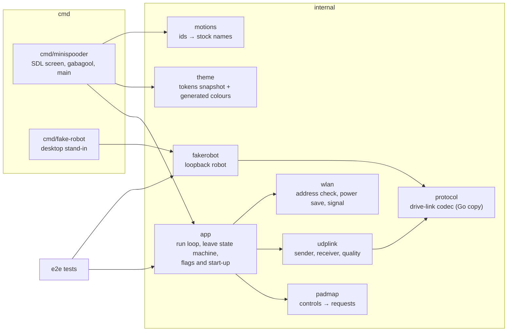
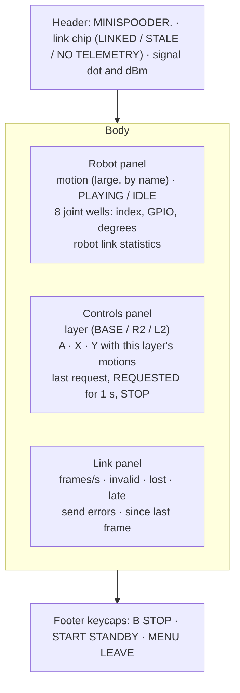

# Design

## Context

See proposal.md for the motivation. No pak source exists yet. Three facts shape the approach:

- **The robot side is someone else's change.** `drive-link` owns the access point, the UDP port, the framing, the command and telemetry frames, the one-remote rule and link loss; `motion-playback` owns the motion ids, names and what stop does. The pak only consumes them. What this design needs from them is listed under Cross-change assumptions, and each is a named constant or a generated table in the pak so that a change on the robot side is a one-place edit.
- **Spooder.pak is a working reference** (`../spooder/desktop/handheld`, its change `add-handheld-controller`): gabagool on SDL2, a nested Go module, a patched power-button hook, a launch script that restores WiFi power saving, an arm64 build under rootless Podman with a glibc check, an address check with one lease renewal, a two-frame leave confirmation and per-sequence link quality. This repository copies the parts it needs; it does not import from, build against or edit `../spooder`.
- **The stock remote has no hold semantics.** The stock controller page (`baseline/portal-strings.txt`) sends one `controller?pm=<n>` request per button click and nothing on release. The pak keeps that: one request per press.

## Goals / Non-Goals

**Goals:** the smallest pak that plays every stock motion from the TrimUI, stops the robot on demand and before it leaves, shows what the robot reports and how healthy the link is, and is tested without the robot (host tests plus an end-to-end run against a fake robot), with a reproducible device build.

**Non-Goals:**
- Direct servo control, calibration, the zero check page and the motion editor from the pak: they stay on the robot's web portal (`web-portal`).
- The stock `pms` variant of `/controller` (purpose unknown, `baseline/README.md`).
- Continuous driving while a control is held, stick driving, or any motion not in the stock set.
- Joining WiFi from inside the pak (NextUI's WiFi settings do it).
- Authenticated command frames (see D9).

## Decisions

### D1. A Go module at `handheld/`

The pak is the module `github.com/blackfyre/mini-spooder/handheld` at the repository root's `handheld/`, as the agreed layout has it. It is standalone (no `replace` to any other module of this repository: there is no other Go module here). Layout:

Everything below `cmd/minispooder` is hardware-free and SDL-free, so `go test` covers it without a display. Alternatives: putting the pak under a `desktop/` directory as Spooder does (rejected: this repository has no desktop calibrator, and the agreed layout names `handheld/`).

### D2. The control mapping (`internal/padmap`)

A pure function of the previous and current pad state (buttons, trigger axes) to zero or more events: `Motion{id}` or `Stop`. Edge-triggered: an event only on a press edge; a hold or a release gives none. The layer is read at the press edge: R2 held (axis beyond half travel) gives the Dance layer, L2 the Lie/Sleep/Zero layer, both or neither as in the spec. The mapping table is one Go table, the same one the screen uses for its labels, so the labels cannot drift from what is sent.

The app turns events into the desired state: `Motion{id}` sets `motion = id` and increments the 8-bit motion request counter; `Stop` increments the stop request counter. The command frame always carries both, every period, as the spooder rule requires (complete desired state, not deltas): a lost frame costs nothing, since the next one carries the same counters.

**Presses only on a live link.** Under A3 the robot takes the first frame of a session as its counter baseline. A press made before the robot has seen the pak's frames (at start, after a resume, after the robot ended the session for link loss) would advance a counter that the robot then takes as its baseline, and the motion would never play, nor any later frame repair it. So the app takes a press only while the link is live: at least two telemetry frames accepted since the link last (re)started, the newest no more than 250 ms old. Telemetry goes only to the remote whose session is live (A4, A6), so receiving it shows that the robot has already baselined this pak's counters. A press otherwise is shown as `NOT SENT` and dropped, never queued (a queued Forward played seconds later would be a surprise). The residual race, the robot ending the session within the 250 ms window, loses at most one press, which the screen shows by not reporting the motion as playing. The leave's stop is sent regardless, since the robot's link loss stops it anyway if the session has gone. Alternative: a session echo of the robot's counters in telemetry (more exact, but a `drive-link` field this change cannot add).

Why this layout of controls: locomotion on the D-pad and shoulders (as a TrimUI user expects movement there), the three stock "Say Hi / Fighting / Push up" tiles on the face buttons, the six remaining motions behind the two analogue triggers, which are hard to press by accident, Zero position (pm 100, a pose for the zero check) behind L2 so that it is not one slip away, and B as stop in every layer. Alternatives: an on-screen grid with a cursor (two presses per motion and the D-pad lost for walking), hold-to-walk (a new behaviour the stock firmware does not have).

### D3. The drive-link codec in Go (`internal/protocol`)

A Go copy of the framing that `drive-link` specifies (start marker, version, type, sequence, length, CRC; a decoder that discards and resynchronises and counts discards), written from the spec and checked against the robot's codec by golden frames (D11). Copied, not shared: the robot's codec is C++ in `core/`, and a cgo binding would drag the native toolchain into the pak's cross-build. Spooder's Go protocol package is a model for the code structure only; its frame types and fields are not this robot's.

### D4. The UDP link (`internal/udplink`)

- One socket per run: `net.DialUDP` to the robot's address, created once after the address check (D7) and kept across suspend and resume. A connected socket makes the kernel drop datagrams from any other address and port; the receiver checks the source again for the desktop build's sake.
- The sender ticks at the drive link's command period and sends `protocol.EncodeCommand(state)`; the frame sequence number advances by one per frame. A send error is counted and the next tick tries again.
- The receiver reads into a buffer one byte larger than the largest telemetry frame and decodes each datagram with a fresh decoder; it accepts it only when exactly one telemetry frame spans the whole datagram. Anything else from the robot's address is counted invalid.
- Quality: `d = uint8(seq - newest)`; `d == 1` is in order, `2..127` counts `d - 1` lost, `0` or `128..255` counts late and the frame is not taken. Rebaseline (take any sequence number as newest, count nothing) on the first frame of a run, the first after a resume and the first after 500 ms without a frame taken as newest. The last clause is measured from the newest frame taken, not from any valid frame, so a robot restart whose sequence starts again lower (all its frames late) recovers within 500 ms instead of stalling. Staleness and the link-live gate (D2) use the same clock. Frames per second over the last whole second. The 8-bit width is an assumption (A3); the comparison is written over the sequence type's width so a 16-bit sequence only changes the type.

### D5. Leaving, and the power button through a patched gabagool

A hardware-free state machine in `internal/app`, with an injected clock:

```mermaid
stateDiagram-v2
  [*] --> Driving
  Driving --> Leaving: Menu / Power short / Power long<br/>(stop counter +1, remember newest seq)
  Leaving --> Leaving: telemetry newer than remembered seq<br/>idle → count+1; motion → count=0
  Leaving --> Done: count == 2, or 3 s since the press
  Leaving --> Leaving: further presses ignored, pad treated as neutral
  Done --> [*]: Menu → exit
  Done --> Suspended: Power short → restore power save, run suspend
  Done --> [*]: Power long → restore power save, power off
  Suspended --> Driving: resume → power save off, rebaseline,<br/>no new motion request
```

Two frames in a row, each newer than anything taken before the press, because a telemetry frame carries no echo of the command that caused it: one delayed frame could otherwise report an idle that predates the stop. A frame reporting a motion between them restarts the count; a late frame never counts. The residual case (two delayed idle frames and every fresher one lost) is accepted: confirmation only shortens the wait, and if the pak stops sending, `drive-link`'s link loss puts the robot in its safe state anyway (A5). 3 s is a named constant: stop has to bring the robot back to standby from mid-motion; if `motion-playback`'s stop is found to take longer, the constant moves, not the design.

gabagool's NextUI mode runs the suspend script or powers off on the Power button itself. As in Spooder (`add-handheld-controller` D5), a small patch adds `Options.PowerButtonHook func(long bool)`; when set, gabagool calls it instead of acting. The patch is copied into `handheld/third_party/gabagool-power-hook.patch`, against gabagool v2.26.6; `mise run handheld-fork` downloads that version with `go mod download` (checksum-verified), copies it to `build/handheld/gabagool`, checks and applies the patch, and `handheld/go.mod` replaces gabagool with that directory. Alternatives: no Power handling (a Power press would suspend with the robot still playing a motion until link loss); reading `/dev/input` directly (loses gabagool's NextUI integration).

### D6. Power saving and `launch.sh`

`launch.sh` (copied from Spooder's and renamed throughout) reads `iw dev wlan0 get power_save`, traps EXIT, INT, TERM and HUP before anything changes state, runs the binary with `--device` in its own process group, and on the way out stops that group and restores the setting. The binary does the same itself (read, set off, restore on exit and on SIGINT/SIGTERM, restore before suspend and power-off, set off after resume), so a binary run by hand is also clean; restoring twice is harmless. `LD_LIBRARY_PATH=/usr/trimui/lib:/usr/lib:$PAK/lib`, so the device's libraries win and the pak's fill the gaps. The log goes to `$LOGS_PATH/MiniSpooder.txt` when NextUI sets `LOGS_PATH`. Power saving off is kept because the WiFi chip's power saving delays received frames by its beacon interval, which shows as late and bunched telemetry and delayed stop requests.

### D7. Joining and the address check (`internal/wlan`)

With `--device`: read `wlan0`'s IPv4 addresses; one in the robot's subnet passes. Otherwise run `udhcpc -i wlan0 -n -q -t 5` once and read again. Still none: a gabagool message names the robot's network and password (A1) to join in NextUI's WiFi settings and the current network from `iw dev wlan0 link`, with retry and quit. All commands go through an injectable runner, so host tests cover each branch. The signal level is the `level` column of `/proc/net/wireless` where present, else the `signal:` line of `iw dev wlan0 link` (the TrimUI's driver has no `/proc/net/wireless`, as found for Spooder), sampled every second in the background with a 500 ms bound on `iw`, and unknown when neither gives a value.

### D8. The screen (`cmd/minispooder`)

One SDL screen on gabagool's renderer, 1280×720, redrawn every 50 ms, laid out as:

The joint wells show index and GPIO, not leg names: which servo sits on which leg is not confirmed (`baseline/README.md`). The leave wait and the join instructions use gabagool's message screens with the same colours. A screen model (the strings and states each panel shows) is computed in `internal/app` from the app state, so its content is host-tested; `cmd/minispooder` only draws it.

Colours: `handheld/internal/theme/tokens.json` is a committed snapshot of the Blackfyre `project/tokens.json`; a `go generate` step writes `theme_gen.go` with the tokens the screen uses (`bf-ink`, `bf-ink-raised`, `bf-ink-code`, `bf-ink-card-hover`, `bf-ink-chip`, `bf-ink-deep`, `bf-surface`, `bf-ink-subtle`, `bf-accent`, `bf-accent-on-dark`, `bf-on-accent`, `bf-ok`, `bf-warn`), and a test regenerates it in memory and compares. Refreshing the snapshot is a manual step with the design system's read path documented in the generator. Fonts: Archivo SemiBold and JetBrains Mono embedded, with their OFL licences in the pak. Alternative: hand-copied constants as Spooder has (rejected by the project's rule to take exact values from `tokens.json`).

### D9. Security

The UDP socket is an outside input: it is connected (D4); the receiver takes only exactly one valid telemetry frame per datagram; frames change only the screen and the leave confirmation, never what is sent. Authenticated command frames are not added: the robot's access point is WPA2 with a fixed, publicly known stock password (A1) and `drive-link` takes one remote at a time, so a station on the network could send its own frames once the pak's session lapses. That is a property of `drive-link`, not something the pak can fix alone; it is recorded as an open question for `drive-link`.

### D10. The fake robot (`internal/fakerobot`, `cmd/fake-robot`)

A Go program, not a host build of the firmware: it uses the pak's own Go codec (checked against the robot's by D11), so it needs no C++ toolchain, and the end-to-end tests stay `go test`. Its behaviour is the drive link's contract towards one remote (spec: Fake robot) with fixed motion durations (a table in the fake robot, not the stock keyframe data), fixed joint angles from the stock page defaults (70, 90, 90, 110, 110, 90, 90, 70), and test hooks to drop or corrupt telemetry. `cmd/fake-robot --listen 127.0.0.1:<port>` runs it for the desktop build. Alternative: a host build of `core/`'s motion player and codec as a virtual robot, as Spooder does (stronger, but it couples this change to the internals of `motion-playback` and `drive-link`; a follow-up once they exist).

### D11. Tests and golden frames

- **Golden frames:** this change adds a Unity test in the PlatformIO native env (`test/test_drive_link_golden/`) that encodes a fixed set of command and telemetry cases with `core/`'s codec and compares them with the committed `test/golden/drive-link-frames.txt`; an environment variable makes it rewrite the file. The pak's `internal/protocol` tests read the same file (encode commands, decode telemetry, compare fields and bytes). If `drive-link` already ships golden frames, task 2.1 uses that file instead and adds no test (A7).
- **Host tests (`mise run handheld-test`):** gofmt, go vet, staticcheck, go test: the mapping table and edge rules; the sender's rate, sequence and single source port on loopback; the receiver's validation and the quality counters; the leave state machine with a fake clock; the address check and power-save handling with a fake runner; the screen model; the theme comparison; `launch.sh` under `sh` with stub `iw` and binary on `PATH`; `check-glibc.sh` with a stub `readelf` (AArch64 + 2.31 passes, AArch64 + 2.34 fails, x86-64 fails).
- **End to end (`mise run handheld-e2e`):** `app.ParseFlags` and `app.Start` with `--addr` set to an in-process fake robot on a free loopback port, scripted pad input: a press plays a motion, B stops it, Menu exits only after idle is confirmed, a second sender is ignored, corrupted telemetry is counted invalid.
- **On the device:** install, join, every control, leave by Menu and by Power, `ldd` showing no missing library. These need the robot running the new firmware.

### D12. Build and packaging

- `handheld/build/Containerfile`: `debian:bullseye-slim` pinned by digest for `linux/arm64`, gcc, pkg-config and the SDL2, SDL2_ttf, SDL2_image and SDL2_gfx development packages, and Go downloaded from go.dev with its SHA-256 checked, at the version `mise.toml` pins (a script checks they agree). Bullseye's glibc 2.31 is not newer than the TrimUI's.
- `mise run handheld-build-device`: `podman build --platform linux/arm64` (rootless, qemu-user-static), then `go build -trimpath` inside it with the repository and the patched gabagool mounted, to `build/handheld/arm64/minispooder`, then `check-glibc.sh`.
- `mise run handheld-package`: stages `MiniSpooder.pak/` (`launch.sh`, `minispooder`, `lib/libSDL2_gfx-1.0.so.0`) and zips it to `build/handheld/MiniSpooder.pak.zip`. Gabagool-based paks ship only `libSDL2_gfx`; the on-device `ldd` check confirms nothing else is missing.
- `mise run handheld-build`: the amd64 desktop binary with the host's SDL2 (`check-deps.sh` names missing Fedora or Debian packages), plus `build/handheld/amd64/fake-robot`.

## Cross-change assumptions

Each is a fact another change owns. The pak keeps each in one constant or table; if the owning change settles a different value, that place changes and the specs here stay as written.

- **A1 (`drive-link`): access point.** SSID `Spider Robot`, password `12345678` (the stock values in `baseline/README.md`), robot address 192.168.4.1 in 192.168.4.0/24 (the ESP8266 soft-AP default), one UDP port for commands and telemetry. The port number is `drive-link`'s; until it is settled the pak's constant is a placeholder.
- **A2 (`drive-link`): framing.** Spooder's link framing (start marker, version, type, sequence, length, CRC), one frame per datagram in both directions.
- **A3 (`drive-link`): command frame.** Fields: requested motion id (0 = none), an 8-bit motion request counter, an 8-bit stop request counter; the robot plays the requested motion when the motion counter advances and stops when the stop counter advances; the first frame of a session sets the robot's baseline of both counters without acting on them; the frame sequence number is 8-bit and wraps.
- **A4 (`drive-link`): telemetry frame.** Fields: its own sequence number, the current motion id (0 = none playing), the eight joint angles in whole degrees, and the robot's link statistics (frames accepted, frames discarded, sessions); sent at a fixed rate (assumed 10 Hz) to the current remote only.
- **A5 (`drive-link`): timing and link loss.** A fixed command period (assumed 20 ms) and a link-loss time (assumed below 500 ms) after which the robot stops the motion and goes to its safe state, ends the session and accepts a new remote.
- **A6 (`drive-link`): one remote.** While a session is live the robot ignores and does not answer other senders.
- **A7 (`drive-link`): golden frames.** `drive-link` does not ship golden frame vectors; if it does, the pak reads its file instead of adding `test/test_drive_link_golden/`.
- **A8 (`motion-playback`): motions.** Ids 1–15 and 100 with the stock names of `baseline/README.md`; stop ends the current motion and returns to standby, taking well under 3 s; a request while a motion plays is the robot's to handle (replace or ignore), and the pak only shows what telemetry reports.
- **A9 (`firmware-foundation`, `servo-output`): joint angles** are reported per servo index 0–7, so the pak labels them by index and GPIO (14, 12, 13, 15, 16, 5, 4, 2).

## Risks / Trade-offs

- [The drive-link's frames differ from A3/A4] → the codec, the golden cases and the screen model change in one place each; the specs here speak of "the requested motion", "the counters" and "the current motion", not of byte offsets.
- [Edge-triggered locomotion feels slow if one stock Forward request is only a step or two] → that is the stock behaviour; a hold-to-repeat mode would be a new feature and is out of scope (Open questions).
- [The device's glibc or SDL2 libraries differ from the assumption] → the glibc check and the on-device `ldd` check catch it before use.
- [The fake robot passes while the real robot behaves differently] → the golden frames keep the bytes honest; behaviour is confirmed by the on-device check against the robot.
- [The gabagool patch stops applying on a gabagool update] → the version is pinned and the fork script runs `git apply --check` first, failing the build loudly.
- [Zero position (100) played by accident moves every servo to its zero] → it is behind L2, and B stops it.

## Migration Plan

Nothing to migrate: the pak is a new folder on the SD card. Install by unzipping `MiniSpooder.pak.zip` into `Tools/tg5040/`; remove by deleting the folder. The stock firmware has no drive link, so the pak only works with this project's firmware once `drive-link` is implemented; with the stock firmware the pak shows no telemetry and the robot ignores its datagrams.

## Open Questions

- **Calibration in the stock firmware.** The user recalls that the original firmware had no calibration. The stock image does contain a "Servo calibration" page (`/setting`, SET per servo through `/save?key=<servo>&value=<v>`, RESET ALL as `key=100`), but its EEPROM emulation sector (0x3FB000) is erased, so whether stock ever persisted calibration, and where, is unverified. This does not affect the pak (calibration is not on it); it matters to `servo-calibration` and `web-portal`.
- **Hold-to-repeat.** Whether the robot should keep walking while a D-pad direction is held is a product decision outside the stock scope; the mapping's edge rule would change, not the frames.
- **Drive-link authentication.** With the stock password public, whether `drive-link` should authenticate command frames (D9) is that change's question.
- **Stop duration.** The 3 s leave bound assumes stop reaches standby well within it (A8); it is confirmed on the robot.
