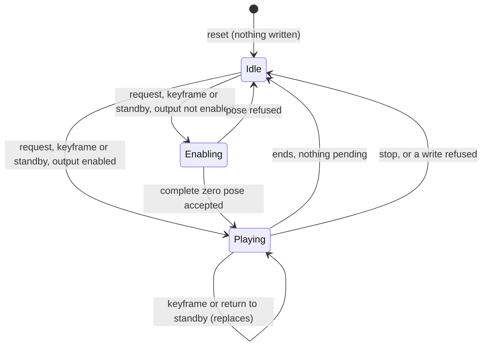
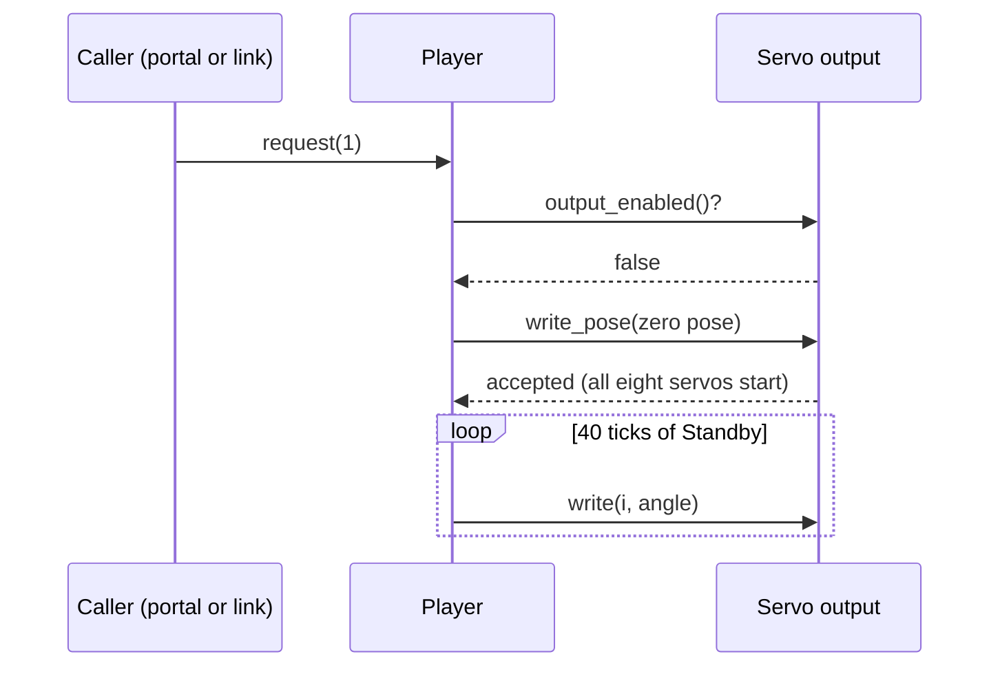

# Design

## Context

See proposal.md for the motivation. The requirements are in `specs/motion-playback/spec.md`. This section records what the stock image shows, because the design follows from it.

**Evidence from the stock image.** The disassembly of `baseline/original-flash-4MB.bin` is recorded in `docs/lafvin-comparison.md`, and every keyframe in `docs/lafvin-motions.md`. Flash offset `x` maps to the instruction-ROM address `0x40200000 + x`.

| Finding | Where | Status |
|---|---|---|
| Keyframes are rows of nine little-endian 32-bit integers: angles for servos 0–7, then a duration in ms | tables 0x3FC9C–0x40DE7; centre pose 0x40DE8; zero pose 0x40E0C | Verified (lafvin-comparison, lafvin-motions) |
| The motion dispatch loads one table address and one step-count address per `pm` value 1–15 | pointer pairs at flash 0x500C–0x5083 | Verified; the table-to-`pm` mapping is inferred with high confidence |
| Step counts, as 32-bit integers from `pm` 15 down to `pm` 1: 10, 9, 10, 2, 11, 11, 7, 1, 8, 8, 11, 11, 11, 11, 2 | flash 0x4AE84 (RAM 0x3FFE84CC) | Found by scan, consistent with the table boundaries |
| `pm` 9 runs the Say Hi table and then the Standby table; `pm` 12 runs the Standby table and then the Sleep table | flash 0x5169–0x517A, 0x5191–0x51A2 | Verified |
| `pm` 99 and `pm` 100 write the centre pose and the zero pose to servos 0–7 with `delay(10)` after each, then `delay(300)`; on stock both poses are 135, 45, 135, 45, 45, 135, 45, 135 | flash 0x1380, 0x13D0; dispatch 0x5106–0x5115, 0x51C4–0x51D3 | Verified |
| The stock setup runs the zero routine at boot | ROM 0x40201FD8 | Found in the disassembly; not reproduced (D7) |
| The keyframe loop: `floor(T / 10)` steps from index 0; each step writes an interpolated angle only to servos whose angle changes, then `delay(10)`; the keyframe angle itself is never written, but the cached pose becomes the keyframe | flash 0x1420–0x14FE | Verified; the shortfall is a stock defect, not reproduced (D3) |
| The keyframe loop does not call the web server, so stock motions block every request until they end | flash 0x1420–0x14FE | Verified |
| `/online` reads `m0`–`m7` and `t1` and calls the same runner with one keyframe; the motion editor uses it | flash 0x3920–0x3B03 | Verified |
| The servo write adds a signed EEPROM byte at the servo's index, then maps 1–180° to 400–2400 µs | flash 0x1304–0x132E | Verified |
| Unknown `pm` values are accepted and ignored; `pms` is never handled | flash 0x3814–0x38F4, dispatch 0x5084–0x51E3 | Verified |

**The vendor source is not the stock data.** `docs/lafvin-motions.md` compares every table with `references/lafvin/extracted/0.SpiderBot/actionarray.h`: the timing differs in most tables, the standby poses differ, and Say Hi, Push up and Dance 2 are different motions. The player uses the stock tables.

**Motion durations implied by the stock tables** (10 ms × the sum of `floor(T / 10)`):

| Id | Motion | Ticks | Duration |
|---|---|---|---|
| 1 | Standby | 40 | 0.40 s |
| 2–5 | Forward, Backward, Left shift, Right shift | 165 | 1.65 s |
| 6, 7 | Turn left, Turn right | 120 | 1.20 s |
| 8 | Lie | 50 | 0.50 s |
| 9 | Say Hi (with Standby) | 320 | 3.20 s |
| 10 | Fighting | 407 | 4.07 s |
| 11 | Push up | 718 | 7.18 s |
| 12 | Sleep (with Standby) | 114 | 1.14 s |
| 13 | Dance 1 | 300 | 3.00 s |
| 14 | Dance 2 | 270 | 2.70 s |
| 15 | Dance 3 | 300 | 3.00 s |
| 99, 100 | Centre, Zero position | 38 | 0.38 s |

Stock takes slightly longer than these figures, because each servo write adds to the 10 ms delay. The first motion after a reset or after the safe state takes one tick more (D11).

## Goals / Non-Goals

**Goals:**
- Play every stock motion with the stock keyframes, compositions and tick counts, ending each keyframe exactly on its angles.
- Keep the firmware's main loop free while a motion plays, so the drive link's failsafe and the portal stay responsive and a motion can be stopped.
- Move nothing until a valid command, and give way to servo output's safe state.
- Keep the player hardware-free in `core/`, so the host tests can check it to the exact tick and angle.

**Non-Goals:**
- Routes, pages and the `pm`, `servo` and `/online` parameters: `web-portal`. The command and telemetry frames, and when the link enters its safe state: `drive-link`.
- Pin mapping, pulse widths, boot-safe handling, limp, the safe-range clamp, the output-enable and safe-state gate and the mode state machine: `servo-output` (`firmware-foundation`). Offsets and their storage: `servo-calibration`.
- New motions, smoother gaits and speed control.

## Decisions

### D1. The motion data comes from the stock image, through a checked generator

`tools/extract_motions.py` (run with mise's Python, `python -I`) checks the image's SHA-256 against `baseline/README.md`, reads the step counts and the table rows at the offsets in the evidence table, and writes `core/motion/stock_motions.h`. The header is checked in and marked generated. `mise run extract-motions` regenerates it. `mise run check-motions` re-extracts into memory and fails, naming the motion and keyframe, when the header differs.

The offsets are fixed in the script with a comment citing the dispatch address that each comes from, not searched for, so a wrong guess cannot match silently. Sanity checks fail the script when an angle is outside 0–180, a duration is not positive, or the 15 tables (123 rows by the step counts) do not tile flash 0x3FC9C–0x40DE7 exactly; the centre pose row at 0x40DE8 and the zero pose row at 0x40E0C are read separately (their ninth integer, 200, is ignored, as stock ignores it).

- *Alternative: copy `actionarray.h` from the vendor source.* Rejected: its numbers differ from the stock image (see Context).
- *Alternative: type the tables in by hand from a hexdump.* Rejected: nothing would detect a typo.

### D2. Keyframe format in `core/`

```cpp
struct Keyframe { uint8_t angle[8]; uint16_t duration_ms; };   // angles in servo-index order
struct MotionTable { const Keyframe* frames; uint8_t count; };
struct Motion { uint8_t id; const char* name; uint8_t table_count; MotionTable tables[2];
                const uint8_t* direct_pose; };                  // set for 99 and 100 only
```

A motion is one or two tables played in sequence, which covers Say Hi (Say Hi, then Standby) and Sleep (Standby, then Sleep) without duplicating rows, or a direct pose (99, 100), which stock writes without interpolation, one servo per 10 ms, and then holds. One byte per angle is enough: the stock angles range from 30 to 170. The data is about 1.3 KB of plain `const` arrays. On the ESP8266 these sit in RAM, which costs less than adding a `PROGMEM` abstraction to hardware-free code. The catalogue (`motions()`, id and name) is exported for `web-portal` and `drive-link`.

### D3. Exact keyframe endpoints

Stock interpolates from tick index 0 and never writes the keyframe angle, so a servo can stop up to 3° short (after Standby from the zero pose, servo 0 is commanded to 71 and servo 1 to 88) while the cached pose records 70 and 90. That is a stock defect and is not reproduced. The player numbers ticks `1 … n` with `n = max(1, floor(T / 10))` and writes `A ± floor((i·|B − A| + floor(n/2)) / n)`, so tick `n` writes `B` exactly. The tick count per keyframe stays stock's (`floor(T / 10)`), so the motion durations and the sequence of keyframe angles are stock's; only the intermediate angles differ, by about one step, and the endpoints are exact. A keyframe shorter than 10 ms (possible only for a caller-supplied keyframe, D10) runs one tick that writes `B`. Servos whose angle does not change in a keyframe are not written, as in stock.

- *Alternative: keep the stock arithmetic and write `B` in an extra tick.* Rejected: it adds 10 ms per keyframe and changes every duration.

### D4. A non-blocking, tick-driven player



The firmware's loop calls `service(now_ms)` on every pass, after the drive link's receive and failsafe step. `service` runs at most one tick when one is due. After a tick due at `D` runs at `t`, the next tick is due at `D + 10` when `t < D + 10`, otherwise at `t + 10`: the schedule advances by the interval, so jitter under one tick does not accumulate, while a stall of a tick or more lengthens the motion by the stall and never produces a burst of catch-up writes. Requests (`request(id)`, `play_keyframe(...)`, `stop()`, `return_to_standby()`) only set state. All callers (the web server's handlers, the UDP link and the safe-state hook) run on the Arduino loop's single thread, so the player needs no locking.

The player writes through an interface to servo output: `write(servo_index, angle_deg) -> bool`, `write_pose(angles[8]) -> bool`, `output_enabled()` and `commanded_angle(servo_index)`. The firmware implements it with `servo-output`. The host tests implement it with a recording model that logs `(tick, servo, angle)`, keeps commanded angles and can be told to refuse writes.

- *Alternative: keep the stock blocking loop and call the web server from inside it, as the vendor's later version does.* Rejected: it nests request handling inside motion code, and a request handled there can start another motion re-entrantly.

### D5. One pending request; the latest request wins

Stock blocks during a motion, so HTTP requests that arrive during a motion are handled one by one afterwards. The new player keeps one pending slot, and the last request replaces any earlier one. Without this, a remote that sends its desired state every period would queue a long backlog of motions. Re-requesting the playing motion queues one more run of it, which is how a held "forward" can keep walking (the drive link decides when to re-request).

### D6. Stop, return to standby and one current pose

Both commands are new: stock has neither. Stop ends the motion before its next tick and holds the last angles written. Return to standby does the same and then plays motion 1. The player keeps no pose of its own: every keyframe and direct pose starts from servo output's commanded angles. A direct servo command from the portal, a stop part-way through a keyframe and an exact keyframe end therefore all leave the one pose that the next motion starts from, and the telemetry reports the same angles that the servos were commanded to.

### D7. Still at boot

Stock runs the zero routine in its setup. The new firmware does not move at boot: the player writes nothing until its first command. A reset during walking (for example a brown-out) then leaves the robot limp instead of jumping to the zero pose. The zero pose is still where a session starts (D11).

### D8. `pms`, unknown ids and `pm` 99

- `pms` is never handled by stock (Context), so there is nothing to play; `web-portal` decides how to answer it.
- Stock accepts and ignores an unknown `pm`. The player rejects it and changes nothing, which leaves the same robot behaviour; the HTTP answer is `web-portal`'s.
- `pm` 99 (Centre) is a catalogue entry with stock's centre pose, which equals the zero pose on stock. No stock page has a button for it.

### D9. On-robot verification through a demonstration build

A PlatformIO env, `motion-demo`, builds the normal firmware with `-DMOTION_DEMO`. The demo moves nothing until the line `go` arrives on the serial console (boot still, D7), so the robot can be lifted first. It then plays motions 1–15, 99 and 100 in turn, with a 2 s pause between them, and then runs two interruption scripts: stop Forward 500 ms after it starts, then return to standby 1 s into Dance 1, and finally one 500 ms keyframe. It logs one line per motion, `motion <id> start <ms> last_write <ms> end <ms> ticks <n> <complete|interrupted>`, one line per interruption command, `command <stop|standby> <ms>`, and one line for the keyframe, `keyframe start <ms> end <ms> ticks <n>`, at the console baud rate that `firmware-build` sets. `tools/check_motion_log.py` compares the logged ticks and durations with the generated tables. This gives a deterministic check of on-robot timing without adding a command console to the shipped firmware. The visual match with stock is judged from video of both firmwares (task 5.4).

### D10. Single keyframe for `/online`

`play_keyframe(angles[8], duration_ms)` takes angles 0–180° and a duration 0–60000 ms, and returns a 32-bit identifier, incremented per accepted keyframe and never 0 (0 means rejected). It replaces the current motion or keyframe and the pending request, as return to standby does, because the stock editor sends each keyframe to be played now. `keyframe_ended(id)` is true for every identifier except that of the keyframe now playing. That one rule covers a keyframe that finished, was stopped, was replaced, or was ended by a refused write, and an identifier that was never issued. A motion requested during a keyframe waits for it, as during a motion.

### D11. Output enable and the safe state

`servo-output` sends no pulse until it is given a complete pose and rejects a single-servo write before then; in its safe state it disables output and refuses writes. The player meets this with one handshake: when the first tick of a motion or keyframe is due and `output_enabled()` is false, that tick gives `write_pose(zero pose)`, and the motion starts from the zero pose at the next tick. The zero pose is stock's boot pose, so the first motion after a reset plays as on stock, from zero, one tick later than the stock timing table. After the safe state the physical pose is unknown, and the zero pose is the same known starting point. Any refused write ends the motion and discards the pending request, so the player never keeps retrying against the gate. The firmware also calls `stop()` when servo output enters its safe state, so a pending request cannot start in a later pass.



## Risks / Trade-offs

- **[A table boundary is misread.]** A misplaced boundary would shift keyframes between motions. → The generator fails unless the step counts tile the region exactly, the host tests pin every motion's keyframe count and the first and last keyframes, and the on-robot comparison checks each motion against stock.
- **[Servo output clamps the angles.]** If `servo-output`'s safe range is narrower than the stock tables (30–170°), Sleep and Say Hi would play differently. → This is a cross-change assumption, and task 5.3 checks the extremes on the robot with the legs off the ground.
- **[Loop stalls stretch motions.]** Wi-Fi or a slow HTTP response can delay ticks. → Stalls lengthen the motion and never compress it (as stock's `delay` does). The demo log measures the stretch, and task 5.3 requires the durations to be within 5% of the computed figures.
- **[Latest request wins, which differs from stock.]** Clicking several buttons during a motion in the portal plays only the last. → A deliberate deviation (D5). It only differs from stock when requests overlap a motion.
- **[Intermediate angles differ from stock by about one step.]** → The poses at keyframe ends and the tick counts are stock's; the video comparison (task 5.4) judges the visual match.
- **[The first motion starts with a jump to the zero pose.]** All eight servos start at once in the zero pose. → This is where stock's boot routine put them, and it happens only after a command, with the robot expected to be standing or lifted.
- **[RAM for the tables.]** About 1.3 KB of DRAM. → Acceptable against the ESP8266's roughly 80 KB. Revisit if `firmware-build` reports a RAM budget problem.

## Migration Plan

There is nothing to migrate. The on-robot checks need two writes to flash: the demo build (an upload) and the stock firmware (`mise run restore`) for the comparison. Both need the user's go-ahead. `mise run restore` is the rollback to stock at any point.

## Cross-change assumptions

- **servo-output** (`firmware-foundation`) accepts a write of one servo index 0–7 and an angle in whole degrees, and a complete pose of eight angles; reports whether output is enabled; reports each servo's last commanded angle before calibration (or none); refuses writes, reporting the refusal to the caller synchronously, while its safe state holds; rejects single-servo writes before the first complete pose; and maps angles to pulses as stock does (1–180° to 400–2400 µs). Its per-servo safe range includes the stock tables' angles (30–170° before calibration) for the servos that use them; if it does not, it clamps, and task 5.3 records the difference. It owns the output-enable and safe-state gate and the mode state machine, and the firmware calls the player's `stop()` on entering the safe state.
- **servo-calibration** (`firmware-foundation`) applies the per-servo trim inside servo output, so the player passes uncalibrated table angles and reports them.
- **firmware-build** (`firmware-foundation`) provides the PlatformIO project in `firmware/` with a non-blocking Arduino loop that services the drive link's receive and failsafe step before the player in each pass and can call `service(millis())`; a native env in which `mise run test` runs the Unity tests for `core/`; room for a further env (`motion-demo`); and a serial console at a fixed baud rate that `mise run monitor` reads. It includes a suspended-robot check that confirms each servo index's joint and direction, which task 5.1 requires before any motion runs on the robot.
- **web-portal** maps `/controller?pm=<n>` to `request(n)` (including the Standby button, `pm=1`, and 99), accepts that requests overlapping a motion follow D5 (latest request wins), plays `/online?m0..m7&t1` (used by the motion editor) through `play_keyframe` and waits with `keyframe_ended`, and stops the player before a direct servo command (`/controller?servo=`), which it sends to servo output. How it answers unknown ids and `pms` is its decision.
- **drive-link** maps its command frame to `request(id)`, `stop()` and `return_to_standby()`, triggers servo output's safe state on link loss, reads the player state report (kind, current motion, keyframe, pending motion, commanded angles) for its telemetry, and distinguishes a pending request from the current motion. Its link and failsafe tests with servos attached run before the motion checks (task 5.1).

## Open Questions

- **Calibration persistence (for `servo-calibration`).** The user recalls that the original firmware had no calibration. The disassembly shows that stock adds a signed EEPROM byte per servo index to every angle and that `/save` writes and commits it; the dumped sector is erased, so every trim reads −1° on stock. Whether that ever persisted on this robot is not observed. This change does not depend on the answer: the player hands uncalibrated angles to servo output in either case.
- **The zero pose as the enable pose.** D11 uses the zero pose because it is stock's boot pose. If the on-robot checks show that the jump into the zero pose from a resting robot is too violent, the enable pose is a decision for the user (for example Standby's first keyframe, all 90°).
