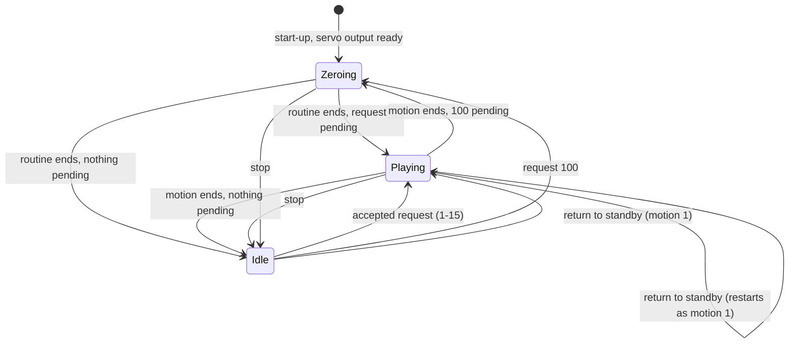

# Design

## Context

See proposal.md for the motivation. The requirements are in `specs/motion-playback/spec.md`. This section records what the stock image shows, because the design follows from it.

**Evidence from the stock image.** A read-only scan made while this change was written found the motion data and the motion code in `baseline/original-flash-4MB.bin`. The extraction task (tasks 1.1–1.3) has to confirm each finding. Flash offset `x` maps to the instruction-ROM address `0x40200000 + x`.

| Finding | Where | Status |
|---|---|---|
| Keyframes are rows of nine 32-bit integers: angles for servos 0–7, then a duration in ms | 0x3FC9C–0x40E2F | Found by scan |
| The motion dispatch loads one table address and one step-count address per `pm` value 1–15 | literal pool at ROM 0x4020500C | Found in the disassembly |
| Step counts, as 32-bit integers from `pm` 15 down to `pm` 1: 10, 9, 10, 2, 11, 11, 7, 1, 8, 8, 11, 11, 11, 11, 2 | flash 0x4AE84 (RAM 0x3FFE84CC) | Found by scan, consistent with the table boundaries |
| `pm` 9 runs the Say Hi table and then the Standby table; `pm` 12 runs the Standby table and then the Sleep table | dispatch at ROM 0x40205169, 0x40205191 | Found in the disassembly |
| `pm` 100 writes the zero pose (table at 0x40E0C) to servos 0–7 with `delay(10)` after each, then `delay(300)` | ROM 0x40201380, 0x402051CD | Found in the disassembly |
| The setup code runs the same zero routine at boot | ROM 0x40201FD8 | Found in the disassembly |
| The keyframe loop: `floor(T / 10)` steps; step `i` writes `A ± map(10·i, 0, T, 0, |B − A|)` only for servos with `A ≠ B`, then `delay(10)`; after the steps the start pose becomes the keyframe | ROM 0x40201420–0x402014FE | Found in the disassembly |
| `map` rounds: `(Δx·Δout + Δin / 2) / Δin + out_min` | ROM 0x40207944 | Found in the disassembly |
| The keyframe loop does not call the web server, so stock motions block every request until they end | ROM 0x40201420–0x402014FE | Found in the disassembly |
| The servo write adds a signed byte read from EEPROM at the servo's index before mapping 1–180° to 400–2400 µs | ROM 0x40201304 | Found in the disassembly |
| `pm` 99 runs the same routine as `pm` 100 on a second pose row (flash 0x40DE8) whose angles equal the zero pose, followed by `delay(300)`; no page calls it | dispatch at ROM 0x402051C4, routine at ROM 0x402013D0 | Found in the disassembly |
| The controller handler's argument names are `pm`, `servo`, `value`, `m0`–`m7` and `t1`; the string `pms` occurs only in the page JavaScript | strings at flash 0x4B060–0x4B0D0 | Found by scan |

**The vendor source is not the stock data.** `references/lafvin/extracted/0.SpiderBot/actionarray.h` has the same layout (eight angles in servo-index order, then ms) and the same composites, but different numbers. Its walking keyframes last 200 ms where stock's last 150 ms, its standby pose is 60, 90, 90, 120, 120, 90, 90, 60 where stock's is 70, 90, 90, 110, 110, 90, 90, 70, and its Say Hi and Dance 2 are different motions. The stock portal's default angles (70, 90, 90, 110, 110, 90, 90, 70) and its zero-check buttons (135, 45, 135, 45, 45, 135, 45, 135) agree with the image, not with the vendor source.

**Motion durations implied by the stock tables** (10 ms × the sum of `floor(T / 10)`), computed by a reference model of the stock loop:

| Id | Motion | Ticks | Duration |
|---|---|---|---|
| 1 | Standby | 40 | 0.40 s |
| 2–5 | Forward, Backward, Left shift, Right shift | 165 | 1.65 s |
| 6, 7 | Turn left, Turn right | 120 | 1.20 s |
| 8 | Lie | 50 | 0.50 s |
| 9 | Say Hi (with Standby) | 320 | 3.20 s |
| 10 | Fighting | 407 | 4.07 s |
| 11 | Push up | 718 | 7.18 s |
| 12 | Sleep (with Standby) | 114 | 1.14 s |
| 13 | Dance 1 | 300 | 3.00 s |
| 14 | Dance 2 | 270 | 2.70 s |
| 15 | Dance 3 | 300 | 3.00 s |
| 100 | Zero position | 38 | 0.38 s |

Stock takes slightly longer than these figures, because each servo write adds to the 10 ms delay.

## Goals / Non-Goals

**Goals:**
- Write, for every stock motion, the same sequence of angles to the same servos at the same tick as the stock firmware does.
- Keep the firmware's main loop free while a motion plays, so the portal and the drive link stay responsive and a motion can be stopped.
- Keep the player hardware-free in `core/`, so the host tests can check it to the exact tick and angle.

**Non-Goals:**
- Routes, pages and the `pm` parameter: `web-portal`. The command and telemetry frames, and what the link's safe state is: `drive-link`.
- Pin mapping, pulse widths, boot-safe handling and limp: `servo-output`. Offsets and their storage: `servo-calibration`.
- New motions, smoother gaits and speed control.

## Decisions

### D1. The motion data comes from the stock image, through a checked generator

`tools/extract_motions.py` (run with mise's Python, `python -I`) checks the image's SHA-256 against `baseline/README.md`, reads the step counts and the table rows at the offsets in the evidence table, and writes `core/motion/stock_motions.h`. The header is checked in and marked generated. `mise run extract-motions` regenerates it. `mise run check-motions` re-extracts into memory and fails, naming the motion and keyframe, when the header differs.

The offsets are fixed in the script with a comment citing the dispatch address that each comes from, not searched for, so a wrong guess cannot match silently. Sanity checks fail the script when an angle is outside 0–180, a duration is not positive, or the 15 tables (123 rows by the step counts) do not tile flash 0x3FC9C–0x40DE7 exactly; the `pm` 99 pose row at 0x40DE8 and the zero pose at 0x40E0C are checked separately.

- *Alternative: copy `actionarray.h` from the vendor source.* Rejected: its numbers differ from the stock image (see Context).
- *Alternative: type the tables in by hand from a hexdump.* Rejected: nothing would detect a typo.

### D2. Keyframe format in `core/`

```cpp
struct Keyframe { uint8_t angle[8]; uint16_t duration_ms; };   // angles in servo-index order
struct MotionTable { const Keyframe* frames; uint8_t count; };
struct Motion { uint8_t id; const char* name; uint8_t table_count; MotionTable tables[2]; };
```

A motion is one or two tables played in sequence, which covers Say Hi (Say Hi, then Standby) and Sleep (Standby, then Sleep) without duplicating rows. The zero position is not a table: it is a separate routine, because stock writes it without interpolation, one servo per 10 ms, and then pauses. One byte per angle is enough: the stock angles range from 30 to 170. The data is about 1.3 KB of plain `const` arrays. On the ESP8266 these sit in RAM, which costs less than adding a `PROGMEM` abstraction to hardware-free code.

### D3. Exact stock arithmetic, including the stock shortfall

The player uses the stock formula for each tick: it writes only servos whose start and keyframe angles differ, and it does not write the keyframe angle at the end of a keyframe. As a result, a servo that does not move in the following keyframe stays a few degrees short of the target. After Standby from the zero pose, for example, servo 0 rests at 71 instead of 70 and servo 1 at 88 instead of 90. Stock does the same.

- *Alternative: write the keyframe angles at the end of each keyframe.* Rejected for now. It changes the final poses by up to 3°, it is no longer stock behaviour, and the host tests could not compare the player with the reference model of the stock loop. It would be a new decision for the user.

### D4. A non-blocking, tick-driven player



The firmware's loop calls `service(now_ms)` on every pass. `service` runs at most one tick when one is due. After each tick the next tick is due 10 ms after the time at which that tick actually ran, so ticks are never closer than 10 ms, a late tick delays every later tick, and missed ticks are dropped rather than run back to back. Requests (`request(id)`, `stop()`, `return_to_standby()`) only set state. They take effect at the next `service` call that is due. All callers (the web server's handlers and the UDP link) run on the Arduino loop's single thread, so the player needs no locking.

The player writes through an interface with one method, `write(servo_index, angle_deg)`. The firmware implements it with `servo-output`. The host tests implement it with a recorder that logs `(tick, servo, angle)`.

- *Alternative: keep the stock blocking loop and call the web server from inside it, as the vendor's later version does.* Rejected: it nests request handling inside motion code, and a request handled there can start another motion re-entrantly.

### D5. One pending request; the latest request wins

Stock has one variable, `Servo_PROGRAM`, but it blocks during a motion, so HTTP requests that arrive during a motion are handled one by one afterwards. Each sets the variable and plays in turn. The new player keeps one pending slot, and the last request replaces any earlier one. Without this, a remote that sends its desired state every period would queue a long backlog of motions. Re-requesting the playing motion queues one more run of it, which is how a held "forward" can keep walking (the drive link decides when to re-request).

### D6. Stop and return to standby

Both commands are new: stock has neither. Stop ends the motion before its next tick and holds the last angles written. Return to standby does the same and then plays motion 1. After either command, the start pose for the next motion is the last angle written to each servo, not the keyframe angle the player was heading for. Without this, the next motion's first tick would jump to an angle that the servo never reached. After a motion that ends normally, the start pose is the keyframe angles, as in stock (D3).

### D7. Zero position at start-up

The firmware asks the player for the zero-position routine as soon as `servo-output` is ready, as the stock setup does. Until then, the player's start pose and reported angles are the zero pose.

### D8. `pms`, `pm` 99 and the `m0`–`m7` handler are not motions of this capability

- `pms`: the firmware has no `pms` argument name (Context), and no element on any stock page calls `controlPms`. `ESP8266WebServer` matches argument names exactly, so `/controller?pms=<n>` probably does nothing in stock. Hence no `pms` variant is specified. Task 5.3 confirms this on the stock firmware.
- `pm` 99 exists in the stock dispatch but no page reaches it, it moves to the same angles as `pm` 100, and the settled id set is 1–15 and 100. It is rejected like any unknown id.
- The `m0`–`m7` and `t1` arguments suggest a whole-pose command with a duration. No stock page sends them, and they belong to `web-portal`'s routes (see the Open Questions).

### D9. On-robot verification through a demonstration build

A PlatformIO env, `motion-demo`, builds the normal firmware with `-DMOTION_DEMO`. After the start-up zero routine, the demo plays motions 1–15 and 100 in turn, with a 2 s pause between them, and then runs two interruption scripts: stop Forward 500 ms after it starts, then return to standby 1 s into Dance 1. It logs at 115200 baud one line per motion, `motion <id> start <ms> last_write <ms> end <ms> ticks <n> <complete|interrupted>`, and one line per interruption command, `command <stop|standby> <ms>`. `tools/check_motion_log.py` compares the logged ticks and durations with the generated tables. This gives a deterministic check of on-robot timing without adding a command console to the shipped firmware. The visual match with stock is judged from video of both firmwares (task 5.2).

## Risks / Trade-offs

- **[A table boundary is misread.]** A misplaced boundary would shift keyframes between motions. → The generator fails unless the step counts tile the region exactly, the host tests pin every motion's keyframe count and the first and last keyframes, and the on-robot comparison checks each motion against stock.
- **[Servo output clamps the angles.]** If `servo-output` clamps to the portal's 45–135° slider range, Sleep (30°, 150°) and Say Hi (170°) would play wrong. → This is a cross-change assumption, and task 4.1 checks the extremes on the robot.
- **[Loop stalls stretch motions.]** Wi-Fi or a slow HTTP response can delay ticks. → Delays lengthen the motion and never compress it (as stock's `delay` does). The demo log measures the stretch, and task 5.1 requires the durations to be within 5% of the computed figures.
- **[Latest request wins, which differs from stock.]** Clicking several buttons during a motion in the portal plays only the last. → This is recorded as a deliberate deviation (D5). It only differs from stock when requests overlap a motion.
- **[RAM for the tables.]** About 1.3 KB of DRAM. → Acceptable against the ESP8266's roughly 80 KB. Revisit if `firmware-build` reports a RAM budget problem.

## Migration Plan

There is nothing to migrate. The on-robot checks need two writes to flash: the demo build (an upload) and the stock firmware (`mise run restore`) for the comparison. Both need the user's go-ahead. `mise run restore` is the rollback to stock at any point.

## Cross-change assumptions

- **servo-output** (`firmware-foundation`) accepts a write of one servo index 0–7 and an angle in whole degrees, at least 30–170 without clamping, and maps the angle to a pulse as stock does (1–180° to 400–2400 µs). It reports when the servos are ready after boot.
- **servo-calibration** (`firmware-foundation`) applies the per-servo offset inside servo output, so the player passes uncalibrated table angles and reports them.
- **firmware-build** (`firmware-foundation`) provides the PlatformIO project in `firmware/` with an Arduino loop that this change can call `service(millis())` from, a native env in which `mise run test` runs the Unity tests for `core/`, and room for a further env (`motion-demo`).
- **web-portal** sends direct servo moves to `servo-output` without going through the player, as stock does, and does not expect them to change the player's start pose (see the Open Questions). It maps `/controller?pm=<n>` to `request(n)`, including the Standby button (`pm=1`), and accepts that requests overlapping a motion follow D5 (latest request wins), not stock's one-by-one handling. It handles `pms` as it decides, with D8 as input.
- **drive-link** maps its command frame to `request(id)`, `stop()` and `return_to_standby()`, decides its safe state from those, and reads the player state report for its telemetry.

## Open Questions

- **Calibration in stock (for `servo-calibration`).** The user recalls that the original firmware had no calibration. The disassembly at ROM 0x40201304 suggests that stock adds a signed EEPROM byte at the servo's index to every angle. The EEPROM sector (0x3FB000) is erased, so on this robot that byte reads 0xFF, that is −1°. If so, the stock firmware plays every angle 1° low. Whether stock's `/save` writes these bytes, and whether it commits them to flash, is unverified. This change does not depend on the answer: the player hands uncalibrated angles to servo output in either case, and the 1° difference is below what the video comparison can show.
- **Direct servo moves and the start pose.** In the vendor source, a direct servo move (`/controller?servo=`) does not update the start pose that the next motion interpolates from, so the next motion's first tick jumps back. The spec follows that: the player's start pose depends only on what the player wrote. Whether stock behaves the same is not yet confirmed from the disassembly; task 1.3 checks it. If stock does update the start pose on a direct move, this change gains a requirement and an entry point through which `web-portal` reports a direct move, before it is archived.
- **The `m0`–`m7`/`t1` handler.** It exists in stock but no stock page uses it. Whether `web-portal` reproduces it is that change's question; it would need no motion from this capability. (`pm` 99 is not open: it is rejected, D8.)
