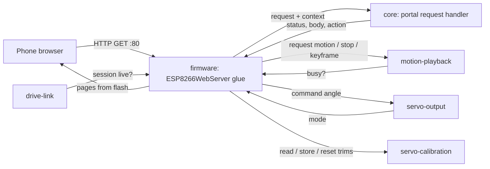
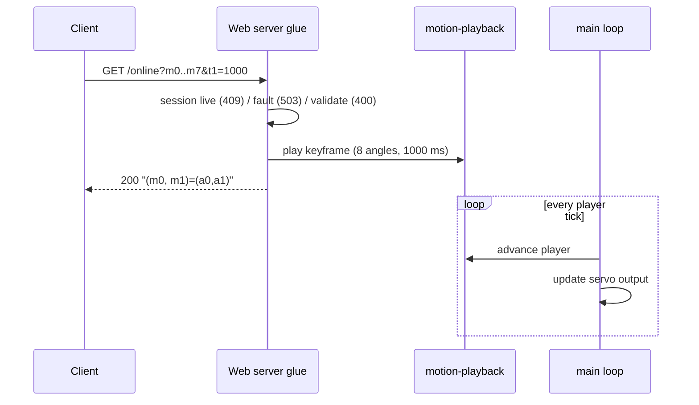
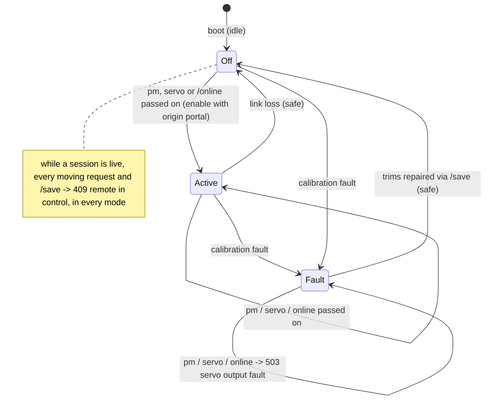

# Design

## Context

See proposal.md for the motivation. Requirements are in `specs/web-portal/spec.md`.

### What the stock portal does

`baseline/README.md` and `docs/lafvin-comparison.md` record the stock behaviour, corrected from a disassembly of the stock image. For this change the handlers were also read from the image: the application image was cut from `baseline/original-flash-4MB.bin` at 0x1000, its segments were listed with `esptool image-info`, and the IROM segment was disassembled with `xtensa-esp-elf-objdump`. Addresses below are code addresses (0x402xxxxx; flash offset = address − 0x40200000). Function identities, such as `String::toInt` or `EEPROM.commit`, are inferred from their call patterns, because the image has no symbols.

| Topic | Stock behaviour | Evidence |
|---|---|---|
| Server | `ESP8266WebServer` on port 80; seven `on()` calls, all `HTTP_GET`; no `onNotFound`, so unknown paths get the library's `404 Not found: <uri>` | static initialiser 0x40204E10 (port 80); route set-up 0x40201C60–0x40201D9E; string `Not found: ` in the image |
| Routes → handlers | `/controller` 0x40203814, `/save` 0x40203644, `/` 0x402049EC, `/editor` 0x4020454C, `/zero` 0x40203CAC, `/setting` 0x40203FEC, `/online` 0x40203920 | literal pool 0x40201C14–0x40201C54 |
| Network | Plain soft AP: `softAP("Spider Robot", "12345678", channel 1, visible, 4 stations)`, no explicit IP (presumably the SDK default 192.168.4.1, not measured). No DNS server and no mDNS (the image contains a `.local` string, but no mDNS call was traced in `setup()`): not a captive portal. `loop()` (0x40205084) calls only `handleClient()` and then the motion dispatch. | 0x40201F67–0x40201FC0; 0x40205084–0x402051E3; `docs/lafvin-comparison.md` |
| `/controller` | Reads `pm` and `servo`. A non-empty `pm` is converted with `toInt` and stored as the requested motion; `loop()` plays it once. Unknown values are accepted and ignored by the dispatch. A non-empty `servo` calls `servoWrite(servo, toInt(value))` at once, so a missing `value` means 0°. The reply is `200 text/html "(pm)=(" + pm + ")"`. `pms` is never read. | 0x40203814–0x402038F4; servo write 0x40201304 |
| Motion dispatch | Blocking switch on pm 1–15, 99 (Centre) and 100 (Zero position). On stock, 99 and 100 write the same pose. Other values do nothing. HTTP is not served while a motion plays, so a motion can't be interrupted. | 0x40205093–0x402051D9 |
| Servo write | angle + `(int8)EEPROM[i]`, mapped from 1–180 to 400–2400 µs | 0x40201304–0x40201364 |
| `/save` | Reads `key` and `value`. Detaches all eight servos and waits 50 ms. `key == 100` writes trim 0 for servos 0–7; otherwise writes `(int8)value` to `EEPROM[key & 0xFF]` when value is within −124…124, with no bound on the key. Then `EEPROM.commit()`, reattach on a different pin order from startup (a stock defect), 10 ms. Reply `200 text/html "(key, value)=(k,v)"`. | 0x40203644–0x402037FB; EEPROM write+commit 0x40201500 |
| `/setting` | Page built in RAM by `String` concatenation; each input's `value` is the signed stored trim; erased bytes read as −1 | 0x40203FEC; eight calls of the read helper 0x40201534 |
| `/online` | Reads `m0`…`m7` and `t1`; plays one keyframe (eight angles over `t1` ms) through the keyframe runner from the current pose, inside the handler; then replies `200 text/html "(m0, m1)=(" + m0 + "," + m1 + ")"` | 0x40203920–0x40203B03; runner 0x40201420 |
| `/` | Title `科睿 小蜘蛛` (vendor brand); footer `
` holds the global `String` `My Store: python.aliexpress.com`; `controlPms` defined, never called | 0x402049EC–0x40204CDD; global at 0x3FFF0778 |
| Page labels | The pages label servos 0–7 as D14, D12, D13, D15, D16, D05, D04, D02. Stock attaches them at startup to GPIO 15, 13, 12, 14, 2, 4, 5, 16. The labels are the vendor source's order, not the hardware. | `baseline/README.md` servo map |

The pages themselves are in `baseline/portal-strings.txt`: layout, labels, default angles, slider directions and request URLs. The order of the Controller page's rows (three buttons per row) is inferred from the order of the strings and the `width=33%` cells.

### Constraints

- The firmware also services the drive link (UDP), its failsafe, the motion player and the servo output in one Arduino `loop()`. No portal handler may block or wait for a motion.
- The ESP8266 has about 40–50 KB of free heap under the Arduino core. The stock approach, a whole page concatenated into a `String`, is the main heap risk.
- The phone has no internet on the robot's network. Pages must be self-contained.
- Design tokens must come from `tokens.json`, never be copied by hand (CLAUDE.md).

## Goals / Non-Goals

**Goals:**
- Stock routes, parameters and 200 response bodies, so that an existing stock client keeps working.
- A request handler that can be tested on the host, separated from the Arduino web server.
- Pages generated from sources and the vendored tokens, checked mechanically.

**Non-Goals:**
- Captive-portal DNS, mDNS, HTTPS, authentication, translations or a dark theme. None of these is in the stock image or the settled scope.
- Motion data, the playback rules, the servo maths, the safe range, the safe state, calibration storage and the access point. Other changes own them (see Cross-change assumptions).
- A JSON API, a route that stock does not have, or a page control that stock does not have (such as an editor button that sends `/online`).

## Decisions

### 1. A hardware-free request handler in `core/`, with a thin web-server layer in `firmware/`

`core/` holds a pure function. It takes a request (method, path and arguments as strings) and a read-only context: whether a drive-link session is live (drive-link's `live()`), servo-output's mode (`idle`, `active`, `safe`, `fault`), is a motion or keyframe playing or pending, which motion ids exist, and the trim range. It returns a result: the status, content type and body, plus at most one action (request motion n; stop and move servo i to a; store a trim; reset all trims; play a keyframe). For a keyframe, the glue reports motion-playback's rejection back as 400; for a direct servo command, it reports servo-output's rejection as 503 `servo output off`. `firmware/` maps the `ESP8266WebServer` callbacks onto it and carries out the action through the other capabilities' interfaces.

- *Why:* every rule in the spec (validation, the order of the lock's 409, the 503, the `motion playing` 409 and the 400 checks, response bodies, ignored ids, `pms`, 404) can then be tested with Unity in the native environment, as spooder tests its link code.
- *Alternative:* logic inside the Arduino handlers, tested only on the robot. This was rejected: none of it could be tested on the host.

### 2. Pages generated from sources and vendored tokens

The page sources live in `firmware/portal/pages/` (one HTML file per page, plus a shared stylesheet and script fragment). They use CSS custom properties named after the tokens (`var(--bf-paper)`). A generator, `tools/portal/gen_pages.py`, writes the `:root` block from `firmware/portal/tokens/tokens.json` (the Paper values) and inlines the shared fragments. It also fills the servo labels (`S<i> · GPIO<g>`) from one table of GPIO numbers, `firmware/portal/servo_labels.json`, so that the labels are not typed into four pages by hand. It emits `portal_pages.h` into the build directory: one `PROGMEM` string per page. A PlatformIO `pre:` extra script runs the generator on every build. The vendored `tokens.json` records its source (artifact URL, version `1794044556-c45e`, SHA-256 `25da75f563fb81140601fa92a83dde5ec8449bfdc84a38e2608f50016e35fb73`) in a `SOURCE.md` beside it.

`mise run portal-check` checks the generated pages. Every `--bf-*` value equals its token. Every `var(--bf-*)` used is defined. There is no external reference (`http:`, `https:`, `//`, `@import`, `src=`/`href=` to another file). Every page has the viewport meta. Each page is within a size budget of 16 KB. The stock control mapping is checked against a table in the check script: which button sends which `pm`, `servo` and `value`, the defaults, the slider directions, the label order, and that no page sends `pms` or `/online`. To make this check mechanical, controls carry their request as `data-pm`, `data-servo` and `data-value` attributes, and one shared click handler sends them. The check also compares `servo_labels.json` with servo-output's index-to-GPIO table in the firmware source, so that a pin-map change that is not reflected in the labels fails the build gate.

- *Alternative:* copy the spooder portal's CSS. This was rejected: its values are copied by hand, which CLAUDE.md forbids.
- *Alternative:* fetch the tokens at build time from the artifact. This was rejected: the build would then need network access and an authenticated session.

### 3. Pages streamed from flash; `/setting` filled in at serve time

Static pages are sent from `PROGMEM` by the portal's sender (decision 10). The `/setting` page source has eight placeholders (`{{OFF0}}`…`{{OFF7}}`). The handler hands the sender the page as a list of flash parts with each placeholder replaced by the trim that servo-calibration reports, formatted into a few bytes of RAM. No page is assembled in RAM.

- *Alternative:* a static `/setting` page that fetches the trims with a script. This was rejected: it would need a new JSON route that stock does not have.

### 4. Validation at the trust boundary, without refusing what stock ignores

The stock handlers act on whatever arrives (a missing `value` moves a servo to 0°; `key=50` writes EEPROM byte 50). The handler accepts only complete, well-formed integers (optional sign, decimal digits, no other characters, within 32-bit range) within the ranges in the spec, and answers anything else with 400. Two stock behaviours are kept because they are harmless:

- An integer `pm` that is not a motion id (0, 16–98, 101 and above, or negative) gets the stock 200 echo and does nothing, as stock accepts and ignores it. Only a malformed `pm` gets 400.
- `/save?key=100` ignores its `value`, as stock does, and always replies `(key, value)=(100,0)`.

Valid requests keep their stock 200 bodies. For a stock client that sends valid requests, nothing differs, apart from the 409 and 503 refusals (decisions 6 and 7).

### 5. No handler waits; `/online` replies when the keyframe is accepted

`/controller?pm` hands the request to motion-playback and replies at once, as stock did. Stock then blocked the loop for the whole motion; here motion-playback advances in its periodic step, so the portal, the drive link and its failsafe keep running.

`/online` departs from stock's pacing. Stock played the keyframe inside the handler and replied after it. Here the handler validates, hands the keyframe to motion-playback and replies at once. The firmware's main loop advances the player and the servo output, so the portal adds no service path of its own and the keyframe reaches the servos as any motion does.

- *Why:* a handler that waits holds the web server (the Arduino web server serves one client at a time) for up to the keyframe's duration. Other clients could not load a page or send a command for that long, and every service step in the wait would have to repeat the main loop's order (failsafe, player, servo output) to be safe.
- *Cost:* a client that paced keyframes by the replies now receives them early. Under motion-playback's rule a keyframe accepted while another plays becomes the single pending request, replacing any earlier pending one, so a client that sends three keyframes in quick succession while nothing plays sees the first played (it starts at once), the second replaced while pending, and the third played after the first; while a motion plays, only the third plays after it. No stock page sends `/online` (`baseline/README.md`), so no known client is affected.
- *Alternative:* keep stock's reply-after-move pacing with a bounded wait that services the other tasks. Rejected for the reasons above.

`t1` is bounded at 0–60000 ms. Stock does not bound it. It is motion-playback's keyframe range, as are the angles 0–180; the portal checks them so that it can answer 400 without a call, and motion-playback defines what 0 ms does.

### 6. Portal lock while a remote's session is live; saves only while nothing plays

While drive-link reports a live session (the pak has control), the portal refuses every request that moves the robot or changes a trim, `/controller` with `pm` or `servo`, `/online` and `/save`, with 409 `remote in control`, in every output mode and before any other check. It never enables output then. Pages, `/controller?pms` and the trims shown on `/setting` stay available, so the phone can still read the robot's state. The lock is the user's decision: one controller at a time, and the pak, which carries the failsafe, wins. It ends with the session (a lapse or the pak's leave), after which the portal's requests are handled as without a session.

- *Why `/save` too:* servo-calibration applies a changed trim to a driven servo at once, so a save moves the robot.
- *Why first:* the lock is checked before the fault and validation checks, so the reply during a session is always the same and says why.
- *Alternative:* let portal and remote requests share the robot while output is `active`, the most recent winning (the earlier draft). Rejected by the user.
- *Cost:* a calibration fault cannot be repaired from the portal while a session is live; the pak must leave first. This rarely matters: in `fault` the pak's requests are refused anyway (firmware-foundation), so a session in `fault` has nothing to drive.

drive-link's session-start stop still ends a portal motion or keyframe that was playing when the remote joined; the lock covers only requests.

A trim change takes effect at once in servo-output (servo-calibration), so a save moves a held servo by the difference in trim. With no session live, the portal accepts a save only when motion-playback reports nothing playing or pending, and answers 409 `motion playing` otherwise. This keeps the movement a save causes to one servo standing still, and it matches stock, which could not save during a motion because it served no HTTP then. `/save` no longer detaches and reattaches the servos as stock did; servo-output owns the pin map, and servo-calibration owns how the write is protected.

- *Alternative:* accept saves during a motion. Rejected: the joint would shift mid-motion, and stock never did it.

### 7. Servo output modes decide what the portal passes on

firmware-foundation owns the output modes and when output may be enabled again; motion-playback carries the enable out for motions and keyframes, and servo-output's direct servo command for a single servo (Cross-change assumptions). With no session live, the portal reads servo-output's mode and:

- in `active`, `idle` or `safe`, passes on `pm`, `servo` and `/online`. In `idle` or `safe` each is an explicit request that switches output on: for `pm` and `/online` through motion-playback's enable with origin `portal`; for `servo` through servo-output's direct servo command, which enables with origin `portal` at the enable pose (the stock zero pose 135, 45, 135, 45, 45, 135, 45, 135) and then applies the commanded angle. This is the user's decision, matching stock, which attaches every servo at boot and so moved a single servo straight away;
- in `fault`, refuses all three with 503 `servo output fault`; `/setting` and `/save` stay available so that the damaged trim can be repaired, after which servo-output moves to `safe`.

Refusing up front, instead of passing a request that would then be rejected, keeps the 200 reply meaningful. The portal never calls enable or the safe-state request itself, and the lock and mode checks come before validation. The robot still boots still: nothing moves until the first explicit request.

- *Cost:* the first Zero check button or editor control after boot or after a safe state moves all eight servos to the enable pose before its own servo moves. For a Zero check button the two agree, because the zero-check angles are the enable pose.
- *Race:* a session can start between the portal's reply to `pm` or `/online` and the player's first tick. drive-link's session-start stop then discards the pending request, so nothing is enabled or played, although the portal answered 200. The window is one loop pass. A direct servo command enables and moves within its handler, so it has no such window.

### 8. No captive-portal DNS

The stock image starts a plain soft AP with no DNS server and no mDNS (Context). Adding captive DNS would be a feature beyond stock. drive-link specifies the access point without DNS or mDNS; this change's spec only states that the portal does not redirect, and that unknown paths get the stock 404. A later change can add it if the user wants phones to open the portal on joining.

### 9. Presentation departures

The changes from stock are limited to presentation and stock defects:
- The title is `Spider Robot.` on every page, with the page name as a mono kicker. The vendor title `科睿 小蜘蛛` and the shop advert are dropped.
- A navigation bar and a status line are added. The stock pages have no links between them, and their response handler writes to a missing `#demo` element, so the operator gets no feedback.
- Servos are labelled `S<i> · GPIO<g>` with the GPIO that servo-output drives, not the stock labels (`D14` for servo 0, and so on), which name the vendor source's pins rather than the ones stock attaches. The stock arrangement by servo index is kept.
- `ZERO Postition` is corrected to `Zero position`.
- RESET ALL is shown. The stock HTML comments it out, but its route works; the settled decisions list it.
- The stock colour groups (yellow `#FFE599` for servos 0, 3, 4 and 7; blue `#BFDFFF` for servos 1, 2, 5 and 6) become two token tones: `bf-surface` panels with a `bf-line-strong` edge, and `bf-surface-sunk` panels.
- Fonts use the token families' fallbacks (`'Archivo', 'Helvetica Neue', Helvetica, sans-serif` and `'JetBrains Mono', ui-monospace, monospace`). No font files are sent, as in spooder's portal.
- Text is English only. The design system's three-language rule is for the site, and the stock pages are English.

### 10. Responses written across loop passes by a portal-owned sender

On the robot, the library's `send_P`/`sendContent_P` held a loop pass until every byte fitted into the send buffer: ordinary page loads gave passes of 63–72 ms, and a client that closed mid-page gave one pass of 9 s (every chunk waited for its write timeout). Meanwhile nothing else ran: no motion tick, no drive-link receive or failsafe, no servo output.

`ESP8266WebServer` now only parses and dispatches. A route handler, or the method hook for non-GET requests (which returns `CLIENT_IS_GIVEN`), hands the connection and the response to a sender in `core/portal/transfer` (hardware-free, Unity-tested against a fake connection). The sender builds the status line (`HTTP/1.<request's minor>`), `Content-Type`, `Content-Length` (the sum of the body's parts) and `Connection: close`, copies the RAM parts (headers, trims, short bodies, the echoed path) and keeps pointers to the flash parts. Each loop pass it writes at most the free send buffer (`availableForWrite()`), in writes of at most 512 bytes through a stack copy of the flash bytes, with the client's write timeout at 0, and stops the pass at the first short write. When everything is written it waits, across passes, until the send buffer is empty (all acknowledged), then closes. It closes at once when the client is gone, and after 2 s without progress (no bytes taken and no send-buffer room freed by acknowledgements). Closing drops the portal's last reference to the connection, which closes it through lwIP without `stop()`'s flush wait.

While a transfer is in progress the portal does not call the library, so new connections wait in the listening socket's queue. The library's keep-alive is no longer used: every response closes its connection.

- *Why:* the loop's budget and drive-link's failsafe timing need every pass short, whatever a client does; a sender in `core/` lets the partial-write, disconnect, stall and byte-exact cases be tested on the host.
- *Cost:* a page load holds the portal for one connection at a time, so a second client waits up to the stall time behind a client that stops reading; the pages are self-contained, so a page load is one connection.
- *Alternative:* the library's own send calls with a short write timeout. Rejected: each chunk still waits for its timeout, and a dead client multiplies it.

### Cross-change assumptions

These are facts that other changes own. This change relies on them and does not specify them.

- **drive-link:** defines the soft access point (stock SSID and password, 192.168.4.1) and its name services (no DNS server, no mDNS), and admits at least two stations at once (the pak and a phone). It does not refuse, undo or replay portal requests, and leaves the portal's handling of them during a session to this change. It reports whether a session is live (`live()`), from the first valid command frame until the session lapses or ends, which is what the portal's lock reads. When a session starts, it calls motion-playback's stop, which ends a portal motion or keyframe. On link loss it calls stop and requests the safe state, and it never re-enables output.
- **motion-playback:** provides the catalogue (stock pm 1–15, 99 Centre, 100 Zero position), a request call that the drive link also uses (rejecting other ids), a stop call (ends the current motion or keyframe before the next tick, discards the pending request, holds the last angles), and a single-keyframe call (eight angles 0–180 and 0–60000 ms, rejecting values out of range; accepted like a motion request, so it becomes the single pending request while something plays). It reports whether a motion or keyframe is playing or pending. It is non-blocking. When output is not enabled at the first tick of a motion or keyframe, it makes servo-output's enable request with the enable pose (the stock zero pose 135, 45, 135, 45, 45, 135, 45, 135) and the request's origin (`portal` for the portal's requests), and ends the request if the enable is rejected.
- **servo-output (firmware-foundation):** reports the output mode (`idle`, `active`, `safe`, `fault`). It offers a direct servo command for the portal that carries no writer token (angle 0–180, before the trim). In `active` it is applied as a single-servo command with the current token would be (it adds the trim and limits the result to the servo's safe range), makes no enable request and leaves the token unchanged, so the token that motion-playback's glue holds stays current. In `idle` or `safe`, when an enable with origin `portal` would be accepted (no session live), it first enables output with origin `portal` at the enable pose, the stock zero pose 135, 45, 135, 45, 45, 135, 45, 135, and then applies the commanded angle in the same call. Otherwise, and in `fault`, it is rejected with no output change. The portal's glue calls it with the servo index and angle and sees only accepted or rejected; it does not obtain or keep a token. Its index-to-GPIO map is 15, 13, 12, 14, 2, 4, 5, 16, which the page labels show. Its commanded angles, updated by direct commands too, are where motion-playback starts the next motion. It owns how output is enabled again: only for an explicit request, a motion or keyframe from a new pak session (origin `link`), or a motion, keyframe or direct servo command from the portal while no session is live (origin `portal`). It rejects enable in `fault`, and leaves `fault` for `safe` once every trim is valid.
- **servo-calibration (firmware-foundation):** exposes read trim i, set trim i (accepted only for 0–7 and −124…+124, allowed in every mode), and reset all to 0. A changed trim takes effect on a driven servo at once. It owns persistence, the value of an erased trim (−1), and how the write is protected.
- **firmware-foundation:** provides the PlatformIO environment (Arduino ESP8266 core, 4 MB), the main loop that runs the drive link, player, HTTP and servo output without blocking, accepts a `pre:` extra script, and provides the native Unity test environment for `core/` with `mise run build`, `mise run upload` and `mise run test`.

## Risks / Trade-offs

- [The stock handler behaviour comes from disassembly without symbols, so a function could be misidentified] → The routes, parameters, bodies and the EEPROM path agree with the vendor sketch and with `docs/lafvin-comparison.md`. The hardware checks in tasks.md compare the new firmware with what stock did on the robot.
- [A 400 for input that stock accepted could break an unknown stock client] → Only malformed or out-of-range input is refused, and stock acted on that input dangerously (0° moves, writes to arbitrary EEPROM bytes). Unknown integer `pm` values keep the stock 200.
- [`/online` replies before the move ends, unlike stock] → No stock page uses it. A client that paced by the replies gets keyframes handled by motion-playback's request rule instead.
- [The phone cannot move the robot while the pak is connected] → Intended (the lock). The status line says that the remote is driving and that the lock ends with its session.
- [After link loss the robot is limp until someone makes a request] → Intended: firmware-foundation's rule. With no session live, any portal motion button or servo control brings output back.
- [The heap is fragmented by chunked `/setting` responses] → Only eight short integers are formatted per request; the sender copies them with the headers into one small allocation, freed when the transfer ends.
- [A client that stops reading holds the portal] → The sender closes it 2 s after its last progress; other connections wait in the queue meanwhile, and no loop pass waits.
- [The vendored tokens drift from the design system] → `SOURCE.md` records the version and hash. Updating them is a deliberate copy followed by `mise run portal-check`.
- [The page labels drift from the pin map] → `portal-check` compares `servo_labels.json` with servo-output's table.
- [The Controller row grouping is inferred from string order] → Low impact. The hardware check compares it with a photo or memory of the stock page, if one is available.

## Migration Plan

1. Build and run the host tests and `portal-check` (no hardware).
2. With the user's go-ahead, flash the new firmware with `mise run upload` (every esptool command resets the board).
3. Run the hardware checks in tasks.md.
4. Rollback: `mise run restore` writes `baseline/original-flash-4MB.bin` back, after a hash check, and also needs the user's go-ahead. The stock image does not read anything the new firmware stores, apart from the EEPROM sector. If servo-calibration keeps the stock layout (signed bytes 0–7), stock reads the trims saved by the new firmware.

## Open Questions

- **Calibration persistence on this robot.** The stock image saves trims to EEPROM bytes 0–7 (Context table), but no stock save has been tried on this unit, whose sector is erased. Hardware task 6.6 checks persistence with the new firmware. This does not change the routes.
