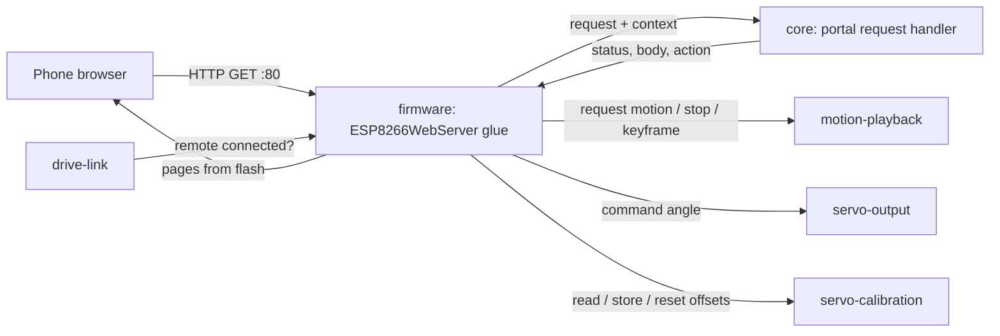
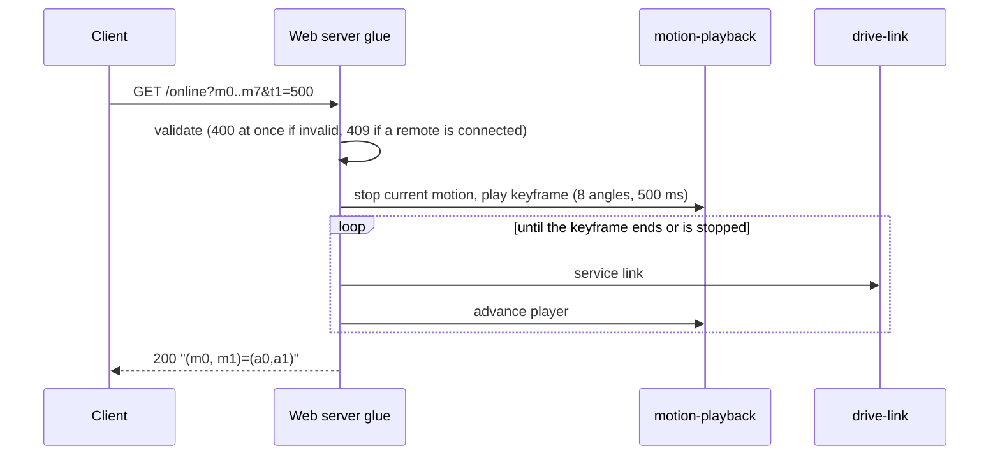

# Design

## Context

See proposal.md for the motivation. Requirements are in `specs/web-portal/spec.md`.

### What the stock portal does

`baseline/README.md` lists the routes and says that how each handler behaves "is inferred from the page JavaScript, not from disassembly". For this change the handlers were read from the image. Method: the application image was cut from `baseline/original-flash-4MB.bin` at 0x1000, its segments were listed with `esptool image-info`, and the IROM segment was disassembled with PlatformIO's `xtensa-esp-elf-objdump`. String addresses were resolved against the DRAM segment loaded at 0x3FFE8530. Addresses below are code addresses (0x402xxxxx). `docs/lafvin-motions.md` in the main checkout independently confirms the calibration and dispatch points. Function identities, such as `String::toInt` or `EEPROM.commit`, are inferred from their call patterns, because the image has no symbols.

| Topic | Stock behaviour | Evidence |
|---|---|---|
| Server | `ESP8266WebServer` on port 80; seven `on()` calls, all `HTTP_GET`; no `onNotFound`, so unknown paths get the library's `404 Not found: <uri>` | static initialiser 0x40204E10 (port 80); route set-up 0x40201C60–0x40201D9E; string `Not found: ` in the image |
| Routes → handlers | `/controller` 0x40203814, `/save` 0x40203644, `/` 0x402049EC, `/editor` 0x4020454C, `/zero` 0x40203CAC, `/setting` 0x40203FEC, `/online` 0x40203920 | literal pool 0x40201C14–0x40201C54 |
| Captive portal | None. `loop()` (0x40205084) calls only `handleClient()` and then the motion dispatch. Set-up calls `softAP("Spider Robot", "12345678", channel 1, visible, 4 stations)` and `EEPROM.begin(512)`, with no DNS server. The vendor sketch (`references/lafvin/extracted/0.SpiderBot/webserver.cpp`) has none either. | 0x40201F67–0x40201FC0; 0x40205084–0x402051E3 |
| `/controller` | Reads `pm` and `servo`. A non-empty `pm` sets the requested-motion global; `loop()` plays it once and clears it. A non-empty `servo` calls `servoWrite(servo, toInt(value))` at once, so a missing `value` means 0°. Indices ≥ 7 all go to servo 7, and negative indices are ignored. The reply is `200 text/html "(pm)=(" + pm + ")"`. `pms` is never read. | 0x40203814–0x402038F4; servo write 0x40201304 |
| Motion dispatch | Blocking switch on pm 1–15, 99 and 100. pm 99 and 100 both write the stored zero pose. Other values do nothing. HTTP is not served while a motion plays. | 0x40205093–0x402051D9 |
| Servo write | angle + `(int8)EEPROM[i]`, mapped to 400–2400 µs | 0x40201304–0x40201364 |
| `/save` | Reads `key` and `value`. Detaches all eight servos and waits 50 ms. `key == 100` writes offset 0 for servos 0–7; otherwise writes `(int8)value` to `EEPROM[key & 0xFF]` when value is within −124…124, with no bound on the key. Then `EEPROM.commit()`, reattach, 10 ms. Reply `200 text/html "(key, value)=(k,v)"`. | 0x40203644–0x402037FB; EEPROM write+commit 0x40201500 |
| `/setting` | Page built in RAM by `String` concatenation; each input's `value` is the signed stored offset | 0x40203FEC; eight calls of the read helper 0x40201534 |
| `/online` | Reads `m0`…`m7` and `t1`; plays one keyframe (eight angles over `t1` ms) through the keyframe runner from the current pose, inside the handler; then replies `200 text/html "(m0, m1)=(" + m0 + "," + m1 + ")"` | 0x40203920–0x40203B03; runner 0x40201420 |
| `/` | Title `科睿 小蜘蛛` (vendor brand, "Kerui little spider"); footer `
` holds the global `String` `My Store: python.aliexpress.com`; `controlPms` defined, never called | 0x402049EC–0x40204CDD; global at 0x3FFF0778 |
| `Hello!`, `text/plain` | Strings in the image with no code reference found | literal search over IROM |

The pages themselves are in `baseline/portal-strings.txt`: layout, labels, default angles, slider directions and request URLs. The order of the Controller page's rows (three buttons per row) is inferred from the order of the strings and the `width=33%` cells.

### Constraints

- The firmware also services the drive link (UDP) and the motion player. Neither may be starved, so no handler may block, apart from the bounded `/online` wait (decision 5).
- The ESP8266 has about 40–50 KB of free heap under the Arduino core. The stock approach, a whole page concatenated into a `String`, is the main heap risk.
- The phone has no internet on the robot's network. Pages must be self-contained.
- Design tokens must come from `tokens.json`, never be copied by hand (CLAUDE.md).

## Goals / Non-Goals

**Goals:**
- Stock routes, parameters and 200 response bodies, so that an existing stock client keeps working.
- A request handler that can be tested on the host, separated from the Arduino web server.
- Pages generated from sources and the vendored tokens, checked mechanically.

**Non-Goals:**
- Captive-portal DNS, mDNS, HTTPS, authentication, translations or a dark theme. None of these is in the stock image or the settled scope.
- Motion data, the playback rules, the servo maths, calibration storage and the access point. Other changes own them (see Cross-change assumptions).
- A JSON API or any route that stock does not have.

## Decisions

### 1. A hardware-free request handler in `core/`, with a thin web-server layer in `firmware/`

`core/` holds a pure function. It takes a request (method, path and arguments as strings) and a read-only context (is a remote connected, which motion ids exist, the accepted angle and offset ranges). It returns a result: the status, content type and body, plus at most one action (request motion n; stop and move servo i to a; store an offset; reset all offsets; play a keyframe). `firmware/` maps the `ESP8266WebServer` callbacks onto it and carries out the action through the other capabilities' interfaces.

- *Why:* every rule in the spec (validation, 400/409, response bodies, `pms`, 404) can then be tested with Unity in the native environment, as spooder tests its link code.
- *Alternative:* logic inside the Arduino handlers, tested only on the robot. This was rejected: none of it could be tested on the host.

### 2. Pages generated from sources and vendored tokens

The page sources live in `firmware/portal/pages/` (one HTML file per page, plus a shared stylesheet and script fragment). They use CSS custom properties named after the tokens (`var(--bf-paper)`). A generator, `tools/portal/gen_pages.py`, writes the `:root` block from `firmware/portal/tokens/tokens.json` (the Paper values) and inlines the shared fragments. It emits `portal_pages.h` into the build directory: one `PROGMEM` string per page. A PlatformIO `pre:` extra script runs the generator on every build. The vendored `tokens.json` records its source (artifact URL, version `1794044556-c45e`, SHA-256 `25da75f563fb81140601fa92a83dde5ec8449bfdc84a38e2608f50016e35fb73`) in a `SOURCE.md` beside it.

`mise run portal-check` checks the generated pages. Every `--bf-*` value equals its token. Every `var(--bf-*)` used is defined. There is no external reference (`http:`, `https:`, `//`, `@import`, `src=`/`href=` to another file). Every page has the viewport meta. Each page is within a size budget of 16 KB. The stock control mapping is checked against a table in the check script: which button sends which `pm`, `servo` and `value`, the defaults, the slider directions and the label order. To make this check mechanical, controls carry their request as `data-pm`, `data-servo` and `data-value` attributes, and one shared click handler sends them.

- *Alternative:* copy the spooder portal's CSS. This was rejected: its values are copied by hand, which CLAUDE.md forbids.
- *Alternative:* fetch the tokens at build time from the artifact. This was rejected: the build would then need network access and an authenticated session.

### 3. Pages streamed from flash; `/setting` filled in at serve time

Static pages are sent with `send_P` from `PROGMEM`. The `/setting` page source has eight placeholders (`{{OFF0}}`…`{{OFF7}}`). The handler sends the page in chunks, replacing each placeholder with the offset that servo-calibration reports. No page is assembled in RAM.

- *Alternative:* a static `/setting` page that fetches the offsets with a script. This was rejected: it would need a new JSON route that stock does not have.

### 4. Validation at the trust boundary

The stock handlers act on whatever arrives (a missing `value` moves a servo to 0°; `key=50` writes EEPROM byte 50). The handler accepts only complete, well-formed integers (optional sign, decimal digits, no other characters) within the ranges in the spec, and answers anything else with 400. The one exception is `/save?key=100`. Stock ignores its `value`, so the portal ignores it too and always replies `(key, value)=(100,0)`. Valid requests keep their stock 200 bodies. For a stock client that sends valid requests, only the 400 for invalid ones differs. Unknown `pm` values (0, 16–98, 99, 101+) are answered 400. motion-playback owns the id set, and stock's pm 99 is not in it (see Open questions).

### 5. Non-blocking handlers, except a bounded `/online` wait

`/controller?pm` hands the request to motion-playback and replies at once. Stock replied at once too, but then blocked the loop for the whole motion. `/online` keeps stock's pacing: the reply follows the keyframe. A client that paces keyframes by the replies, which is presumably what `/online` was made for, then works unchanged. While it waits, the handler runs a service step (drive link and motion player, with `yield()`) until that keyframe ends (by its identifier, not by "anything playing", so that a remote's next motion cannot hold the wait), and at the latest at t1 + 500 ms. Stock does not limit `t1`. The portal bounds it at 60000 ms only to cap how long the server can be held, so any realistic keyframe is still accepted. A page command queued behind a long keyframe may outlast its page's 5 s timeout. The status line then says that the command may still run (spec: Navigation and command feedback). During the wait no other HTTP request is served, as in stock. If the keyframe is stopped (by a remote taking control), the wait ends and the reply is still `200` with the stock body. That body only echoes the request.

### 6. One controller at a time: 409 while a remote is connected

The settled protocol has the remote send the complete desired state at a fixed period. A portal command would be overridden by the next frame, or would fight it. The portal therefore refuses robot-moving requests while drive-link reports a connected remote. It keeps serving pages and calibration saves: a save moves nothing, and the stock flow saves offsets independently of motion. `/save` no longer detaches and reattaches the servos. In stock that re-attach also changed which pin each servo object drove (`docs/lafvin-motions.md`); servo-output owns the pin map now.

- *Alternative:* let the portal and the remote share control, with the last command winning. This was rejected: it contradicts the drive link's safe-state rule.

### 7. No captive-portal DNS

The stock image has no DNS server (see Context). `baseline/README.md` says that it has one, but that line is not marked verified, and the disassembly contradicts it. Adding captive DNS would be a feature beyond stock, so the spec states that there is none, and unknown paths get the stock 404. A later change can add it if the user wants phones to open the portal on joining.

### 8. Presentation departures

The changes from stock are limited to presentation and stock defects:
- The title is `Spider Robot.` on every page, with the page name as a mono kicker. The vendor title `科睿 小蜘蛛` and the shop advert are dropped.
- A navigation bar and a status line are added. The stock pages have no links between them, and their response handler writes to a missing `#demo` element, so the operator gets no feedback.
- `ZERO Postition` is corrected to `Zero position`.
- RESET ALL is shown. The stock HTML comments it out, but its route works; the settled decisions list it.
- The stock colour groups (yellow `#FFE599` for servos 0, 3, 4 and 7; blue `#BFDFFF` for servos 1, 2, 5 and 6) become two token tones: `bf-surface` panels with a `bf-line-strong` edge, and `bf-surface-sunk` panels.
- Fonts use the token families' fallbacks (`'Archivo', 'Helvetica Neue', Helvetica, sans-serif` and `'JetBrains Mono', ui-monospace, monospace`). No font files are sent, as in spooder's portal.
- Text is English only. The design system's three-language rule is for the site, and the stock pages are English.

### Cross-change assumptions

These are facts that other changes own. This change relies on them and does not specify them.

- **drive-link:** defines the soft access point (SSID, password, the address the portal is reached at, conventionally 192.168.4.1) and admits at least two stations at once (the pak and a phone; stock admits four). It exposes a "remote connected" state that is true while a remote's frames arrive and false after its link-loss timeout. It provides a non-blocking service step that the `/online` wait can call. When a remote connects while the portal's motion or keyframe is playing, drive-link and motion-playback decide what happens to it.
- **motion-playback:** exposes the set of valid motion ids (stock pm 1–15 and 100), a request call that the drive link also uses, a stop call, a call that plays one caller-supplied keyframe (eight angles and a duration in ms, 0–60000) from the current pose and returns an identifier for it, and a query of whether that keyframe has ended (finished, stopped, or replaced by another motion). The portal's wait does not rely on the query alone: it also ends at t1 + 500 ms. It is non-blocking: a motion advances in a periodic step. It defines what a new request does while a motion is playing.
- **servo-output:** exposes "command servo i to angle a" for i 0–7, applying servo-calibration's offset, and publishes its accepted input-angle range. The portal rejects angles outside that range with 400. The editor's 45–135 sliders and the zero-check angles 45° and 135° lie within it.
- **servo-calibration:** exposes read offset i, store offset i, reset all to 0, and its accepted offset range (stock: −124…124). It owns persistence across power cycles and the default for an unset offset; servo-output owns how an offset is applied to a commanded angle. The portal's hardware checks (tasks.md group 6) rely on persistence but do not specify it.
- **firmware-foundation:** provides the PlatformIO environment (Arduino ESP8266 core, 4 MB), accepts a `pre:` extra script, and provides the native Unity test environment for `core/` with `mise run build`, `mise run upload` and `mise run test`.

## Risks / Trade-offs

- [The stock handler behaviour comes from disassembly without symbols, so a function could be misidentified] → The routes, parameters, bodies and the EEPROM path agree with the vendor sketch and with `docs/lafvin-motions.md`. The hardware checks in tasks.md compare the new firmware with what stock did on the robot.
- [A 400 for input that stock accepted could break an unknown stock client] → Only malformed or out-of-range input is refused, and stock acted on that input dangerously (0° moves, writes to arbitrary EEPROM bytes).
- [`/online` holds the HTTP server for as long as `t1` (at most 60 s)] → The wait services the drive link and the motion player, so the robot's safety does not depend on HTTP. A page that times out meanwhile says that its command may still run, rather than that it failed. Stock behaves the same way, with no bound at all.
- [The heap is fragmented by chunked `/setting` responses] → Only eight short integers are formatted per request, into a stack buffer.
- [The vendored tokens drift from the design system] → `SOURCE.md` records the version and hash. Updating them is a deliberate copy followed by `mise run portal-check`.
- [The Controller row grouping is inferred from string order] → Low impact. The hardware check compares it with a photo or memory of the stock page, if one is available.

## Migration Plan

1. Build and run the host tests and `portal-check` (no hardware).
2. With the user's go-ahead, flash the new firmware with `mise run upload` (every esptool command resets the board).
3. Run the hardware checks in tasks.md.
4. Rollback: `mise run restore` writes `baseline/original-flash-4MB.bin` back, after a hash check, and also needs the user's go-ahead. The stock image does not read anything the new firmware stores, apart from the EEPROM sector. If servo-calibration keeps the stock layout (signed bytes 0–7), stock reads the offsets saved by the new firmware.

## Open Questions

- **Calibration in the original firmware.** The user recalls that the original firmware had no calibration. The stock image read from this robot has the Servo calibration page, a `/save` handler that writes signed bytes 0–7 of the EEPROM emulation and commits them, and a servo write that adds that byte (Context table). So the image contains code meant to persist calibration. Unverified: whether a stock save actually persists, and where in flash it lands. 0x3FB000 is only the expected EEPROM sector for the 4 MB layout, and no stock save has been tried on the robot. The sector is erased (all 0xFF) on this unit. That shows no saved data is present now, not that nothing was ever saved, since the sector could have been erased later. While it is erased, stock reads 0xFF as a signed −1 and applies −1° to every servo. Also unverified: whether Jason Workshop's original Q1 mini firmware had calibration. The user's recollection may concern that firmware, not this port. This does not change this change's routes. servo-calibration owns the default for an erased sector.
- **Captive DNS.** Is a captive portal wanted even though stock has none? If so, it is a later, additive change (decision 7). `baseline/README.md`'s "DNS server for the captive portal" line should then be corrected or marked inferred; that file is outside this change.
- **pm 99.** Stock dispatches pm 99 (it writes the same stored pose as 100, `docs/lafvin-motions.md`). The portal answers 400 unless motion-playback adds id 99. No stock page sends 99.
- **Who used `/online`.** No stock page calls it. It is presumably for a LAFVIN phone app or PC tool. Its exact pacing expectations are unknown, so decision 5 keeps stock's reply-after-move pacing.
- **mDNS.** The image contains a `.local` string. No mDNS call was traced in `setup()`, so the portal does not announce one. Not verified further.
