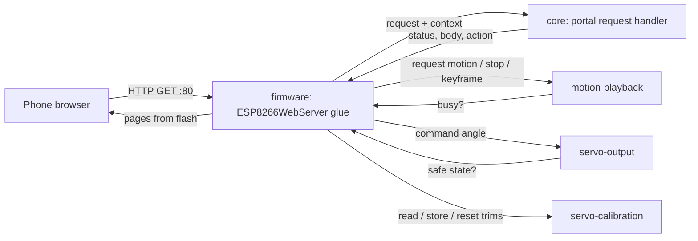
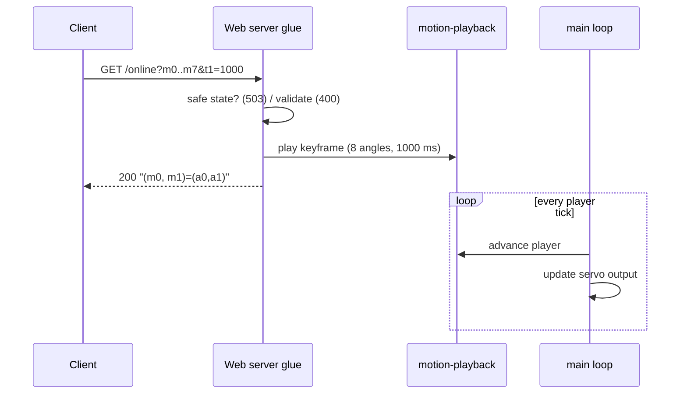
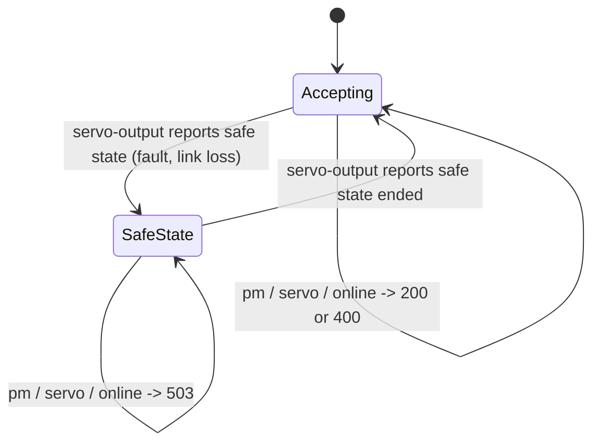

# Design

## Context

See proposal.md for the motivation. Requirements are in `specs/web-portal/spec.md`.

### What the stock portal does

`baseline/README.md` and `docs/lafvin-comparison.md` record the stock behaviour, corrected from a disassembly of the stock image. For this change the handlers were also read from the image: the application image was cut from `baseline/original-flash-4MB.bin` at 0x1000, its segments were listed with `esptool image-info`, and the IROM segment was disassembled with `xtensa-esp-elf-objdump`. Addresses below are code addresses (0x402xxxxx; flash offset = address − 0x40200000). Function identities, such as `String::toInt` or `EEPROM.commit`, are inferred from their call patterns, because the image has no symbols.

| Topic | Stock behaviour | Evidence |
|---|---|---|
| Server | `ESP8266WebServer` on port 80; seven `on()` calls, all `HTTP_GET`; no `onNotFound`, so unknown paths get the library's `404 Not found: <uri>` | static initialiser 0x40204E10 (port 80); route set-up 0x40201C60–0x40201D9E; string `Not found: ` in the image |
| Routes → handlers | `/controller` 0x40203814, `/save` 0x40203644, `/` 0x402049EC, `/editor` 0x4020454C, `/zero` 0x40203CAC, `/setting` 0x40203FEC, `/online` 0x40203920 | literal pool 0x40201C14–0x40201C54 |
| Network | Plain soft AP: `softAP("Spider Robot", "12345678", channel 1, visible, 4 stations)`, no explicit IP (presumably the SDK default 192.168.4.1, not measured). No DNS server and no mDNS: not a captive portal. `loop()` (0x40205084) calls only `handleClient()` and then the motion dispatch. | 0x40201F67–0x40201FC0; 0x40205084–0x402051E3; `docs/lafvin-comparison.md` |
| `/controller` | Reads `pm` and `servo`. A non-empty `pm` is converted with `toInt` and stored as the requested motion; `loop()` plays it once. Unknown values are accepted and ignored by the dispatch. A non-empty `servo` calls `servoWrite(servo, toInt(value))` at once, so a missing `value` means 0°. The reply is `200 text/html "(pm)=(" + pm + ")"`. `pms` is never read. | 0x40203814–0x402038F4; servo write 0x40201304 |
| Motion dispatch | Blocking switch on pm 1–15, 99 (Centre) and 100 (Zero position). On stock, 99 and 100 write the same pose. Other values do nothing. HTTP is not served while a motion plays, so a motion can't be interrupted. | 0x40205093–0x402051D9 |
| Servo write | angle + `(int8)EEPROM[i]`, mapped from 1–180 to 400–2400 µs | 0x40201304–0x40201364 |
| `/save` | Reads `key` and `value`. Detaches all eight servos and waits 50 ms. `key == 100` writes trim 0 for servos 0–7; otherwise writes `(int8)value` to `EEPROM[key & 0xFF]` when value is within −124…124, with no bound on the key. Then `EEPROM.commit()`, reattach on a different pin order from startup (a stock defect), 10 ms. Reply `200 text/html "(key, value)=(k,v)"`. | 0x40203644–0x402037FB; EEPROM write+commit 0x40201500 |
| `/setting` | Page built in RAM by `String` concatenation; each input's `value` is the signed stored trim; erased bytes read as −1 | 0x40203FEC; eight calls of the read helper 0x40201534 |
| `/online` | Reads `m0`…`m7` and `t1`; plays one keyframe (eight angles over `t1` ms) through the keyframe runner from the current pose, inside the handler; then replies `200 text/html "(m0, m1)=(" + m0 + "," + m1 + ")"` | 0x40203920–0x40203B03; runner 0x40201420 |
| `/` | Title `科睿 小蜘蛛` (vendor brand); footer `
` holds the global `String` `My Store: python.aliexpress.com`; `controlPms` defined, never called | 0x402049EC–0x40204CDD; global at 0x3FFF0778 |
| Page labels | The pages label servos 0–7 as D14, D12, D13, D15, D16, D05, D04, D02. Stock attaches them at startup to GPIO 15, 13, 12, 14, 2, 4, 5, 16. The labels are the vendor source's order, not the hardware. | `baseline/README.md` servo map |

The pages themselves are in `baseline/portal-strings.txt`: layout, labels, default angles, slider directions and request URLs. The order of the Controller page's rows (three buttons per row) is inferred from the order of the strings and the `width=33%` cells.

### Constraints

- The firmware also services the drive link (UDP), its failsafe, the motion player and the servo output in one Arduino `loop()`. No portal handler may block or wait for a motion.
- The ESP8266 has about 40–50 KB of free heap under the Arduino core. The stock approach, a whole page concatenated into a `String`, is the main heap risk.
- The phone has no internet on the robot's network. Pages must be self-contained.
- Design tokens must come from `tokens.json`, never be copied by hand (CLAUDE.md).

## Goals / Non-Goals

**Goals:**
- Stock routes, parameters and 200 response bodies, so that an existing stock client keeps working.
- A request handler that can be tested on the host, separated from the Arduino web server.
- Pages generated from sources and the vendored tokens, checked mechanically.

**Non-Goals:**
- Captive-portal DNS, mDNS, HTTPS, authentication, translations or a dark theme. None of these is in the stock image or the settled scope.
- Motion data, the playback rules, the servo maths, the safe range, the safe state, calibration storage and the access point. Other changes own them (see Cross-change assumptions).
- A JSON API, a route that stock does not have, or a page control that stock does not have (such as an editor button that sends `/online`).

## Decisions

### 1. A hardware-free request handler in `core/`, with a thin web-server layer in `firmware/`

`core/` holds a pure function. It takes a request (method, path and arguments as strings) and a read-only context: is servo output in the safe state, is a motion or keyframe playing or pending, which motion ids exist, the accepted angle and trim ranges. It returns a result: the status, content type and body, plus at most one action (request motion n; stop and move servo i to a; store a trim; reset all trims; play a keyframe). `firmware/` maps the `ESP8266WebServer` callbacks onto it and carries out the action through the other capabilities' interfaces.

- *Why:* every rule in the spec (validation, 400/409/503, response bodies, ignored ids, `pms`, 404) can then be tested with Unity in the native environment, as spooder tests its link code.
- *Alternative:* logic inside the Arduino handlers, tested only on the robot. This was rejected: none of it could be tested on the host.

### 2. Pages generated from sources and vendored tokens

The page sources live in `firmware/portal/pages/` (one HTML file per page, plus a shared stylesheet and script fragment). They use CSS custom properties named after the tokens (`var(--bf-paper)`). A generator, `tools/portal/gen_pages.py`, writes the `:root` block from `firmware/portal/tokens/tokens.json` (the Paper values) and inlines the shared fragments. It also fills the servo labels (`S<i> · GPIO<g>`) from one table of GPIO numbers, `firmware/portal/servo_labels.json`, so that the labels are not typed into four pages by hand. It emits `portal_pages.h` into the build directory: one `PROGMEM` string per page. A PlatformIO `pre:` extra script runs the generator on every build. The vendored `tokens.json` records its source (artifact URL, version `1794044556-c45e`, SHA-256 `25da75f563fb81140601fa92a83dde5ec8449bfdc84a38e2608f50016e35fb73`) in a `SOURCE.md` beside it.

`mise run portal-check` checks the generated pages. Every `--bf-*` value equals its token. Every `var(--bf-*)` used is defined. There is no external reference (`http:`, `https:`, `//`, `@import`, `src=`/`href=` to another file). Every page has the viewport meta. Each page is within a size budget of 16 KB. The stock control mapping is checked against a table in the check script: which button sends which `pm`, `servo` and `value`, the defaults, the slider directions, the label order, and that no page sends `pms` or `/online`. To make this check mechanical, controls carry their request as `data-pm`, `data-servo` and `data-value` attributes, and one shared click handler sends them. The check also compares `servo_labels.json` with servo-output's index-to-GPIO table in the firmware source, so that a pin-map change that is not reflected in the labels fails the build gate.

- *Alternative:* copy the spooder portal's CSS. This was rejected: its values are copied by hand, which CLAUDE.md forbids.
- *Alternative:* fetch the tokens at build time from the artifact. This was rejected: the build would then need network access and an authenticated session.

### 3. Pages streamed from flash; `/setting` filled in at serve time

Static pages are sent with `send_P` from `PROGMEM`. The `/setting` page source has eight placeholders (`{{OFF0}}`…`{{OFF7}}`). The handler sends the page in chunks, replacing each placeholder with the trim that servo-calibration reports. No page is assembled in RAM.

- *Alternative:* a static `/setting` page that fetches the trims with a script. This was rejected: it would need a new JSON route that stock does not have.

### 4. Validation at the trust boundary, without refusing what stock ignores

The stock handlers act on whatever arrives (a missing `value` moves a servo to 0°; `key=50` writes EEPROM byte 50). The handler accepts only complete, well-formed integers (optional sign, decimal digits, no other characters, within 32-bit range) within the ranges in the spec, and answers anything else with 400. Two stock behaviours are kept because they are harmless:

- An integer `pm` that is not a motion id (0, 16–98, 101 and above, or negative) gets the stock 200 echo and does nothing, as stock accepts and ignores it. Only a malformed `pm` gets 400.
- `/save?key=100` ignores its `value`, as stock does, and always replies `(key, value)=(100,0)`.

Valid requests keep their stock 200 bodies. For a stock client that sends valid requests, nothing differs, apart from the 409 and 503 refusals (decisions 6 and 7).

### 5. No handler waits; `/online` replies when the keyframe is accepted

`/controller?pm` hands the request to motion-playback and replies at once, as stock did. Stock then blocked the loop for the whole motion; here motion-playback advances in its periodic step, so the portal, the drive link and its failsafe keep running.

`/online` departs from stock's pacing. Stock played the keyframe inside the handler and replied after it. Here the handler validates, hands the keyframe to motion-playback and replies at once. The firmware's main loop advances the player and the servo output, so the portal adds no service path of its own and the keyframe reaches the servos as any motion does.

- *Why:* a handler that waits holds the web server (the Arduino web server serves one client at a time) for up to the keyframe's duration. Other clients could not load a page or send a command for that long, and every service step in the wait would have to repeat the main loop's order (failsafe, player, servo output) to be safe.
- *Cost:* a client that paced keyframes by the replies now receives them early. No stock page uses `/online` (Open questions), and the order of consecutive keyframes is motion-playback's request rule, so a client that sends them in sequence still sees them played as motion-playback defines.
- *Alternative:* keep stock's reply-after-move pacing with a bounded wait that services the other tasks. Rejected for the reasons above.

`t1` is bounded at 0–60000 ms. Stock does not bound it. The bound only rejects durations that no keyframe in the stock tables comes near (the longest is 1500 ms), and motion-playback defines what 0 ms does.

### 6. Shared control with the remote; saves only while nothing plays

drive-link's command frame carries a motion-request counter, so a frame with an unchanged counter makes no request, and a portal request is not undone by the remote's next frame. drive-link therefore specifies that portal and remote requests both reach motion-playback and the most recent one wins. The portal follows that policy and does not refuse requests while a remote's session is live. The earlier draft's 409 for a connected remote is dropped: it contradicted drive-link's coexistence requirement and its hardware check (Dance 1 requested from the phone during a session).

A trim change takes effect at once in servo-output, so a save moves a held servo by the difference in trim. The portal accepts a save only when motion-playback reports nothing playing or pending, and answers 409 otherwise. This keeps the movement a save causes to one servo standing still, and it matches stock, which could not save during a motion because it served no HTTP then. `/save` no longer detaches and reattaches the servos as stock did. Stock's re-attach also changed the pin of each servo index (a stock defect); servo-output owns the pin map now, and servo-calibration owns how the write is protected.

- *Alternative:* refuse portal movement while a remote is connected (the earlier draft). Rejected: drive-link's counter-based frames do not fight portal requests, and the link-loss failsafe (decision 7) covers safety.
- *Alternative:* accept saves during a motion. Rejected: the joint would shift mid-motion, and stock never did it.

### 7. The safe state outranks the portal

The link-loss failsafe has the highest priority: once a remote's frames stop, neither the player nor the portal may keep moving the servos. firmware-foundation owns the output gate and the mode in which servo output is disabled; drive-link enters it on link loss. The portal reads that state from servo-output. While it is set, every robot-moving request gets 503 before validation, and the portal has no request that leaves it or enables output. Pages and `/save` stay available, because they do not drive a servo: a save in the safe state only changes the stored trim.

### 8. No captive-portal DNS

The stock image starts a plain soft AP with no DNS server and no mDNS (Context). Adding captive DNS would be a feature beyond stock, so the spec states that there is none, and unknown paths get the stock 404. A later change can add it if the user wants phones to open the portal on joining.

### 9. Presentation departures

The changes from stock are limited to presentation and stock defects:
- The title is `Spider Robot.` on every page, with the page name as a mono kicker. The vendor title `科睿 小蜘蛛` and the shop advert are dropped.
- A navigation bar and a status line are added. The stock pages have no links between them, and their response handler writes to a missing `#demo` element, so the operator gets no feedback.
- Servos are labelled `S<i> · GPIO<g>` with the GPIO that servo-output drives, not the stock labels (`D14` for servo 0, and so on), which name the vendor source's pins rather than the ones stock attaches. The stock arrangement by servo index is kept.
- `ZERO Postition` is corrected to `Zero position`.
- RESET ALL is shown. The stock HTML comments it out, but its route works; the settled decisions list it.
- The stock colour groups (yellow `#FFE599` for servos 0, 3, 4 and 7; blue `#BFDFFF` for servos 1, 2, 5 and 6) become two token tones: `bf-surface` panels with a `bf-line-strong` edge, and `bf-surface-sunk` panels.
- Fonts use the token families' fallbacks (`'Archivo', 'Helvetica Neue', Helvetica, sans-serif` and `'JetBrains Mono', ui-monospace, monospace`). No font files are sent, as in spooder's portal.
- Text is English only. The design system's three-language rule is for the site, and the stock pages are English.

### Cross-change assumptions

These are facts that other changes own. This change relies on them and does not specify them.

- **drive-link:** defines the soft access point (stock SSID and password, 192.168.4.1) and admits at least two stations at once (the pak and a phone). Its coexistence rule is that portal and remote requests both reach motion-playback and the most recent wins, and a frame with an unchanged request counter makes no request. On link loss it puts servo output into the safe state through firmware-foundation's gate. The portal does not read drive-link's session state.
- **motion-playback:** defines the motion ids (stock pm 1–15, 99 Centre with the stock zero pose, and 100 Zero position), a request call that the drive link also uses, a stop call, and a call that plays one caller-supplied keyframe (eight angles and a duration of 0–60000 ms, including what 0 ms means) from the current commanded pose with the same interpolation as table keyframes. It reports whether a motion or keyframe is playing or pending. It is non-blocking: it advances in the main loop's periodic step. It defines what a new request or keyframe does while a motion plays, and it respects the safe state.
- **servo-output (firmware-foundation):** commands servo i (0–7) to an angle, adds servo-calibration's trim, then clamps the result to that servo's safe range, and publishes its accepted input-angle range; the editor's 45–135 sliders and the zero-check angles 45° and 135° lie within it. Its index-to-GPIO map is 15, 13, 12, 14, 2, 4, 5, 16 (the stock startup order), which the page labels show. It keeps one commanded pose per servo, updated by direct commands as well as by the player, from which motion-playback starts the next motion. It owns the output gate and the safe state (entered on a fault or link loss, and how it ends), and reports whether the safe state is set. A changed trim takes effect on a held servo at once.
- **servo-calibration (firmware-foundation):** exposes read trim i, store trim i, reset all to 0, and one accepted trim range that the portal validates against. Stock accepts −124…124; the range that firmware-foundation settles is the portal's range. It owns persistence across power cycles, the value of an erased trim (stock reads −1), and how the stored trims are protected during a write.
- **firmware-foundation:** provides the PlatformIO environment (Arduino ESP8266 core, 4 MB), the main loop that runs the failsafe, player, HTTP and servo output without blocking, accepts a `pre:` extra script, and provides the native Unity test environment for `core/` with `mise run build`, `mise run upload` and `mise run test`.

## Risks / Trade-offs

- [The stock handler behaviour comes from disassembly without symbols, so a function could be misidentified] → The routes, parameters, bodies and the EEPROM path agree with the vendor sketch and with `docs/lafvin-comparison.md`. The hardware checks in tasks.md compare the new firmware with what stock did on the robot.
- [A 400 for input that stock accepted could break an unknown stock client] → Only malformed or out-of-range input is refused, and stock acted on that input dangerously (0° moves, writes to arbitrary EEPROM bytes). Unknown integer `pm` values keep the stock 200.
- [`/online` replies before the move ends, unlike stock] → No stock page uses it. A client that paced by the replies gets keyframes handled by motion-playback's request rule instead.
- [A portal command and a remote command interleave during a session] → The most recent wins, as drive-link specifies; each side sees the result in its own feedback (the pak in telemetry, the portal only in its status line, which reports acceptance, not what plays later).
- [The safe state leaves the portal unable to move the robot until servo-output ends it] → Intended: the failsafe outranks the portal. The status line says why. How the safe state ends is firmware-foundation's (Open questions).
- [The heap is fragmented by chunked `/setting` responses] → Only eight short integers are formatted per request, into a stack buffer.
- [The vendored tokens drift from the design system] → `SOURCE.md` records the version and hash. Updating them is a deliberate copy followed by `mise run portal-check`.
- [The page labels drift from the pin map] → `portal-check` compares `servo_labels.json` with servo-output's table.
- [The Controller row grouping is inferred from string order] → Low impact. The hardware check compares it with a photo or memory of the stock page, if one is available.

## Migration Plan

1. Build and run the host tests and `portal-check` (no hardware).
2. With the user's go-ahead, flash the new firmware with `mise run upload` (every esptool command resets the board).
3. Run the hardware checks in tasks.md.
4. Rollback: `mise run restore` writes `baseline/original-flash-4MB.bin` back, after a hash check, and also needs the user's go-ahead. The stock image does not read anything the new firmware stores, apart from the EEPROM sector. If servo-calibration keeps the stock layout (signed bytes 0–7), stock reads the trims saved by the new firmware.

## Open Questions

- **Calibration in the original firmware.** The user recalls that the original firmware had no calibration. The stock image read from this robot has the Servo calibration page, a `/save` handler that writes signed bytes 0–7 of the EEPROM emulation sector at 0x3FB000 and commits them, and a servo write that adds that byte (Context table). Unverified: whether a stock save actually persists on this robot, since no stock save has been tried. The sector is erased (all 0xFF) on this unit, which shows that no saved data is present now, not that nothing was ever saved. Also unverified: whether Jason Workshop's original Q1 mini firmware had calibration; the user's recollection may concern that firmware, not this port. This does not change this change's routes.
- **Is `/online` used by the motion editor?** `baseline/README.md` and the corrections to this plan describe `/online` as "used by the motion editor", and a cross-change review asked for the editor to send it. The stock image does not support that: the only occurrence of `online` in `baseline/portal-strings.txt` is the route registration, the editor's JavaScript sends only `controller?servo=…` and `controller?pm=1`, and `strings` over the whole dump finds `/online` and its reply format and nothing that builds an `online?` URL. So the replacement editor, like the stock one, does not send `/online`, and the route stays for other clients. If the user wants an editor button that plays the Action Code through `/online`, it is a new control and a decision for the user; `baseline/README.md`'s wording may need correcting (outside this change).
- **How the safe state ends.** The portal refuses movement while servo-output reports the safe state and cannot end it. If firmware-foundation's rule ends it only on a fresh drive-link session or a reboot, a phone user cannot use the portal after the pak's link was lost until then. That rule is firmware-foundation's.
- **mDNS.** The image contains a `.local` string, but no mDNS call was traced in `setup()`, so the portal does not announce one.
